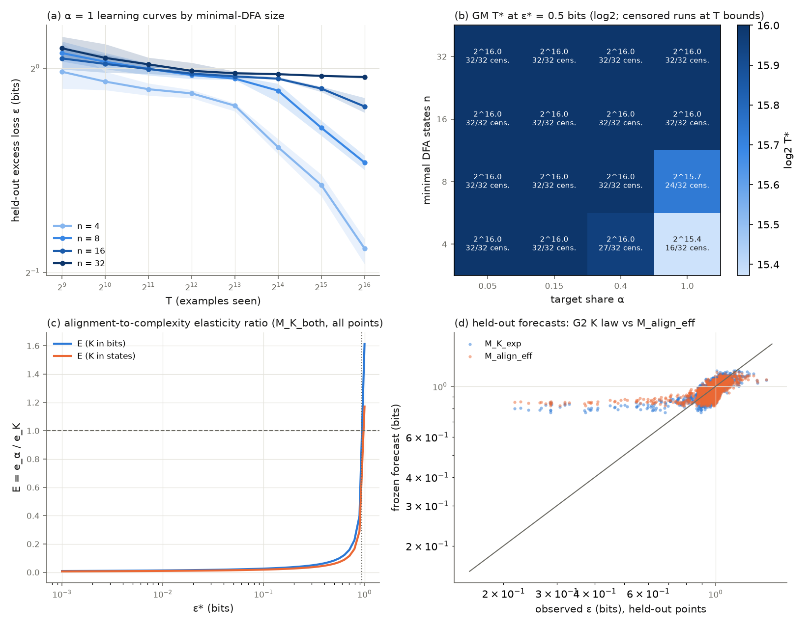

# Results: exact DFA complexity versus data alignment (`11_dfa_exact_complexity_vs_alignment`)

Run on 10-18-2026 on a 4-core CPU box, 512 of 512 gated runs completed (8 seeds x 16 targets x 4 target shares α), 9,075 s of grid wall time. K is exact for the DFA description language (minimal deterministic finite automaton size n, checked by both Hopcroft and Moore minimization), and K_bits = n(2⌈log2 n⌉ + 1) = 20, 56, 144, 352 bits.

## Takeaway

**Nothing was established. On this budget the 104,002-parameter transformer learned only the smallest automata, so the two questions stay open.**

- **Does α set a floor? No measurable floor.** The floor law fits a small floor term, a1 = 0.043 bits (95% interval 0.027 to 0.058). That means a run with almost no target data would sit about 0.04 bits higher forever. But adding the term improves held-out forecasts by only 0.3% (interval 0.2% to 0.4%), far below the 10% bar (G6). Most runs ended between 0.4 and 1.0 bits of excess loss, so a floor of a few hundredths of a bit could not show up here.
- **Does exact K move the coefficient c or the exponent γ? Unresolved, though the fitted direction is the exponent.** In the law that lets both move (M_K_both), the learning-curve exponent falls with complexity: γ1 = −0.0107 per doubling of K_bits (interval −0.0114 to −0.0100). That is about 0.065 at n = 4 against about 0.011 at n = 32 in the all-points refit, so bigger automata give flatter curves, not just shifted ones. The coefficient term κ is negative (−0.084, interval −0.094 to −0.076), the opposite sign from the description-length reading, so G3a fails. The exponent-only law beats the coefficient-only law on held-out cells by only 2.6% (interval 2.4% to 2.9%), under the 5% bar, so G3b also fails. Conclusion C3 is "unresolved".
- **Alignment versus complexity (G4) is not settled either.** The fitted laws say a step up in complexity costs far more data than the same step down in target share. The elasticity ratio is E = 0.083 bits (interval 0.078 to 0.090) at ε* = 0.5, against the bar of E > 1. The model-free estimate points the other way (E_mf = 4.3 at the 0.7-bit fallback), but 94% of its runs are censored. The distractors were not pure waste: the effective-data exponent is η = 0.71 (interval 0.61 to 0.83), below 1, which reads as transfer.
- **What the data do show.** Loss after 2^16 examples at α = 1 rises with n: 0.54, 0.72, 0.88 and 0.97 bits (averaged over string lengths) for n = 4, 8, 16, 32. The n = 16 and n = 32 targets stayed near chance in every run, at every α, and all 256 of those runs are flagged as plateaued. Only 3 of 16 targets (two with n = 4, one with n = 8) reached the primary threshold ε* = 0.5 bits at α = 1. At α < 1 only 5 of 384 runs did, all on one n = 4 target at α = 0.4. Every T*-based number below is therefore set mostly by the 2^16 cap, not by learning speed. An exploratory LSTM run on the same data learned the n = 4 to 16 languages almost perfectly, so the limit is this transformer at this size and budget, not the data.

## Pilot disclosure (seed 11909, before the freeze)

- Pilot: α = 1, all 16 targets, learning rate 1e-3, trained to 2^17 examples (about 16 minutes wall). At 2^16 the losses were 0.31 to 0.99 bits (median 0.90). No target reached 0.1 bits even at 2^17. The n = 16 and n = 32 targets stayed at 0.8 bits or more. 15 of 16 targets were still improving from 2^16 to 2^17, 7 of them by more than 10%.
- Pilot rules: P1 (median T*(0.1 bits) above the budget) fired. P2 (too easy, at most 0.1 bits by 2^10) did not fire, with 0 of 16 targets. P3 (projected time over the cap) did not fire: projected 15,178 s against 16,200 s.
- Learning-rate calibration was pre-registered in CKPT before any calibration result was read. It used fresh seed 11910 (never reused), α = 1, the gated window 2^9 to 2^16, learning rates 3e-3 and 1e-2, and took about 11 minutes of wall time. The rule was the lowest median over the 16 targets of ε(2^16). Medians: 0.899 bits at 1e-3, 0.931 at 3e-3, 0.977 at 1e-2, so the learning rate stayed at 1e-3.
- New rule P1b, written before calibration: if the median T*(0.3 bits) is also above 2^14, the primary ε* becomes 0.5 bits and the levels become {0.5, 0.3, 0.1}. P1b fired, so the gated primary ε* is 0.5 bits, and the G4 model-free fallback is ε* = 0.7 bits. The pilot paragraph in PROTOCOL Section 2.6 predicted heavy right-censoring at the primary level, and that is what happened.
- The protocol was frozen at commit 4caa44f1 before any gated training. The pilot, the calibration runs and their summaries are committed in results_pilot/, results_calib_lr0.003/, results_calib_lr0.01/ and pilot_summary.json. The pilot is not gated. It reused pool strings between 2^16 and 2^17, which the gated grid never does.

## Deviations from PROMPT.md and PROTOCOL.md

1. **The grid ran in two chunks.** The protocol says "resume once". The grid ran as two resume-safe chunks with `--resume` because a single foreground command is limited to 60 minutes and background jobs to 2 hours: 382 cells in 6,619 s, then 130 cells in 2,456 s. That is one resume, and both chunks are logged in manifest.json and CKPT. No cell was rerun. Done markers are written last, so the second chunk skipped completed cells only.
2. **Learning-rate calibration and rule P1b were added before the freeze.** Both are disclosed above and in PROTOCOL Section 2.6.
3. **Python environment.** The code ran in an existing environment with the pinned versions in requirements.txt (Python 3.12.3, torch 2.14.1+cpu, numpy 2.5.4, scipy 1.18.1). The suggested path ~/venvs/exp11 was not used.
4. **Unit-test tolerance.** test_model.py compares batched evaluation with a naive per-string loop at a tolerance of 1e-5, not 1e-12. The measured maximum difference is 7.4e-7 and comes from float32 kernels. The checkpoint replay in verify.py is still exact (the replay is batched in the same way).
5. **One bug fix in analyze.py after the freeze.** The E_mf fallback ε* (0.7 bits) was not in the T* table, so stage 2 raised an error. A synthetic dry run found it before any gated result was read. The fix computes T* at 0.7 bits on the fly with the same t_star function. No gate, threshold, split, seed or ε* changed.
6. **Scope of verify.py check 1.** The pass/fail check covers the training-side sources (config.json, dfa.py, data.py, model.py, run.py) against the hashes in manifest.json. The analysis-side hashes (laws.py, independent_fit.py, analyze.py, verify.py, report.py) are recorded in verification.json. They also match manifest.json, which was written after the deviation-5 fix.
7. **Steps left to the parent task.** No archive move, README rows, push or pull request were done in this run. The branch is committed locally, and Experiments 14 and 15 read `expt_v1/results/` in place.
8. **The E table uses the frozen levels.** It reports ε* = 0.5, 0.3 and 0.1 bits instead of PROMPT.md's 0.3, 0.1 and 0.03 (from P1b). E at 0.03 bits, read off the E curve, is 0.017.

## Limitations (PROTOCOL Section 9, plus what this run adds)

- K is exact for the DFA description language and this random-DFA sampler only. It is not universal Kolmogorov complexity. Both units (n and K_bits) are reported, and they give the same verdicts.
- One architecture, one model size, one learning rate and lengths 8 to 24 were used. With 4 targets per level, the seed-only intervals are conditional on these 16 automata, and the two-stage intervals are much wider (G1 two-stage: 1.0 to 2.54).
- **Undertraining is the main limitation.** The T axis stops at 2^16 examples, and most curves were still falling there. The complexity multiplier M_K = 1.55 and the alignment multiplier 1.17 are both capped, because a censored run counts as T* = 2^16. The cap fixes both numbers (every n = 32 run sits at the cap, and so do half the n = 4 targets), so neither can be read as an estimate of the true ratio. The gap between n = 32 and n = 4 grew from 0.07 to 0.43 bits between 2^12 and 2^16 (G5 ρ = 5.9), because the small automata started to learn while the large ones did not. That is a transient of this budget, not evidence about the asymptote.
- α is set by construction, with unrelated distractor languages. This is the cleanest form of alignment, not the graded alignment of real data that Experiments 14 and 15 study.
- A positive or negative result here is about this learner on regular languages. It says nothing directly about benchmark difficulty in large language models.

## LSTM arm (exploratory, not gated)

After the grid, an 84,290-parameter LSTM ran with the same 8 seeds, the 16 targets, α = 1, the same data, the same schedule and the same checkpoints: 128 of 128 runs in 3,185 s. It learns these languages far more easily than the transformer. At 2^16 examples, the mean excess loss by level was:

| n | LSTM mean (median) | transformer mean (median) | LSTM GM T*(0.1 bits) [censored/32] |
|---|---|---|---|
| 4 | 0.000 (0.000) | 0.542 (0.501) | 7,698 [0] |
| 8 | 0.003 (0.001) | 0.726 (0.826) | 15,736 [0] |
| 16 | 0.135 (0.004) | 0.878 (0.910) | 39,383 [8] |
| 32 | 0.669 (0.815) | 0.970 (0.986) | 65,490 [31] |

97 of 128 LSTM runs reached 0.5 bits by 2^16, against 24 of 128 transformer runs. For the LSTM the data bill clearly rises with n: T*(0.1 bits) roughly doubles from n = 4 to n = 8 and at least quintuples by n = 16. One n = 32 target (dfa_n32_t2) is mostly learned (0.13 bits), and the other three stay near chance. So the transformer's failure on n ≥ 16 belongs to this transformer at this size and budget. The languages themselves are learnable from this data. That makes the LSTM, or a bigger or longer-trained transformer, the natural learner for a rerun.

## Artifacts

All under `experiments/11_dfa_exact_complexity_vs_alignment/expt_v1/` on branch `results/cpu-expts-11-15`:

- `results/`: the output contract that Experiments 14 and 15 read: tasks.json, data/, mixes.json, metrics.csv, tstar.csv, fits.json, forecasts_frozen.json, analysis.json, manifest.json, verification.json, plus cells/ and predictions/.
- `results/checkpoints/`: 4,096 transformer checkpoints. They are packed as `results/checkpoints_dfa.tar`, kept out of git, and their SHA-256 is in `ARTIFACT_SHA256.json`.
- The LSTM arm is in `results/lstm_arm/`. Its checkpoints are also kept out of git.
- The figure is `dfa_complexity_alignment_results.png` / `.pdf`. The dated log is `CKPT_dfa_complexity_alignment.md`.

## Gate table

All gates are reported with equal prominence. Intervals are 95% seed-block bootstrap percentile intervals (20,000 draws over the 8 seeds); "two-stage" also resamples the 4 targets within each level.

| Gate | Statistic | Estimate | 95% interval(s) | Threshold | Verdict |
|---|---|---|---|---|---|
| G1 complexity is real | M_K = GM T*(n=32) / GM T*(n=4) at alpha=1 (ε* = 0.5 bits) | 1.55 | seed [1.48, 1.6]; two-stage [1, 2.54] | >= 2.0, both lower bounds > 1.0 | **NOT_ESTABLISHED** |
| G2 K adds value beyond alignment | held-out RMSE reduction of M_K_exp over M_align_eff (log2 bits) | 0.0719 | [0.0689, 0.0758] | >= 10%, lower bound > 0, lower on K=16, 0 invalid | **NOT_ESTABLISHED** |
| G3a coefficient (MDL) | κ in M_K_both; γ1 interval contains 0; RMSE coef ≤ exp | κ = -0.0843, γ1 = -0.0107 | κ [-0.0942, -0.0756]; γ1 [-0.0114, -0.00996] | κ LB > 0 | **NOT_ESTABLISHED** |
| G3b exponent (quanta) | γ1 in M_K_both; M_K_exp gain over M_K_coef | γ1 = -0.0107, gain = 0.0263 | γ1 [-0.0114, -0.00996]; gain [0.0244, 0.0289] | γ1 UB < 0, gain ≥ 5%, LB > 0 | **NOT_ESTABLISHED** |
| G4 alignment dominates | E = e_alpha / e_K (law-based, M_K_both on all points) at ε* = 0.5 | bits 0.0832; states 0.0604; E_mf 4.26 (ε* = 0.7) | bits [0.0782, 0.0901]; states [0.0568, 0.0654] | E > 1 with lower bound > 1 in both units; E_mf > 1 | **NOT_ESTABLISHED** |
| G5 gap shrinks | rho = g(65536) / g(4096), gap in bits (n=32 minus n=4) at alpha=1 | 5.86 (gap 0.0731 → 0.428 bits) | [5.14, 6.64] | g_ref > 0, rho <= 0.5, upper bound < 1.0 | **NOT_ESTABLISHED** |
| G6 alignment floor | a1 in M_K_floor = M_K_exp + a1 (1 - alpha); held-out gain over M_K_exp | a1 = 0.0426; gain = 0.00342 | a1 [0.0273, 0.0578]; gain [0.0023, 0.00446] | a1 lower bound > 0 and gain >= 10% with lower bound > 0 | **NOT_ESTABLISHED** |
| G7 quanta mechanism | Spearman(gamma_j, tau_j) over 16 targets | 0.0118 (partial given log K: 0.341) | seed [-0.0618, 0.0882]; two-stage [-0.498, 0.482] | >= 0.5 with seed lower bound > 0 | **NOT_ESTABLISHED** |

C3 reading: **unresolved**.

## Target table

| id | n | K_bits | acceptance | sensitivity | τ | γ_j (α=1) | GM T*(0.5) at α=1 [censored/8] | GM T*(0.3) at α=1 [censored/8] | GM T*(0.1) at α=1 [censored/8] |
|---|---|---|---|---|---|---|---|---|---|
| dfa_n04_t1 | 4 | 20 | 0.455 | 0.158 | 0.73 | 0.181 | 37360 [0] | 65536 [8] | 65536 [8] |
| dfa_n04_t2 | 4 | 20 | 0.500 | 0.204 | 1.30 | 0.243 | 20165 [0] | 52565 [0] | 65536 [8] |
| dfa_n04_t3 | 4 | 20 | 0.500 | 0.253 | 0.53 | 0.066 | 65536 [8] | 65536 [8] | 65536 [8] |
| dfa_n04_t4 | 4 | 20 | 0.571 | 0.405 | 0.58 | 0.036 | 65536 [8] | 65536 [8] | 65536 [8] |
| dfa_n08_t1 | 8 | 56 | 0.390 | 0.169 | 0.84 | 0.229 | 31205 [0] | 63066 [4] | 65536 [8] |
| dfa_n08_t2 | 8 | 56 | 0.500 | 0.300 | 0.92 | 0.046 | 65536 [8] | 65536 [8] | 65536 [8] |
| dfa_n08_t3 | 8 | 56 | 0.459 | 0.353 | 0.59 | 0.036 | 65536 [8] | 65536 [8] | 65536 [8] |
| dfa_n08_t4 | 8 | 56 | 0.647 | 0.402 | 0.65 | 0.015 | 65536 [8] | 65536 [8] | 65536 [8] |
| dfa_n16_t1 | 16 | 144 | 0.481 | 0.306 | 1.26 | 0.034 | 65536 [8] | 65536 [8] | 65536 [8] |
| dfa_n16_t2 | 16 | 144 | 0.573 | 0.375 | 0.65 | 0.038 | 65536 [8] | 65536 [8] | 65536 [8] |
| dfa_n16_t3 | 16 | 144 | 0.421 | 0.391 | 0.88 | 0.024 | 65536 [8] | 65536 [8] | 65536 [8] |
| dfa_n16_t4 | 16 | 144 | 0.439 | 0.475 | 1.32 | 0.020 | 65536 [8] | 65536 [8] | 65536 [8] |
| dfa_n32_t1 | 32 | 352 | 0.390 | 0.377 | 0.90 | 0.019 | 65536 [8] | 65536 [8] | 65536 [8] |
| dfa_n32_t2 | 32 | 352 | 0.485 | 0.431 | 1.26 | 0.024 | 65536 [8] | 65536 [8] | 65536 [8] |
| dfa_n32_t3 | 32 | 352 | 0.448 | 0.447 | 0.63 | 0.015 | 65536 [8] | 65536 [8] | 65536 [8] |
| dfa_n32_t4 | 32 | 352 | 0.443 | 0.463 | 0.81 | 0.016 | 65536 [8] | 65536 [8] | 65536 [8] |

## Held-out RMSE (log2 bits, censored residual) by slice

| law | all (K bits) | K = 16 | α = 0.15 | T = T_max | all (K in states) | invalid forecasts |
|---|---|---|---|---|---|---|
| M0_scale | 0.2090 | 0.1042 | 0.1057 | 0.3893 | 0.2090 | 0 |
| M_align_eff | 0.2021 | 0.1004 | 0.0982 | 0.3772 | 0.2021 | 0 |
| M_align_add | 0.2004 | 0.0924 | 0.0922 | 0.3768 | 0.2004 | 0 |
| M_K_coef | 0.1927 | 0.0917 | 0.0942 | 0.3591 | 0.1929 | 0 |
| M_K_exp | 0.1876 | 0.0875 | 0.0917 | 0.3496 | 0.1879 | 0 |
| M_K_both | 0.1814 | 0.0834 | 0.0907 | 0.3380 | 0.1819 | 0 |
| M_K_floor | 0.1869 | 0.0885 | 0.0909 | 0.3478 | 0.1872 | 0 |

Held-out points: 260 per seed. G2 K law (chosen on fit cells before held-out rows were read): `M_K_exp`. Frozen forecasts SHA-256 `ea5bd67245fb807086b5ac8d7f29b566af7e74d9e6c55f9b7f7f72ba297d1b53`. Fitter agreement (laws.py vs independent_fit.py): True, max relative forecast difference 1.49e-05.

## Alignment: η and the two alignment laws

- η from M_align_eff: 0.616 [0.55, 0.69]; from `M_K_exp`: 0.711 [0.608, 0.832]; from the all-points M_K_both refit: 0.865 [0.792, 0.946]. Reading (G2 K law interval versus 1): **transfer (distractors help)**.
- M_align_eff versus M_align_add held-out RMSE: 0.2021 versus 0.2004; relative reduction -0.00839 [-0.00998, -0.00688]; invalid forecasts 0 versus 0.

## Elasticity ratio E and range ratio R

| ε* (bits) | E (K in bits) | 95% interval | E (K in states) | e_α | e_K (bits) |
|---|---|---|---|---|---|
| 0.5 | 0.0832 | [0.0782, 0.0901] | 0.0604 | 0.865 | 10.4 |
| 0.3 | 0.0489 | [0.0459, 0.0534] | 0.0355 | 0.865 | 17.7 |
| 0.1 | 0.026 | [0.0243, 0.0284] | 0.0189 | 0.865 | 33.3 |

Flip point ε_flip (E = 1) in [1e-3, 1] bits: 0.944. Slope of log K_bits on log n: 1.378. E from a refit with K = n: 0.0609 [0.0572, 0.066]. Model-free E_mf = 4.26 at ε* = 0.7 (censored fraction per seed [0.94, 0.95, 0.95, 0.95, 0.94, 0.94, 0.94, 0.94]).

Range ratio R = 0.756 [0.739, 0.78]: alignment multiplier T*(α=0.05)/T*(α=1) = 1.17 versus complexity multiplier M_K = 1.55.

## K versus sensitivity

Regression of seed-mean log2 T*_j(α = 1, 0.5 bits) on standardized log K_bits and standardized sensitivity (16 targets): log K coefficient -0.00879 (seed [-0.021, 0.00105], two-stage [-0.207, 0.19]); sensitivity coefficient 0.37 (seed [0.346, 0.395], two-stage [0.142, 0.569]); correlation 0.681, VIF 1.87. Censored T* at α = 1: {'left': 0, 'right': 104}.

## Plateau census and per-length loss

Runs flagged as plateaued (ε(T_max) ≥ 0.8 ε(2^14) and ε(T_max) > 0.1 bits), out of 32 runs per (level, α) cell:

| n | α = 0.05 | α = 0.15 | α = 0.4 | α = 1.0 |
|---|---|---|---|---|
| 4 | 32 | 27 | 16 | 8 |
| 8 | 32 | 32 | 25 | 22 |
| 16 | 32 | 32 | 32 | 32 |
| 32 | 32 | 32 | 32 | 32 |

Per-length loss at α = 1, T = T_max (bits), by level:

| n | 8 | 9 | 10 | 11 | 12 | 13 | 14 | 15 | 16 | 17 | 18 | 19 | 20 | 21 | 22 | 23 | 24 |
|---|---|---|---|---|---|---|---|---|---|---|---|---|---|---|---|---|---|
| 4 | 0.55 | 0.62 | 0.49 | 0.55 | 0.50 | 0.51 | 0.54 | 0.54 | 0.51 | 0.52 | 0.53 | 0.57 | 0.54 | 0.55 | 0.56 | 0.57 | 0.56 |
| 8 | 0.83 | 0.76 | 0.75 | 0.69 | 0.72 | 0.68 | 0.71 | 0.73 | 0.70 | 0.70 | 0.72 | 0.73 | 0.74 | 0.70 | 0.73 | 0.72 | 0.74 |
| 16 | 0.81 | 0.85 | 0.86 | 0.85 | 0.87 | 0.88 | 0.89 | 0.87 | 0.88 | 0.90 | 0.90 | 0.92 | 0.89 | 0.86 | 0.89 | 0.90 | 0.91 |
| 32 | 0.95 | 0.98 | 0.97 | 0.96 | 0.97 | 0.95 | 0.97 | 0.97 | 0.98 | 0.97 | 0.96 | 0.98 | 0.98 | 0.97 | 0.98 | 0.96 | 0.98 |

LSTM arm: see the notes above.

## Verification

`verify.py`: **PASS**. 1_training_sources_match_manifest = True, 2_tasks_regenerated_identical = True, 2_hopcroft_moore_n_match = 32/32, 3_covariates_exact_and_monte_carlo = 32/32, 4_data_regenerated_identical = 32/32, 4_mixes_regenerated_identical = 512/512, 5_checkpoints_replayed = 4096, 5_max_abs_diff_excess_bits = 0.0, 5_max_abs_diff_accuracy = 0.0, 6_max_abs_diff_predictions = 0.0, 5_metrics_rows = 4096, 7_tstar_identical = True, 8_forecasts_hash_identical = True, 8_fitters_agree = True, 9_gates_identical = True, 9_key_numbers_identical = True.

**TLDR-end:** [tdc: Expt 11 results] 512 of 512 CPU runs; every gate G1-G7 NOT_ESTABLISHED because the 104,002-parameter transformer barely learned within 2^16 examples (n = 16 and 32 stayed near chance). No measurable alignment floor (a1 = 0.043 bits, 0.3% held-out gain). Complexity leans toward the exponent (gamma falls from about 0.065 to 0.011) but the exponent law beats the coefficient law by only 2.6%. An exploratory LSTM learned n = 4-16 on the same data. verify.py PASS.
