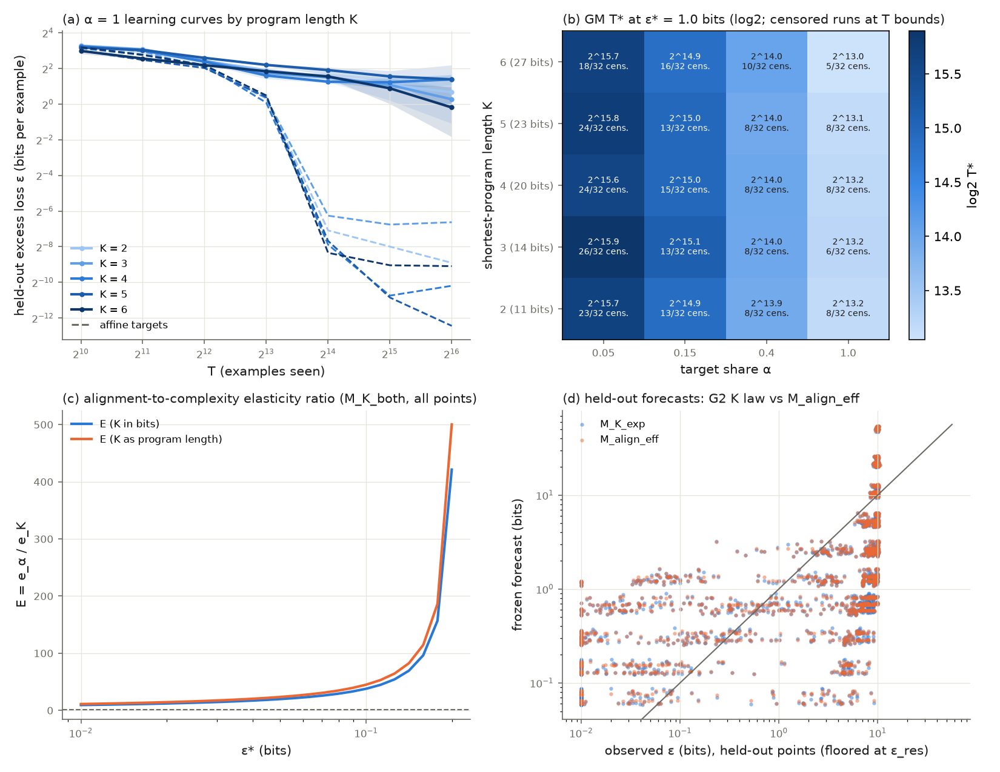
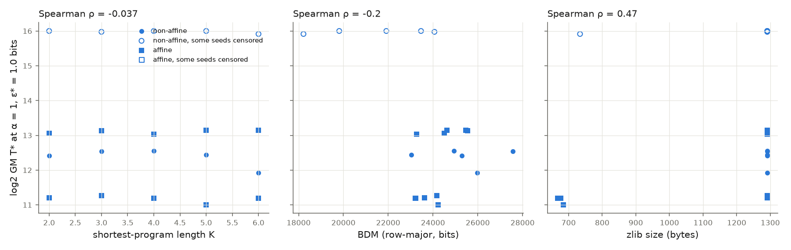

# Results: exact DSL program complexity versus data alignment (`12_dsl_shortest_program_complexity_vs_alignment`)

## Plain-language takeaway

On 20 bit-word functions whose exact shortest-program length K in a 12-primitive language (a domain-specific language, DSL) runs from 2 to 6, trained by a 103,618-parameter transformer at target shares α = 0.05 to 1 (640 runs, 8 seeds), **program length does not cost data, while alignment costs a lot**:

- **Complexity is not real for this learner (G1 NOT_ESTABLISHED).** At α = 1, the length-6 targets need slightly *less* data than the length-2 targets to reach 1.0 bits of test error: M_K (the data multiplier between the hardest and easiest level) is 0.92, seed interval [0.90, 0.94], two-stage interval (seeds and targets) [0.17, 5.05]. The repetition arm (0.97 [0.95, 0.99]) and the MLP arm (1.00 [0.98, 1.03]) say the same.
- **What makes a target hard is its sensitivity and type, not its length.** In the regression of log T* on log K, sensitivity and the affine indicator, log K's coefficient is 0.005 [−0.005, 0.017] (two-stage [−0.20, 0.22]) while sensitivity's is 1.58 [1.57, 1.60]. The five high-sensitivity non-affine targets (stratum S4, one per level) almost never reach 1.0 bits at α = 1 within 2^16 examples (35 of their 40 runs are censored); the other 15 reach it in about 2,000–9,000 examples whatever their K.
- **Knowing K adds nothing to forecasts (G2 NOT_ESTABLISHED).** The K law's held-out error equals the alignment-only law's to four digits (2.64395 vs 2.64394 log2 bits; reduction −0.0005%).
- **Alignment matters, through effective data with transfer.** Going from α = 1 to α = 0.05 multiplies the data needed by 5.9×. A target example at share α is worth about α^0.78 of a fully aligned one (η = 0.78 [0.77, 0.79] < 1, so the distractors, built from the same primitives, transfer rather than interfere). The effective-data law beats the additive one on held-out cells by 18% [17%, 19%].
- **G4 is formally SUPPORTED, but only because complexity costs nothing.** The elasticity ratio E = e_α / e_K is infinite: the complexity elasticity at 1.0 bits is slightly negative (e_K = −0.05 per log-unit of K in bits), so any positive alignment elasticity "dominates". This is not evidence that alignment beats a real complexity cost; there is no complexity cost to beat here.
- **Against Experiment 13 (E = 0.80 < 1): they disagree.** Exp 13's exact HMM state count raised the data bill 2.6× and outweighed alignment; Exp 12's exact program length does not raise it at all. The two experiments disagree on whether description length, as each language measures it, costs data. Exp 12 suggests the cost tracks how many input bits each output depends on (sensitivity) and whether the function is affine, not how short its program is.
- **Against Experiment 11: no comparison possible (G9 NOT_ESTABLISHED).** Exp 11's G3 is unresolved (its T* was capped by the 2^16 budget), and so is this one's (G3a/G3b both NOT_ESTABLISHED: neither a constant multiplier nor an exponent shift for K is supported, since K has no effect).
- **Local-rule diversity predicts the learning exponent, but only across the affine/non-affine split (G7 SUPPORTED, weakly).** Spearman(γ_j, H_rule,j) over 20 targets is −0.84 [−0.85, −0.80]; within the 10 non-affine targets alone it is −0.07 [−0.22, 0.13], which passes the gate's sign condition by point estimate only. The 5 t1 targets' exponents sit at the fitter's upper bound of 3.0.
- **CTM/BDM (block decomposition method) does not track K (G8a, G8b NOT_ESTABLISHED).** Row-major BDM correlates −0.31 [−0.44, −0.18] with K over 200 tasks, the negative sign the prototype predicted, and −0.20 with T*. Ordinary compressors track T* better than K does (lzma +0.54, zlib +0.47, K −0.04).

Symbols: ε is test excess loss in bits per example (10 output bits); ε* = 1.0 bits is the gated level; T* is the number of training examples to reach ε*; K_bits is program length times log2(12) plus the length code.

## Caveats a reader needs

- **Censoring.** 35 of the 160 (target, seed) pairs at α = 1 are right-censored at 1.0 bits, all of them S4 targets (8, 6, 8, 8 and 5 of 8 seeds at K = 2 to 6), and most α = 0.05 cells are. M_K compares levels that each contain one censored S4 target, so it is a comparison of the 3 learnable targets per level plus a censored floor.
- **8 seeds, 4 targets per level.** Seed-only intervals are conditional on these 20 functions; the two-stage interval on M_K ([0.17, 5.05]) is the honest one and is wide. The G1 null is "no detectable K effect at this budget", not "K never matters".
- **Narrow K range.** K = 2–6 is a factor of 2.45 in K_bits. A longer-program effect could appear beyond level 6, which this search does not reach.
- **One small learner.** One transformer size, one learning rate, bidirectional attention with per-bit readout; the MLP arm is the only other learner and agrees.
- **Repetition.** With 512 training inputs per task, T beyond about 2^9/α is repetition. The R768 arm (768 inputs) changes test bits by under 2% at α = 1 and 2^16 (median ratio 0.98), so repetition is not driving the result.
- **K is exact for this 12-primitive DSL**, not universal Kolmogorov complexity; another primitive set would rank functions differently.

## Pilot disclosure

Seed 12909, 20 runs at α = 1 to T = 2^17 (`pilot_summary.json`, PROTOCOL Section 2.8). P1, P2 and P4 did not fire; ε* = 1.0 bits and the 2^10…2^16 window stayed. P3 as computed fired only because other jobs loaded the box during the pilot (see Deviation 1). The pilot already showed the S4 targets censored at every K and the other 15 reaching ~0 bits by 2^13 regardless of K. Pilot outputs are not pooled; seed 12909 was not reused.

## Deviations (also in CKPT_dsl_complexity_alignment.md)

1. **P3 judged on uncontended timing.** The pilot's mean cell time projected 19,092 s (> 90% of the 18,000 s cap) because other experiments started training on the 4-core box mid-pilot (load 12–13; identical cells slowed from ~110 s to ~520 s). On uncontended timing (first pilot round: 2.5 h; check-only probe: 1.91 h) P3 does not fire, so the grid ran instead of stopping to ask. The 5-hour cap was kept and held: the whole run, both secondary arms included, took 12,375 s.
2. **Two resumes instead of one.** Chunk 1 stopped at its own budget (383/640). Chunk 2 (the one allowed `--resume`) was killed at 523/640 when the session hosting it ended, before run.py wrote its timing; its 2,044 s (launch to kill, an upper bound) were added to `run_state.json` by hand. Chunk 3, a second `--resume`, finished the last 117 cells. The stop was an infrastructure kill, not a decision made after seeing results; finished cells are atomic and none was retrained.
3. **Background load** of 4–10 on 4 cores at times during chunk 1 from another local job (slower throughput only).
4. **Foreground chunks, not a detached run**, because no process may outlive the session that starts it.
5. **Not archived, pushed or opened as a pull request** (PROMPT steps 10–11). The results are committed locally on `results/cpu-expts-11-15`; the parent task archives and pushes once repository access works.
6. **The first `verify.py` run reported FAIL on one check of 16: fitter agreement.** For the additive alignment law `M_align_add` on seed 12101 (both K units), `laws.py` and `independent_fit.py` reached the same cost to 4e-10 relative (2203.0580045 vs 2203.0580035) but their held-out forecasts differed by up to 2.8e-4 relative, above the frozen 1e-4 tolerance; the other 110 of 112 (law, seed, unit) fits agreed. Every other check passed. That run's outputs are kept unchanged in `expt_v1/results_pre_fix_16d7ef03/` and in commit 16d7ef03. Deviation 7 is the fix.
7. **Primary-fitter fix after the frozen stage 1 (`laws.py`, `M_align_add` only).** The stall was in `laws.py`, not in the independent fitter. On seed 12101, γ sits near its 10^-3 lower bound, where a and c (about −573 and +599) cancel, and the 4-parameter trust-region fit stopped on that ridge at γ = 0.003347. Given γ, (a, c, d) are linear, so the exact 1-D profile over γ has its minimum at γ = 0.0032993, which `independent_fit.py` had found. The fix: after the multistart, `laws.py` polishes `M_align_add` by a bounded 1-D minimization of that profile (xatol 1e-12), kept only if the cost falls. Stage 1 and stage 2 were rerun with it. **The pre-registered frozen record is stage-1 hash `896bf348…` (commit 7133c357) and results commit 16d7ef03; the hash after the fix is `b0dde3e2…`.** Only `M_align_add` seed 12101's forecasts moved (by 0.03%, 2.8e-4 relative); every other law and seed is bitwise unchanged. `M_align_add` enters no gate: every gate verdict, G9 and all 11 key numbers are bitwise identical, and the only reported numbers that move are the additive baseline's held-out RMSE (3.218481 → 3.218478 log2 bits) and the effective-over-additive gain (0.178514 → 0.178513), identical at the precision reported here. Fitter agreement is now 112 of 112 (max relative forecast difference 8e-6). `verify.py` then passed all 16 checks.

## Consumer note (Experiments 14 and 15)

Each task's training file holds 512 rows, and every mix uses all of them (even α = 0.05 makes 6.4 passes). A consumer that needs more examples per task, or examples no mix used, must draw from the train partition with `data.example_stream` or `data.sample_inputs`, and content repeats. Experiments 14 and 15 should check `dsl.py`, `data.py` and `model.py` against the hashes in `results/manifest.json`.

## Artifact location

`experiments/12_dsl_shortest_program_complexity_vs_alignment/expt_v1/results/` on the experiment box (`scratch/at343/repo`). Checkpoints (`results/checkpoints/`, 640 runs × 7) stay on disk and out of git, untarred; `ARTIFACT_SHA256.json` records the SHA-256 of every results file, every checkpoint included.

## Gate table

All gates are reported with equal prominence. Intervals are 95% seed-block bootstrap percentile intervals (20,000 draws over the 8 seeds); "two-stage" also resamples the 4 targets within each level. Seed-only intervals are conditional on these 20 target functions. K is exact for this 12-primitive DSL.

| Gate | Statistic | Estimate | 95% interval(s) | Threshold | Verdict |
|---|---|---|---|---|---|
| G1 complexity is real | M_K = GM T*(K=6) / GM T*(K=2) at alpha=1 (ε* = 1.0 bits) | 0.918 | seed [0.898, 0.94]; two-stage [0.17, 5.05] | >= 2.0, both lower bounds > 1.0 | **NOT_ESTABLISHED** |
| G2 K adds value beyond alignment | held-out RMSE reduction of M_K_exp over M_align_eff (log2 bits) | -5.48e-06 (K = 4 slice: 2.64 vs 2.64) | [-0.000174, 0.000143] | >= 10%, lower bound > 0, lower on K=4, 0 invalid | **NOT_ESTABLISHED** |
| G3a coefficient (MDL) | κ in M_K_both; γ1 interval contains 0; RMSE coef ≤ exp | κ = -0.231, γ1 = -0.0134; RMSE 2.64 vs 2.64 | κ [-0.408, -0.0321]; γ1 [-0.0331, 0.00847] | κ LB > 0 | **NOT_ESTABLISHED** |
| G3b exponent (quanta) | γ1 in M_K_both; M_K_exp gain over M_K_coef | γ1 = -0.0134, gain = 1.42e-05 | γ1 [-0.0331, 0.00847]; gain [-2.67e-05, 8.04e-05] | γ1 UB < 0, gain ≥ 5%, LB > 0 | **NOT_ESTABLISHED** |
| G4 alignment dominates | E = e_alpha / e_K (law-based, M_K_both on all points) at ε* = 1.0 | bits ∞; length ∞; E_mf ∞ (ε* = 1.0) | bits [22.4, ∞]; length [26.6, ∞] | E > 1 with lower bound > 1 in both units; E_mf > 1 | **SUPPORTED** |
| G5 gap shrinks | rho = g(65536) / g(4096), gap in bits (K=6 minus K=2) at alpha=1 | 1.23 (gap -0.286 → -0.352 bits) | [0.178, 2.75] | g_ref > 0, rho <= 0.5, upper bound < 1.0 | **NOT_ESTABLISHED** |
| G6 alignment floor | a1 in M_K_floor = M_K_exp + a1 (1 - alpha); held-out gain over M_K_exp | a1 = 0.374; gain = -0.012 | a1 [0.0111, 0.885]; gain [-0.0314, 0.000467] | a1 lower bound > 0 and gain >= 10% with lower bound > 0 | **NOT_ESTABLISHED** |
| G7 quanta mechanism | Spearman(gamma_j, H_rule_j) over 20 targets | -0.838 (non-affine -0.0674; partial given log K_bits -0.838) | seed [-0.852, -0.8]; two-stage [-0.918, -0.626] | <= -0.5 with seed upper bound < 0, and < 0 over the 10 non-affine | **SUPPORTED** |
| G8a BDM tracks exact K | Spearman(bdm_rowmajor, K) over 200 tasks | -0.312 | task bootstrap [-0.435, -0.181] | >= 0.5 with task-bootstrap lower bound > 0 | **NOT_ESTABLISHED** |
| G8b BDM tracks learning cost | Spearman(bdm_rowmajor_j, T*_j) at alpha=1, eps*=1.0, over 20 targets | -0.205 | seed [-0.247, -0.182] | >= 0.5 with seed lower bound > 0 | **NOT_ESTABLISHED** |
| G9 agreement with Experiment 11 | same decided G3 verdict, same sign, ratio in [0.5, 2] | Experiment 11 G3: unresolved; here: unresolved | — | decided and equal G3; ratio in range | **NOT_ESTABLISHED** (Experiment 11 G3 is unresolved) |

C3 reading: **unresolved**. Experiment 11 `analysis.json` read for G9: `/var/lib/agent/scratch/at343/repo/experiments/11_dfa_exact_complexity_vs_alignment/expt_v1/results/analysis.json` (SHA-256 `8c25407a13967ad0788a39df2e200e52e69205eced72b36188e324ef45c9a0c8`).

## Target table

| id | K | K_bits | canonical program (applied right to left) | sensitivity | stratum | affine | H_rule | BDM | zlib | γ_j | GM T*(3.0) α=1 [passes; censored/8] | GM T*(1.0) α=1 [passes; censored/8] | GM T*(0.3) α=1 [passes; censored/8] |
|---|---|---|---|---|---|---|---|---|---|---|---|---|---|
| dsl_k2_t1 | 2 | 11 | ROTL1 ∘ REV | 0.1000 | S1 | yes | 0.000 | 23615 | 1291 | 3.000 | 2038 [4.0; 0] | 2355 [4.6; 0] | 2693 [5.3; 0] |
| dsl_k2_t2 | 2 | 11 | ROTR1 ∘ INC | 0.1396 | S2 | no | 3.957 | 25288 | 1291 | 1.699 | 3600 [7.0; 0] | 5441 [10.6; 0] | 7983 [15.6; 0] |
| dsl_k2_t3 | 2 | 11 | GRAY ∘ REV | 0.1900 | S3 | yes | 0.000 | 24505 | 1291 | 2.247 | 6742 [13.2; 0] | 8510 [16.6; 0] | 10123 [19.8; 0] |
| dsl_k2_t4 | 2 | 11 | PREFIX_XOR ∘ INC | 0.5500 | S4 | no | 3.957 | 23464 | 1291 | 0.290 | 51655 [100.9; 2] | 65536 [128.0; 8] | 65536 [128.0; 8] |
| dsl_k3_t1 | 3 | 14 | ROTL1 ∘ ROTL1 ∘ REV | 0.1000 | S1 | yes | 0.000 | 24179 | 1291 | 3.000 | 2182 [4.3; 0] | 2460 [4.8; 0] | 2804 [5.5; 0] |
| dsl_k3_t2 | 3 | 14 | SWAP_HALVES ∘ INC ∘ NEG | 0.1392 | S2 | no | 3.922 | 27567 | 1291 | 1.720 | 4131 [8.1; 0] | 5964 [11.6; 0] | 8865 [17.3; 0] |
| dsl_k3_t3 | 3 | 14 | REV ∘ GRAY ∘ SWAP_HALVES | 0.1900 | S3 | yes | 0.000 | 25540 | 1291 | 2.103 | 7204 [14.1; 0] | 9020 [17.6; 0] | 10666 [20.8; 0] |
| dsl_k3_t4 | 3 | 14 | INC ∘ PREFIX_XOR ∘ ROTR1 | 0.4295 | S4 | no | 3.957 | 24064 | 1291 | 0.330 | 48950 [95.6; 3] | 64424 [125.8; 6] | 65536 [128.0; 8] |
| dsl_k4_t1 | 4 | 20 | SWAP_ADJ ∘ SHR1 ∘ SWAP_ADJ ∘ SHL1 | 0.0800 | S1 | yes | 0.000 | 23219 | 676 | 3.000 | 1978 [3.9; 0] | 2330 [4.6; 0] | 2661 [5.2; 0] |
| dsl_k4_t2 | 4 | 20 | SWAP_HALVES ∘ SWAP_ADJ ∘ INC ∘ ROTR1 | 0.1396 | S2 | no | 3.957 | 24932 | 1291 | 1.511 | 4138 [8.1; 0] | 5985 [11.7; 0] | 9374 [18.3; 0] |
| dsl_k4_t3 | 4 | 20 | ROTR1 ∘ ROTR1 ∘ GRAY ∘ NOT | 0.1900 | S3 | yes | 0.000 | 23274 | 1291 | 2.335 | 6654 [13.0; 0] | 8354 [16.3; 0] | 9810 [19.2; 0] |
| dsl_k4_t4 | 4 | 20 | NEG ∘ PREFIX_XOR ∘ PREFIX_XOR ∘ SHR1 | 0.3229 | S4 | no | 3.957 | 21916 | 1291 | 0.175 | 65536 [128.0; 8] | 65536 [128.0; 8] | 65536 [128.0; 8] |
| dsl_k5_t1 | 5 | 23 | SWAP_ADJ ∘ ROTR1 ∘ NOT ∘ SHR1 ∘ ROTL1 | 0.0900 | S1 | yes | 0.000 | 24221 | 685 | 3.000 | 1497 [2.9; 0] | 2057 [4.0; 0] | 2450 [4.8; 0] |
| dsl_k5_t2 | 5 | 23 | SHL1 ∘ REV ∘ INC ∘ INC ∘ ROTR1 | 0.1292 | S2 | no | 3.922 | 23033 | 1291 | 1.569 | 4011 [7.8; 0] | 5560 [10.9; 0] | 7806 [15.2; 0] |
| dsl_k5_t3 | 5 | 23 | ROTR1 ∘ SWAP_ADJ ∘ ROTL1 ∘ GRAY ∘ GRAY | 0.1800 | S3 | yes | 0.000 | 24612 | 1291 | 2.295 | 7275 [14.2; 0] | 9050 [17.7; 0] | 10399 [20.3; 0] |
| dsl_k5_t4 | 5 | 23 | SHL1 ∘ PREFIX_XOR ∘ SHL1 ∘ INC ∘ REV | 0.5161 | S4 | no | 3.857 | 19813 | 1291 | 0.166 | 62047 [121.2; 6] | 65536 [128.0; 8] | 65536 [128.0; 8] |
| dsl_k6_t1 | 6 | 27 | SWAP_HALVES ∘ SWAP_ADJ ∘ INC ∘ SHL1 ∘ ROTR1 ∘ REV | 0.0900 | S1 | yes | 0.000 | 23204 | 668 | 3.000 | 1981 [3.9; 0] | 2341 [4.6; 0] | 2673 [5.2; 0] |
| dsl_k6_t2 | 6 | 27 | PREFIX_XOR ∘ NOT ∘ GRAY ∘ SWAP_ADJ ∘ NEG ∘ SWAP_ADJ | 0.1396 | S2 | no | 3.957 | 25985 | 1291 | 1.517 | 1976 [3.9; 0] | 3878 [7.6; 0] | 5633 [11.0; 0] |
| dsl_k6_t3 | 6 | 27 | ROTR1 ∘ NOT ∘ GRAY ∘ ROTR1 ∘ GRAY ∘ ROTL1 | 0.2000 | S3 | yes | 0.000 | 25469 | 1291 | 2.271 | 7546 [14.7; 0] | 9063 [17.7; 0] | 10336 [20.2; 0] |
| dsl_k6_t4 | 6 | 27 | SHL1 ∘ REV ∘ NEG ∘ SWAP_ADJ ∘ REV ∘ PREFIX_XOR | 0.5038 | S4 | no | 3.957 | 18216 | 734 | 0.398 | 39932 [78.0; 1] | 61744 [120.6; 5] | 65536 [128.0; 8] |

T* at every α (examples and target passes αT*/512, with censor flags) is in `expt_v1/results/tstar.csv`.

## Held-out RMSE (log2 bits, censored residual) by slice

| law | all (K_bits) | K = 4 | α = 0.15 | T = 2^16 | all (K as length) | invalid forecasts |
|---|---|---|---|---|---|---|
| M0_scale | 2.9886 | 2.9685 | 2.5015 | 3.9215 | 2.9886 | 0 |
| M_align_eff | 2.6439 | 2.6435 | 2.2953 | 3.4401 | 2.6439 | 0 |
| M_align_add | 3.2185 | 3.1934 | 2.6187 | 4.4452 | 3.2185 | 160 |
| M_K_coef | 2.6440 | 2.6443 | 2.2953 | 3.4402 | 2.6438 | 0 |
| M_K_exp | 2.6440 | 2.6444 | 2.2952 | 3.4400 | 2.6438 | 0 |
| M_K_both | 2.6435 | 2.6440 | 2.2949 | 3.4392 | 2.6434 | 0 |
| M_K_floor | 2.6756 | 2.6560 | 2.3167 | 3.5251 | 2.6752 | 0 |

Held-out points: 272 per seed. G2 K law (chosen on fit cells before held-out rows were read): `M_K_exp`. Frozen forecasts SHA-256 `b0dde3e2bd0661d38ee9e4dced105053367bc8b28bbfb0509c655a05fd0c13d5`. Fitter agreement (laws.py vs independent_fit.py): True, max relative forecast difference 8.14e-06.

## Alignment: η and the two alignment laws

- η from M_align_eff: 0.783 [0.77, 0.794]; from `M_K_exp`: 0.783 [0.77, 0.794]; from the all-points M_K_both refit: 0.924 [0.903, 0.944]. Reading (G2 K law interval versus 1): **transfer (distractors help)**.
- M_align_eff versus M_align_add held-out RMSE: 2.6439 versus 3.2185; relative reduction 0.179 [0.17, 0.188]; invalid forecasts 0 versus 160.
- Per-target η_j: Spearman with K 0.092; with primitive overlap with the distractor pool 0.0279.

## Elasticity ratio E and range ratio R

| ε* (bits) | E (K in bits) | 95% interval | E (K as length) | 95% interval | e_α | e_K (bits) |
|---|---|---|---|---|---|---|
| 3.0 | ∞ | [∞, ∞] | ∞ | [∞, ∞] | 0.924 | -0.0848 |
| 1.0 | ∞ | [22.4, ∞] | ∞ | [26.6, ∞] | 0.924 | -0.0496 |
| 0.3 | ∞ | [7.16, ∞] | ∞ | [8.5, ∞] | 0.924 | -0.0109 |

Flip point ε_flip (E = 1) in [1e-2, 10] bits: n/a. Slope of log K_bits on log K: 0.842. E from a refit with K = program length: ∞ [21.2, ∞]. Model-free E_mf = ∞ at ε* = 1.0 (censored fraction per seed at the primary ε*: [0.41, 0.36, 0.41, 0.4, 0.41, 0.41, 0.44, 0.42]; uncensored pairs per seed used: [47, 51, 47, 48, 47, 47, 45, 46]).

Range ratio R = 6.42 [6.16, 6.74]: alignment multiplier T*(α=0.05)/T*(α=1) = 5.9 versus complexity multiplier M_K = 0.918.

## K versus sensitivity versus type

Regression of seed-mean log2 T*_j(α = 1, 1.0 bits) on standardized log K_bits, standardized sensitivity and the affine indicator (20 targets; 35 censored runs at α = 1):

| coefficient | estimate | seed interval | two-stage interval | VIF |
|---|---|---|---|---|
| logK_bits | 0.0052 | [-0.00523, 0.0174] | [-0.199, 0.222] | 1 |
| sensitivity | 1.58 | [1.57, 1.6] | [1.36, 2.18] | 1.4 |
| affine | -0.354 | [-0.395, -0.316] | [-0.964, 0.0837] | 1.39 |

M_K by type: affine 1.03 [0.979, 1.08]; non-affine 0.819 [0.78, 0.864].

## Simplicity bias versus program length (CTM/BDM and compressors)

Spearman of per-target T* (α = 1, 1.0 bits) with: K -0.0368, bdm_rowmajor -0.205, bdm_bitplane 0.468, zlib 0.472, lzma 0.54. Partial Spearman of T* with K given zlib: 0.211; with zlib given K: 0.506.

| proxy | Spearman with K (200 tasks) | Spearman with T* (20 targets) |
|---|---|---|
| bdm_rowmajor | -0.312 | -0.205 |
| bdm_bitplane | 0.212 | 0.468 |
| zlib_bytes | -0.399 | 0.472 |
| lzma_bytes | -0.281 | 0.54 |
| zlib_u16_bytes | -0.421 | 0.21 |

## Train-fit census and per-output-bit loss

Runs flagged as plateaued (ε(2^16) ≥ 0.8 ε(2^14) and ε(2^16) > 1.0 bits), split into memorizing (train loss ≤ 0.1 bits) and not fitting (train loss > 1.0 bits), as plateau / memorizing / not fitting out of 8 runs:

| level, type | α = 0.05 | α = 0.15 | α = 0.4 | α = 1.0 |
|---|---|---|---|---|
| K2_affine | 6/0/6 | 0/0/0 | 0/0/0 | 0/0/0 |
| K2_nonaffine | 8/0/8 | 5/0/5 | 0/0/0 | 1/0/1 |
| K3_affine | 5/0/5 | 0/0/0 | 0/0/0 | 0/0/0 |
| K3_nonaffine | 4/0/4 | 0/0/0 | 7/0/7 | 0/0/0 |
| K4_affine | 8/0/8 | 0/0/0 | 0/0/0 | 0/0/0 |
| K4_nonaffine | 7/0/7 | 6/0/6 | 2/0/2 | 8/0/6 |
| K5_affine | 7/0/7 | 0/0/0 | 0/0/0 | 0/0/0 |
| K5_nonaffine | 8/0/8 | 8/0/8 | 5/0/5 | 2/0/2 |
| K6_affine | 7/0/7 | 0/0/0 | 0/0/0 | 0/0/0 |
| K6_nonaffine | 8/0/8 | 8/0/8 | 0/0/0 | 0/0/0 |

Total: 120 plateaued of 640 runs (0 memorizing, 118 not fitting).

Per-output-bit excess loss at α = 1, T = 2^16 (bits; bit 0 is the least significant):

| K | bit 0 | bit 1 | bit 2 | bit 3 | bit 4 | bit 5 | bit 6 | bit 7 | bit 8 | bit 9 |
|---|---|---|---|---|---|---|---|---|---|---|
| 2 | 0.218 | 0.212 | 0.144 | 0.077 | 0.053 | 0.031 | 0.026 | 0.015 | 0.012 | 0.003 |
| 3 | 0.270 | 0.001 | 0.137 | 0.083 | 0.043 | 0.014 | 0.013 | 0.021 | 0.016 | 0.008 |
| 4 | 0.088 | 0.392 | 0.318 | 0.241 | 0.115 | 0.095 | 0.024 | 0.023 | 0.009 | 0.005 |
| 5 | 0.000 | 0.312 | 0.271 | 0.288 | 0.205 | 0.091 | 0.081 | 0.029 | 0.027 | 0.005 |
| 6 | 0.000 | 0.105 | 0.185 | 0.044 | 0.074 | 0.008 | 0.011 | 0.003 | 0.007 | 0.002 |

## Secondary arms

**Repetition (R768)**, 160 cells (seeds [12101, 12202, 12303, 12404]): median ratio ε_768 / ε_512 on the shared 256 test inputs at T = 2^16, α = 1: 0.98. M_K with 768 training inputs 0.967 [0.948, 0.986] versus 0.921 [0.9, 0.937] with 512 (same seeds, shared inputs); η (two α levels) 0.951 [0.9, 1] versus 0.923 [0.86, 0.984].

| α | T = 1024 | T = 2048 | T = 4096 | T = 8192 | T = 16384 | T = 32768 | T = 65536 |
|---|---|---|---|---|---|---|---|
| 1.0 | 1.003 | 1.002 | 1.006 | 1.014 | 0.982 | 0.984 | 0.980 |
| 0.15 | 0.999 | 1.002 | 1.001 | 0.999 | 1.000 | 1.003 | 1.006 |

**MLP arm** (4 seeds, α = 1): M_K = 1 [0.977, 1.03] (transformer: 0.918); plateaued 1 of 80 runs (0 memorizing, 1 not fitting); mean test bits at 2^16 by K: K = 2: 1.604, K = 3: 1.369, K = 4: 0.883, K = 5: 1.627, K = 6: 1.221.

## Verification

`verify.py`: **PASS** in 3549.3 s. Checks: 1_training_sources_match_manifest = True, 2_bfs_level_counts = True, 2_tasks_K_program_nshortest = True, 3_tasks_regenerated_identical = True, 3_covariates_recomputed = True, 4_split_identical = True, 4_data_files_identical = True, 4_mixes_regenerated_identical = True, 5_checkpoints_replayed = True, 6_predictions_match = True, 7_secondary_bitwise_equal = True, 8_tstar_identical = True, 9_forecasts_hash_identical = True, 9_fitters_agree = True, 10_gates_identical = True, 10_key_numbers_identical = True. Counts: 2_bfs_seconds = 81.1, 2_tasks_K_program_nshortest = 200/200, 3_covariates_recomputed = 200/200, 4_data_files_identical = 400/400, 4_mixes_regenerated_identical = 880/880, 5_checkpoints_replayed = 4480, 5_main_metrics_rows = 4480, 5_max_abs_diff_excess_bits = 0.0, 5_max_abs_diff_train_bits = 0.0, 5_max_abs_diff_accuracy = 0.0, 6_max_abs_diff_predictions = 0.0.

**TLDR-end:** [tdc: Expt 12 results] Exp 12 results: exact shortest-program length (K 2-6 in a 12-primitive DSL) does not raise the data a small transformer needs (M_K 0.92, G1 NOT_ESTABLISHED); sensitivity and affine type do, and alignment costs 5.9x from alpha 1 to 0.05 (eta 0.78). G4 is SUPPORTED only because complexity costs nothing, so this disagrees with Exp 13 (E 0.80). verify.py: 16/16 checks pass after a disclosed primary-fitter fix on one baseline law (stage-1 hash 896bf348 -> b0dde3e2; no gate verdict or key number changed).
