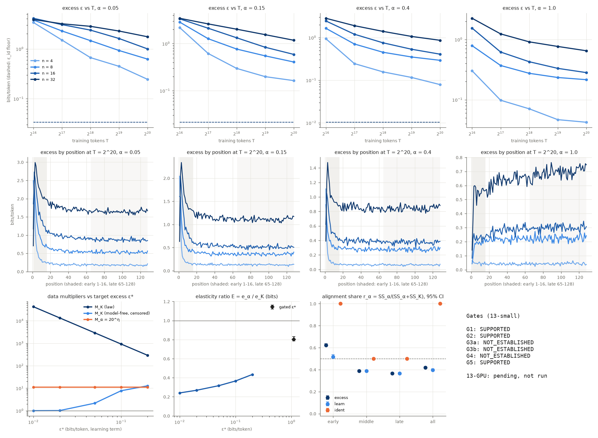

# Results: Experiment 13-small, GINC-style HMM mixtures, complexity versus alignment

Arm 13-small (CPU, 354,240-parameter transformer). **13-GPU: pending, not run.** Protocol: [PROTOCOL.md](PROTOCOL.md) as frozen; run log: [CKPT_ginc_hmm.md](CKPT_ginc_hmm.md).

## Plain-language takeaway

On small GINC-style HMM mixtures (exact minimal state count n = 4 to 32, alignment α = 0.05 to 1, 128 runs, 4 seeds), **complexity clearly costs data, and here it moves the data bill more than alignment does**:

- **Complexity is real (G1 SUPPORTED).** At α = 1, a 32-state concept needs at least 2.6× the training tokens of a 4-state one to reach the gated excess (seed interval [2.52, 2.73]). It is a lower bound: every 4-state run was already below ε* at the first checkpoint, 2^16 tokens. The fitted law puts the ratio at 17×.
- **Knowing K helps forecasting (G2 SUPPORTED).** Adding K to the best alignment-only law cuts held-out error by 52% [49%, 55%], and also on the unseen n = 16 level (0.33 vs 0.79).
- **Alignment does not dominate (G4 NOT_ESTABLISHED, in the reverse direction).** Per log-unit, complexity moves the data bill more than alignment: E = e_α/e_K = 0.80 [0.79, 0.83] in bits, 0.75 in states, 0.73 model-free, all below 1. The draft range ratio says the same (R = 0.84 [0.83, 0.85]). E falls further for stricter targets (0.24 at ε* = 0.01, from the fitted law).
- **Coefficient or exponent: both (G3 unresolved).** The joint law has a clear constant-multiplier term (κ = 0.79 [0.77, 0.81]) *and* a slower learning rate for complex concepts (γ1 = −0.17 [−0.19, −0.16]). The coefficient-only law forecasts held-out cells far better than the exponent-only law (RMSE 0.51 vs 0.85), and the joint law is best (0.43), so neither single picture passes its gate.
- **Alignment acts early, complexity late (G5 SUPPORTED).** The alignment share of explained variance is 0.62 [0.61, 0.64] in positions 1–16 and 0.37 [0.36, 0.37] in positions 65–128.

## Caveats a reader needs

- **The target excess is loose.** The pilot rule raised ε* from 0.05 to 1.10 bits/token, about 38% of the targets' entropy rates (2.73–2.96 bits). "Trained" here means partly trained: at 2^20 tokens and α = 1 the 32-state targets are still 0.65 bits above the oracle. The multiplier curves at 0.01–0.2 bits rest on the fitted law extrapolating past the data (20–32 of the 32 α = 1 target-seeds never reach those levels).
- **Identification is easy in this construction.** After 16 tokens the oracle posterior on the true target is 1.000 for every target and α, and ε_id over all 128 positions equals log2(1/α)/128 exactly (0.034 bits at α = 0.05), independent of K. So alignment acts here almost entirely through effective data (η = 0.79 [0.78, 0.81] in both M_align_eff and the K law), not through a prior-identification cost. The 13-GPU arm or harder distractors would be needed to test the identification route.
- **Only 4 seeds.** The seed-block bootstrap has 35 distinct resamples, so its intervals understate between-seed uncertainty; the two-stage interval for G1 ([2.42, 2.85]) is the more honest one.
- **No support for the quanta mechanism.** Spearman between each target's γ at α = 1 and its stationary tail exponent is 0.0 over 8 targets.
- **Model-free vs law M_K disagree** (2.6 vs 17.1 at ε*): the model-free value is held down by left-censoring at n = 4; the law value depends on the exponent term extrapolating below the first checkpoint for n = 4.
- **Relation to Experiment 11.** No Exp 13 gate uses an Exp 11 number; only Exp 11's gate definitions were adopted (PROTOCOL Section 5 note). Exp 11's verdicts (all NOT_ESTABLISHED, T* capped) are not inputs here.

## Deviations (also in CKPT_ginc_hmm.md)

1. **Wall cap raised before the freeze**, 14,400 → 18,000 s, because the pilot projected 4.58 h even with the fallback T range. In the event the grid took 12,067 s (3.35 h) cumulative, so it would have fit the original cap.
2. **Grid ran in 4 resume-safe chunks** (one foreground command is limited to 60 minutes). Chunk 1 was killed by the command timeout at 3,500 s with 4 runs in flight; their temporary checkpoint folders were discarded and the 4 runs redone from scratch in chunk 2 (runs are deterministic from seeds; verify.py replays them). Chunk 1's run_state entry was reconstructed by hand from the shell timestamps (3,501 s, 36 runs).
3. **Background CPU load** of about 3 from other jobs on the 4-core box during pilot and grid (lower throughput, no effect on results).
4. **ε_res = 0.015 bits** set at the freeze (this protocol had no value; Exp 11's censored residual needs one). No cell came near it (smallest cell mean 0.042).
5. **report.py** E panel changed after the analysis (linear axis plus the gated ε* point); reporting only, no number changed.
6. **13-GPU not run** (no GPU on this box). Its code path is not implemented in this commit: `run.py --arm gpu` exits with "pending, not run", and the `--pilot-job`, `--pilot-select`, `--merge` and verify modes that launch/README.md describes still have to be written (and the GPU `--check-only` run) before any GPU launch. Diversity coefficient: follow-up (Exp 14 code did not exist at run time).
7. **Not pushed**: committed locally on results/cpu-expts-11-15; the parent task pushes.

## Gates (all at equal prominence)

ε* = 1.1 bits/token on the learning term ε_learn = ε − ε_id. Intervals are 95% seed-block bootstrap (4 seeds, 20,000 draws, 35 distinct resamples), unless marked two-stage.

| Gate | Estimate | 95% interval | Threshold | Verdict |
|---|---|---|---|---|
| G1 complexity is real (model-free M_K at α = 1) | 2.61 | seed [2.52, 2.73]; two-stage [2.42, 2.85] | M_K ≥ 2.0, both lower bounds > 1 | **SUPPORTED** |
| G2 K law (M_K_coef) beats M_align_eff on held-out rows | 52.3% RMSE reduction | [49.4%, 55%] | ≥ 10%, lower bound > 0, lower RMSE on n = 16 (0.329 vs 0.787), 0 invalid | **SUPPORTED** |
| G3a coefficient picture | κ = 0.789, γ1 = -0.174 | κ [0.77, 0.808], γ1 [-0.185, -0.164] | κ > 0, γ1 interval ∋ 0, RMSE coef (0.507) ≤ exp (0.852) | **NOT_ESTABLISHED** |
| G3b exponent picture | γ1 = -0.174; exp vs coef -68.1% | γ1 [-0.185, -0.164]; [-78.6%, -53.8%] | γ1 upper < 0, reduction ≥ 5% with lower > 0 | **NOT_ESTABLISHED** |
| G4 alignment dominates (E = e_α/e_K) | E_bits 0.802, E_states 0.751, E_mf 0.73 (at ε = 1.1) | bits [0.786, 0.83]; states [0.736, 0.778] | all > 1, lower bounds > 1 | **NOT_ESTABLISHED** |
| G5 alignment early, complexity late | r_α early 0.623, late 0.366 | early [0.613, 0.637]; late [0.36, 0.374] | early lower > 0.5, late upper < 0.5 | **SUPPORTED** |
| G6 (13-GPU only) | — | — | — | pending, not run |

C3 (coefficient or exponent): **unresolved**.

## Draft-protocol versions (reported, not gated)

Before the freeze, G1–G4 were aligned with Experiment 11's frozen gates (PROMPT step 6). The draft definitions are reported here so nothing pre-registered disappears.

- Law-based M_K (M_K_both, fit rows, n = 32 vs 4): 17.1 [15.8, 18.5].
- Range ratio R = log M_α / log M_K: 0.844 [0.833, 0.851] (M_α = 11, M_K = 17.1).
- Complexity gap at α = 1, Δ(T_last fit)/Δ(T_first): 0.37 [0.347, 0.413] (Δ = 1.94 → 0.719 bits/token).
- Bonferroni G2: M_K_coef 52.3% [48.7%, …]; M_K_exp 19.8% [15.2%, …].
- ρ = RMSE(M_K_exp)/RMSE(M_K_coef) = 1.68 [1.54, 1.79].

## Held-out RMSE of every law (log2 ε)

| Law | primary | no offset | K = n | K = K_bits − log2 n! | invalid (primary) | level only | α only | T only |
|---|---|---|---|---|---|---|---|---|
| M0_scale | 1.3 | 1.31 | 1.3 | 1.3 | 0 | 1.12 | 1.14 | 1.67 |
| M_align_eff | 1.06 | 1.07 | 1.06 | 1.06 | 0 | 0.725 | 0.987 | 1.53 |
| M_align_add | 6.12 | 6.12 | 6.12 | 6.12 | 40 | 5.41 | 1.24 | 10.2 |
| M_K_coef | 0.507 | 0.506 | 0.507 | 0.507 | 0 | 0.297 | 0.53 | 0.755 |
| M_K_exp | 0.852 | 0.896 | 0.852 | 0.852 | 0 | 0.701 | 0.766 | 1.13 |
| M_K_both | 0.431 | 0.438 | 0.432 | 0.431 | 0 | 0.298 | 0.37 | 0.698 |

Independent fitter (L-BFGS-B, different starts): **AGREE**.

## Fitted laws per seed (fit rows)

- **M0_scale**: seed 13101: logA 0.565, gamma 0.699; seed 13202: logA 0.499, gamma 0.666; seed 13303: logA 0.632, gamma 0.719; seed 13404: logA 0.515, gamma 0.676
- **M_align_eff**: seed 13101: logA -0.456, gamma 0.683, eta 0.803; seed 13202: logA -0.482, gamma 0.652, eta 0.81; seed 13303: logA -0.373, gamma 0.704, eta 0.768; seed 13404: logA -0.467, gamma 0.661, eta 0.798
- **M_align_add**: seed 13101: a 1.28, c 1.65, d 1.57, gamma 1.05; seed 13202: a 1.21, c 1.58, d 1.5, gamma 0.979; seed 13303: a 1.43, c 1.79, d 1.68, gamma 1.42; seed 13404: a 1.31, c 1.59, d 1.57, gamma 1.14
- **M_K_coef**: seed 13101: logA -0.456, gamma 0.684, eta 0.798, kappa 0.813; seed 13202: logA -0.482, gamma 0.652, eta 0.805, kappa 0.794; seed 13303: logA -0.374, gamma 0.704, eta 0.764, kappa 0.771; seed 13404: logA -0.466, gamma 0.662, eta 0.794, kappa 0.782
- **M_K_exp**: seed 13101: logA 0.29, eta 0.35, gamma1 -0.455, gamma0 0.903; seed 13202: logA 0.256, eta 0.341, gamma1 -0.433, gamma0 0.865; seed 13303: logA 0.321, eta 0.358, gamma1 -0.445, gamma0 0.91; seed 13404: logA 0.264, eta 0.341, gamma1 -0.438, gamma0 0.874
- **M_K_both**: seed 13101: logA -0.476, eta 0.814, kappa 0.817, gamma1 -0.18, gamma0 0.678; seed 13202: logA -0.495, eta 0.816, kappa 0.798, gamma1 -0.16, gamma0 0.649; seed 13303: logA -0.384, eta 0.773, kappa 0.761, gamma1 -0.19, gamma0 0.702; seed 13404: logA -0.466, eta 0.794, kappa 0.78, gamma1 -0.167, gamma0 0.665

η from M_align_eff: 0.795 [0.776, 0.807]; from the G2 K law: 0.79 [0.773, 0.802]. M_align_eff vs M_align_add held-out RMSE reduction: 82.7% [82.4%, 82.8%].

## Multiplier curves

| ε* | M_K (law) | M_K (model-free) | M_α = 20^η | E (bits) | E 95% | right-censored α = 1 target-seeds |
|---|---|---|---|---|---|---|
| 0.01 | 4.23e+04 | 1 | 11 | 0.241 | [0.235, 0.246] | 32 |
| 0.02 | 1.34e+04 | 1.01 | 11 | 0.268 | [0.263, 0.274] | 31 |
| 0.05 | 2.91e+03 | 2.15 | 11 | 0.316 | [0.311, 0.322] | 24 |
| 0.1 | 920 | 7.69 | 11 | 0.366 | [0.362, 0.371] | 24 |
| 0.2 | 291 | 12.8 | 11 | 0.434 | [0.432, 0.438] | 20 |

## Position decomposition (Section 4.5)

| Slice | r_α of ε | r_α of ε_learn | r_α of ε_id |
|---|---|---|---|
| early | 0.623 [0.613, 0.637] | 0.518 [0.506, 0.537] | 1 [1, 1] |
| middle | 0.388 [0.381, 0.398] | 0.388 [0.381, 0.398] | 0.5 [0.5, 0.5] |
| late | 0.366 [0.36, 0.374] | 0.366 [0.36, 0.374] | 0.5 [0.5, 0.5] |
| all | 0.418 [0.412, 0.429] | 0.396 [0.39, 0.407] | 1 [1, 1] |

Cell means (all positions, averaged over targets and seeds), bits/token:

| n | α | ε at 2^16 | ε at 2^17 | ε at 2^18 | ε at 2^19 | ε at 2^20 | ε_id |
|---|---|---|---|---|---|---|---|
| 4 | 0.05 | 3.39 | 1.5 | 0.667 | 0.447 | 0.245 | 0.0338 |
| 4 | 0.15 | 2.2 | 0.617 | 0.297 | 0.199 | 0.164 | 0.0214 |
| 4 | 0.4 | 0.942 | 0.245 | 0.157 | 0.116 | 0.0789 | 0.0103 |
| 4 | 1.0 | 0.302 | 0.098 | 0.0707 | 0.0467 | 0.0423 | 0 |
| 8 | 0.05 | 3.8 | 2.29 | 1.46 | 0.927 | 0.623 | 0.0338 |
| 8 | 0.15 | 2.87 | 1.27 | 0.765 | 0.549 | 0.407 | 0.0214 |
| 8 | 0.4 | 1.65 | 0.706 | 0.453 | 0.351 | 0.293 | 0.0103 |
| 8 | 1.0 | 0.788 | 0.37 | 0.274 | 0.234 | 0.215 | 0 |
| 16 | 0.05 | 4.11 | 3.06 | 2.38 | 1.61 | 0.998 | 0.0338 |
| 16 | 0.15 | 3.36 | 2.12 | 1.33 | 0.835 | 0.589 | 0.0214 |
| 16 | 0.4 | 2.46 | 1.2 | 0.755 | 0.533 | 0.408 | 0.0103 |
| 16 | 1.0 | 1.54 | 0.618 | 0.427 | 0.331 | 0.282 | 0 |
| 32 | 0.05 | 3.88 | 3.18 | 2.83 | 2.28 | 1.75 | 0.0338 |
| 32 | 0.15 | 3.45 | 2.62 | 2.02 | 1.55 | 1.18 | 0.0214 |
| 32 | 0.4 | 2.84 | 1.9 | 1.4 | 1.06 | 0.864 | 0.0103 |
| 32 | 1.0 | 2.25 | 1.24 | 0.912 | 0.765 | 0.649 | 0 |

## Mechanism analyses (reported, not gated)

- Quanta test: Spearman(γ at α = 1, stationary tail exponent) over the 8 targets = 0 (p = 1).
- ε_id versus α: total residual sum of squares, linear in (1 − α) 0.00079 vs log2(1/α) 3.93e-30 (one parameter per target).
- Share of early-slice excess that is ε_id at the largest T: α = 0.05: 0.235, α = 0.15: 0.243, α = 0.4: 0.222.
- Distractor excess (model − distractor oracle) at the largest T by α: 0.05: 0.676, 0.15: 0.721, 0.4: 0.833, 1.0: 16.7 bits/token.

## Diversity link

follow-up: diversity coefficient of the Experiment 13 mixes (Experiment 14 code did not exist at run time).

## Pilot decisions (disclosed before the freeze)

- Seed 13909, 4 pilot concepts, α ∈ {0.05, 0.4}, T to 2^21: 8 runs, 3884 training tokens/s per worker under 4-way load, 37.1 s evaluation per checkpoint.
- Projected grid: 7.50 h at T_max = 2^21, 4.58 h at 2^20 → T range fallback 2^16..2^20.
- ε* rule: n = 32 pilot concept at α = 0.4 had ε_learn = 1.0930 at T = 524288 → ε* = 1.1 (raised). Eval SE of ε (median) 0.0048 bits/token.

## Which PROTOCOL Section 6 row matches

- "G1 SUPPORTED, G4 fails": complexity rivals or beats alignment here.
- "G5 SUPPORTED": alignment pays for identification, complexity for modeling.

**TLDR-end:** [tdc: Expt 13-small] On small GINC-style HMM mixtures (n = 4-32 states, alpha 0.05-1, 128 runs, verify PASS), complexity clearly costs data (G1: >= 2.6x tokens for 32 vs 4 states) and K improves held-out forecasts by 52% (G2), but alignment does not dominate: complexity moves the data bill more per log-unit (G4: E = 0.80 < 1); both a constant multiplier and a slower learning rate appear (G3 unresolved); alignment acts early and complexity late (G5). Caveat: the pilot loosened eps* to 1.10 bits and identification is trivial in this construction.
