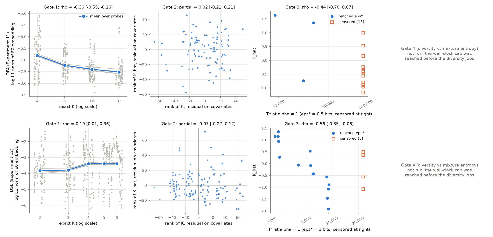

# Experiment 14: does Task2Vec track exact complexity?

**TL;DR.** Not on these probes: the Task2Vec norm does not track exact K (Gates 1-3 NOT_ESTABLISHED in both families); it tracks how well the head already fits a task, and falls as T* rises. Gates 4-5 incomplete at the 4 h cap.

## Takeaway

On these small probes, the Task2Vec norm does not track exact complexity K. The DFA result even goes the wrong way. In the DFA family the norm falls as K rises (Spearman −0.36, 95% interval [−0.56, −0.16]). Once label entropy and sensitivity are taken out, nothing is left (partial 0.02 [−0.21, 0.21]). In the DSL family the link is weak and positive (0.19 [0.01, 0.36]), and it disappears once the same covariates are removed (−0.07 [−0.27, 0.12]).

What the norm does follow is how well the probe's head already fits a task. Across tasks, the Spearman correlation of the norm score with the fitted head's loss is −0.96 in both families. It also follows how quickly a task is learned, but with the opposite sign to the prediction: a larger norm goes with a smaller T\*. The correlation with T\* is −0.44 [−0.70, 0.07] for DFA (13 of 16 targets never reached ε\* and are treated as +∞) and −0.56 [−0.86, −0.06] for DSL.

In the DSL family the norm predicts log T\* far better than K does. In a leave-one-target-out fit on the 15 targets that reached ε\*, the error falls from 0.65 with log K alone to 0.27 with the norm added. So the norm carries information about learnability, but as an "easiness" signal, not as complexity. The pattern holds:
- for all four estimators (E0 through E3);
- for the L2 and log-sum summaries and for either transformer block alone;
- across probe seeds (Kendall's W 0.91 for DFA, 0.95 for DSL).

Label noise lowered the DFA norm rather than raising it (ratio 0.59 [0.45, 0.65]), the opposite of Gate 5's prediction.

**Gate 4 (diversity coefficient) and the rescaling check were not run.** The run hit its pre-registered 4-hour wall-clock cap. Other jobs kept the shared machine's load average at 7–20 for most of the run, so units of work took 2–20 times longer than on a free CPU. Gate 5 is therefore complete for DFA but not for DSL.

So: does Task2Vec track exact K, and T\*? It does not track K. It tracks T\* only with the opposite sign: a higher norm means faster learning, through how well the head fits, not through complexity.

## Timing pilot and freeze

See PROTOCOL Section 2.8. The pilot ran on a contended machine and projected 12.9 h, so the pre-declared fallback (8 diversity batches instead of 12) was applied before the freeze (commit d22ad34e).

## Deviations (details in CKPT_task2vec_complexity.md)

1. **Wall cap and job order (results not seen).** With most of the 4-hour cap used up because of machine contention, the remaining jobs were reordered so that gate inputs ran first. The order became:
   1. all-estimator embeddings;
   2. label noise;
   3. diversity jobs holding the coverage mixes;
   4. everything else.

   The run stopped at 14,121 s with 363 of 503 jobs not run:
   - 4 DSL label-noise jobs;
   - all 224 diversity jobs;
   - 108 rescaled-probe jobs;
   - 27 random-init-probe jobs.

   The finished jobs were merged, and analyses whose inputs are missing are marked not run. Gate verdict NOT_RUN means "not tested", not "failed". The run can be resumed (`run.py --output results --resume`) if the cap is raised.
2. **Embedding storage.** The two families' embeddings have different dimensions (DFA 1,564, DSL 1,566), so `embeddings.npz` holds one set of arrays per family (`dfa_keys`, `dfa_f`, …). The keys are as in PROTOCOL Section 8.

## Verification

`verify.py` passes (results/verify.json, verify.log). It reloads the 5 probes per family and re-evaluates them (max difference 0 bits); recomputes exact K for every task and rebuilds the roster identically with disjoint roles; recomputes 1,788 saved embeddings (a 10% random sample plus every Gate-input embedding; max relative difference 0); and recomputes 142,352 statistics, bootstrap draws and table entries with the independently written independent_stats.py (max absolute difference 8.3e-16). Diversity batch embeddings were not checked because none were computed.

## Limitations

- Gate 4 and the rescaling (parameterization) check are untested. The handoff condition is therefore unresolved on rescaling, but it already fails on Gates 1–3.
- T\* is heavily right-censored for DFA (104 of 128 α = 1 runs never reached ε\* = 0.5 bits), so the DFA Gate 3 estimate rests on 3 finite targets plus ties.
- The probes are tiny transformers pretrained on the same family. A large pretrained probe on real data could behave differently. These results speak about this setting only.
- The negative link between the norm and head loss suggests the E0 norm mostly measures how well the frozen features fit the task. The research note's Kolmogorov reading of the norm does not hold here.

Rows: DFA tasks (Experiment 11), DSL tasks (Experiment 12). Columns: log L1 norm of the E0 embedding against exact K (gray: each of the 4 probes; blue: mean over probes); the same after removing label entropy and sensitivity (rank residuals); K_hat against T* on the training targets (hollow squares: never reached eps*, treated as +inf); diversity coefficient against mixture entropy on the coverage mixes (gray bars: 95% bootstrap interval over batch pairs and probes; dashed: reference bounds).

## Gates

| Gate | Statistic | Family | Estimate | 95% interval | Threshold | Family passes |
|---|---|---|---|---|---|---|
| G1 | Spearman(K_hat, K) on embedded tasks | DFA | -0.359 | [-0.555, -0.159] | ≥ 0.5, lower bound > 0.2 | no |
| G1 | Spearman(K_hat, K) on embedded tasks | DSL | 0.19 | [0.0112, 0.357] | ≥ 0.5, lower bound > 0.2 | no |
| G2 | Partial Spearman(K_hat, K \| label entropy, sensitivity) | DFA | 0.0166 | [-0.209, 0.21] | ≥ 0.3, lower bound > 0 | no |
| G2 | Partial Spearman(K_hat, K \| label entropy, sensitivity) | DSL | -0.072 | [-0.272, 0.116] | ≥ 0.3, lower bound > 0 | no |
| G3 | Spearman(K_hat, T*) on targets (alpha = 1, censored = +inf) | DFA | -0.436 | [-0.697, 0.0673] | ≥ 0.5, lower bound > 0 | no |
| G3 | Spearman(K_hat, T*) on targets (alpha = 1, censored = +inf) | DSL | -0.564 | [-0.855, -0.0572] | ≥ 0.5, lower bound > 0 | no |
| G4 | Diversity vs mixture entropy H, coverage mixes | DFA | not run | — | ≥ 0.7, lower bound > 0.5 | — |
| G4 | Diversity vs mixture entropy H, coverage mixes | DSL | not run | — | ≥ 0.7, lower bound > 0.5 | — |
| G4 | rho_H - \|rho_K\|, coverage mixes | DFA | not run | — | ≥ 0.3, lower bound > 0 | — |
| G4 | rho_H - \|rho_K\|, coverage mixes | DSL | not run | — | ≥ 0.3, lower bound > 0 | — |
| G5 | L1(25% label noise) / L1(clean), median over tasks | DFA | 0.592 | [0.45, 0.653] | ≥ 1.2, lower bound > 1 | no |
| G5 | L1(25% label noise) / L1(clean), median over tasks | DSL | not run | — | ≥ 1.2, lower bound > 1 | — |

| Gate | Verdict (both families must pass) |
|---|---|
| G1 | **NOT_ESTABLISHED** |
| G2 | **NOT_ESTABLISHED** |
| G3 | **NOT_ESTABLISHED** |
| G4 | **NOT_RUN** |
| G5 | **NOT_RUN** |

Handoff to real data (Gates 1-3 supported, Kendall's W ≥ 0.8, rescaled rank correlation ≥ 0.9, non-negative incremental value in both families): **not met**.

Gate 5 is NOT_RUN only because one family's inputs are missing; it cannot pass, since DFA already fails its threshold and both families must pass.

## Estimators and summaries (reported, not gated)

| Embedding | Family | Gate 1 rho [CI] | Gate 2 partial [CI] | Gate 3 rho [CI] |
|---|---|---|---|---|
| E1 | DFA | -0.382 [-0.562, -0.175] | -0.0146 [-0.228, 0.193] | -0.401 [-0.689, 0.0843] |
| E1 | DSL | 0.188 [0.0097, 0.357] | -0.0691 [-0.27, 0.125] | -0.535 [-0.841, -0.0435] |
| E2 | DFA | -0.367 [-0.557, -0.162] | 0.00936 [-0.209, 0.209] | -0.401 [-0.706, 0.0674] |
| E2 | DSL | 0.184 [0.01, 0.355] | -0.0788 [-0.275, 0.114] | -0.564 [-0.855, -0.0616] |
| E3 | DFA | -0.283 [-0.459, -0.0693] | -0.111 [-0.283, 0.0825] | -0.574 [-0.764, -0.0627] |
| E3 | DSL | 0 [-0.18, 0.182] | -0.0923 [-0.281, 0.104] | -0.427 [-0.739, 0.156] |
| E0, rescaled probe | DFA | not run (wall cap) | | |
| E0, rescaled probe | DSL | not run (wall cap) | | |
| E0, L2 norm | DFA | -0.359 [-0.553, -0.143] | -0.00239 [-0.232, 0.194] | -0.367 [-0.703, 0.166] |
| E0, L2 norm | DSL | 0.185 [0.0131, 0.356] | -0.0953 [-0.275, 0.0836] | -0.567 [-0.852, -0.0194] |
| E0, log-sum | DFA | -0.363 [-0.556, -0.156] | 0.0251 [-0.197, 0.225] | -0.401 [-0.698, 0.0327] |
| E0, log-sum | DSL | 0.169 [-0.0145, 0.342] | -0.0776 [-0.29, 0.144] | -0.605 [-0.848, -0.1] |
| E0, block 1 only | DFA | -0.371 [-0.552, -0.178] | -0.0154 [-0.229, 0.177] | -0.436 [-0.732, 0.0674] |
| E0, block 1 only | DSL | 0.138 [-0.0378, 0.318] | -0.072 [-0.273, 0.146] | -0.642 [-0.862, -0.181] |
| E0, block 2 only | DFA | -0.38 [-0.566, -0.182] | -0.0136 [-0.249, 0.189] | -0.436 [-0.713, 0.0282] |
| E0, block 2 only | DSL | 0.196 [0.0102, 0.365] | -0.0482 [-0.268, 0.163] | -0.591 [-0.844, -0.101] |
| E0, random-init probe (point only) | DFA | not run (wall cap) | | |
| E0, random-init probe (point only) | DSL | not run (wall cap) | | |

## Probe and parameterization sensitivity

| Family | Kendall's W | mean pairwise Spearman | probe pairs disagreeing on K-level order | Spearman(K_hat, rescaled K_hat) | Gate 1 rho change, rescaled | median L1 ratio rescaled/original |
|---|---|---|---|---|---|---|
| DFA | 0.911 | 0.882 | 0 | n/a | n/a | n/a |
| DSL | 0.95 | 0.933 | 0.833 | n/a | n/a | n/a |

## Mechanism

| Family | rho khat head loss | rho khat head error | rho khat label entropy | rho khat sensitivity | rho head loss K | rho head error K | rho head loss sensitivity | partial head loss K given sensitivity | partial khat K given head loss | rho sensitivity K | rho label entropy K |
|---|---|---|---|---|---|---|---|---|---|---|---|
| DFA | -0.956 | -0.949 | -0.02 | -0.649 | 0.319 | 0.325 | 0.622 | -0.0279 | -0.195 | 0.543 | -0.0239 |
| DSL | -0.961 | -0.916 | -0.706 | -0.781 | -0.167 | -0.111 | 0.723 | -0.156 | 0.107 | -0.0826 | -0.408 |

## Incremental value over exact K for T*

- DFA: partial khat tstar given K = -0.268; partial khat tstar given K entropy sensitivity = 0.12; rho K tstar = 0.498; n finite targets = 3; n censored targets = 13; loo rmse note = only 3 uncensored targets; leave-one-out RMSE not computed; rho khat code length proxy = -0.776; rho K code length proxy = 0.752
- DSL: partial khat tstar given K = -0.566; partial khat tstar given K entropy sensitivity = -0.2; rho K tstar = -0.0371; n finite targets = 15; n censored targets = 5; loo rmse logK = 0.647; loo rmse logK plus lognorm = 0.267; rho khat code length proxy = -0.555; rho K code length proxy = -0.0245

## E0 against the per-example Fisher (E2)

- DFA: median (E0 L1 × batch size) / (E2 L1) = 0.998; Spearman by probe [0.987, 0.974, 0.977, 0.983]
- DSL: median (E0 L1 × batch size) / (E2 L1) = 0.997; Spearman by probe [0.996, 0.997, 0.995, 0.995]

## Diversity coefficient (reported analyses)

| Family | Mixes | Batches | rho with H | rho with K | rho with Rao Q | other |
|---|---|---|---|---|---|---|
| DFA | coverage (0) | interleaved | n/a | n/a | n/a | range n/a |
| DFA | coverage (0) | single-task | n/a | n/a | n/a | range n/a |
| DFA | Experiment 11/12 training mixes (0) | interleaved | n/a | n/a | n/a | rho with alpha n/a; alpha = 1 slice rho with K n/a (n = 0) |
| DFA | reference bounds | — | — | — | — | lower not run, upper not run |
| DSL | coverage (0) | interleaved | n/a | n/a | n/a | range n/a |
| DSL | coverage (0) | single-task | n/a | n/a | n/a | range n/a |
| DSL | Experiment 11/12 training mixes (0) | interleaved | n/a | n/a | n/a | rho with alpha n/a; alpha = 1 slice rho with K n/a (n = 0) |
| DSL | reference bounds | — | — | — | — | lower not run, upper not run |

## Label noise

- DFA: L1 ratio noisy/clean by rate {'0.10': 0.8003909414970412, '0.25': 0.5924240979683605} (16 tasks)
- DSL: not run (wall cap)

## Censoring of T*

- DFA: 104 of 128 alpha = 1 training runs never reached eps* = 0.5 bits; 13 of 16 targets have a censored median T* (ranked highest, tied).
- DSL: 35 of 160 alpha = 1 training runs never reached eps* = 1 bits; 5 of 20 targets have a censored median T* (ranked highest, tied).

## Run

Wall time 3.92 h on a shared 4-core, 15 GB CPU machine (no GPU); versions {'python': '3.12.3', 'torch': '2.14.1+cpu', 'numpy': '2.5.4', 'scipy': '1.18.1'}; bootstrap 20000 draws, seed 29101426. Full numbers: expt_v1/results/gates.json, analysis.json, task_table.csv, diversity.csv.

**Incomplete run.** The run stopped at the 4 h wall cap with 363 jobs not run (224 diversity, 4 label-noise embedding, 27 random-init-probe embedding, 108 rescaled-probe embedding); analyses that need them are marked not run. The run is resumable with `run.py --resume`.
