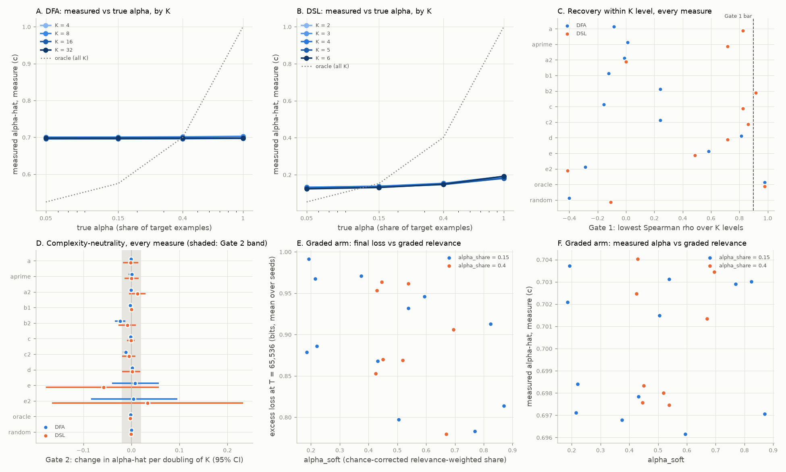

# Results: Can measured alignment recover the true alignment? (Experiment 15)

Run on CPU (4 cores, 15 GB), 10-19-2026 (pilot, freeze and gated run the same day). Protocol: [PROTOCOL.md](PROTOCOL.md) (frozen before any gated run); log: [CKPT_alpha_recovery.md](CKPT_alpha_recovery.md). Every number below is read from `expt_v1/results/` by `report.py`.

## Takeaway

**No. On these toys, Varun's measured α (the combined score c, which is Eq. 2 applied to the average of the compression and probe-embedding scores) does not recover the true alignment within complexity levels.**

- **DFA (Experiment 11 mixes):** α̂_c is nearly flat. Averaged over targets it moves from 0.699 at α = 0.05 to 0.700 at α = 1. The within-level Spearman ρ is 0.39, 0.44, 0.28 and −0.16 for n = 4, 8, 16, 32, against the bar of 0.90 with a lower bound of 0.80.
- **DSL (Experiment 12 mixes):** α̂_c ranks mixes moderately but stays below the bar: ρ 0.87, 0.85, 0.82, 0.82, 0.82, with lower bounds 0.78 to 0.83. The embedding half carries no information here. Target and distractors share their inputs, and the probe-embedding score ignores labels. On DSL every reference input is in the pool, so that score is constant (Deviation 2) and α̂_c is half of the compression score's α̂.
- **Gate 2 passes only because the measure is insensitive.** A score that hardly moves with α cannot move with K either. The slope per doubling of K is −0.0015 [−0.0031, −0.0002] on DFA and −0.0009 [−0.0087, +0.0072] on DSL. Both sit inside the ±0.02 band and match the oracle's slopes (−0.0015 and −0.0021).
- **Gate 3 passes but says little.** With calibrated α̂_c in place of the true α, the best Experiment 11/12 law's held-out RMSE rises by 7.5% [6.5, 8.6] on DFA and falls by 6.9% [6.7, 7.1] on DSL. Uncalibrated α̂ raises it by 5.8% and 2.1%. On DFA, a random α̂ also stays inside the 10% bar (+4.6%), because Experiment 11's large targets never learned and the law depends little on α there. On DSL the random score fails (+16.8%), so the DSL pass is informative.
- **Which scores do track α.**
  - The frozen-gradient score d is the best non-leaking score on DFA: ρ 0.81 to 0.91 (lower bounds 0.63 to 0.84). Permuting its labels cuts its lowest ρ to 0.01, so it reads the input-to-label rule. It still misses the Gate 1 bar.
  - On DSL, b2 (probe loss) clears the bar at every level: ρ 0.92 to 0.98, lower bounds 0.91 to 0.98. c2 is close (lowest ρ 0.86). Both read labels, and both fail on DFA (lowest ρ 0.24).
  - Task2Vec e is noisy: lowest ρ 0.58 on DFA and 0.49 on DSL.
  - When the task token is left in, every score improves sharply (c_leak, lowest ρ 0.78 on both families). This shows how much identity cues can flatter a measure.
- **Graded arm (160 new runs on DFA).** Graded relevance predicts loss better than target share: chance-corrected α_soft cuts held-out RMSE by 11.2% [10.1, 12.3] against α_share, and α_agree by 9.6%. α̂_c does not follow it: ρ with α_soft is −0.03 and with α_share 0.12, a difference of −0.15 [−0.93, +0.25]. The gradient score d does follow it (ρ_soft 0.78 vs ρ_share 0.05, difference 0.73 [0.24, 0.90]), and so do b2 and c2.

**Read with the earlier results.**

- Experiment 11's T* is censored by the 2^16 budget, and its n = 16 and n = 32 targets stayed near chance. That is why the Gate 3 comparison on DFA barely separates good α̂ from random α̂.
- Experiment 13 came out the reverse of C2 (E = 0.80). Experiment 14 found that Task2Vec does not track K. Here the Task2Vec-based α̂ (e) is also the noisiest estimator of α.
- Together these say that neither complexity nor alignment, as measured by the proposed proxies, can yet be read off a fitted law with confidence on these toys.
- The measured α is mostly a share-of-similar-inputs score. Where target and distractors share inputs, as they do here, it does not see the alignment that matters.

## Gate verdicts

All five gates are decided on measure (c), the paper's combined score (compression plus probe embedding), with 20,000 bootstrap draws and 95% percentile intervals.

| Gate | Pass condition | Result | Verdict |
|---|---|---|---|
| 1 (primary): recovery within each K level | rho >= 0.9 and 95% LB >= 0.8 in every K level | DFA lowest rho -0.158 (K = 32, LB -0.878); DSL lowest rho 0.825 (K = 4, LB 0.778) | **NOT_ESTABLISHED** |
| 2 (primary): complexity-neutrality | 95% CI of the slope inside [-0.02, +0.02] per doubling of K, each family | DFA slope -0.002 [-0.003, -0.000], oracle -0.001; DSL slope -0.001 [-0.009, 0.007], oracle -0.002 | **SUPPORTED** |
| 3 (primary): calibrated alpha-hat in the best law | Delta <= 0.1, 95% UB <= 0.1, 0 invalid | DFA Delta +7.5% [+6.5%, +8.6%], 0 invalid; DSL Delta -6.9% [-7.1%, -6.7%], 0 invalid | **SUPPORTED** |
| 4a (secondary): graded relevance predicts loss | reduction >= 10% with 95% LB > 0, 0 invalid | RMSE reduction soft vs share +11.2% [+10.1%, +12.3%]; invalid share/soft 0/0 | **SUPPORTED** |
| 4b (secondary): measured alpha tracks graded relevance | rho(soft) - rho(share) >= 0.1 with 95% LB > 0 | rho(soft) -0.027, rho(share) 0.124, difference -0.151 [-0.929, 0.245] | **NOT_ESTABLISHED** |

Read with the earlier experiments: Experiment 11's data-efficiency endpoint T\* is censored by the 2^16 example budget, Experiment 13 came out the reverse of C2 (E = 0.80), and Experiment 14 is negative.

**Which Section 6 outcome this is.** **The closest row is "G1 NOT_ESTABLISHED for (c), with better numbers for (d)".** Similarity and compression scores miss conditional (input-to-label) alignment, and the optimizer-aware gradient score catches more of it. But (d) does not reach Gate 1 numbers: its lowest ρ is 0.81 on DFA and 0.72 on DSL. So the row holds only in direction.

Three more rows apply:

- **Permuted labels (DFA c, b1).** On DFA, permuted-label and input-only references recover α no worse than true references do: lowest ρ about −0.1 to −0.2 for all of them. The combined measure ignores labels. On DSL, permuting labels does hurt c (lowest ρ 0.82 → 0.28), so there its compression half reads labels.
- **Leak control.** With the task token left in, scores reach ρ 0.73 to 0.97. Stripped of it, c on DFA falls to a mean ρ of 0.24 (random baseline 0.02). Identity cues alone can make α̂ look good.
- **G4a SUPPORTED.** Partially relevant data acts as partial alignment, so "share of target data" understates alignment.

*A, B: measured alpha-hat (measure c, mean over targets and probes) against the hand-set alpha, one line per complexity level K; the dotted line is the oracle. C: Gate 1's lowest within-level Spearman rho for every measure. D: Gate 2's slope per doubling of K with its 95% interval. E, F: the graded-relevance arm, final loss and measured alpha against alpha_soft.*

## Gate 1: recovery within each K level (measure c)

**DFA**

| K | Spearman rho | 95% CI | independent rho |
|---|---|---|---|
| 4 | 0.388 | [-0.491, 0.976] | 0.388 |
| 8 | 0.437 | [0.364, 0.976] | 0.437 |
| 16 | 0.279 | [0.243, 0.798] | 0.279 |
| 32 | -0.158 | [-0.878, 0.491] | -0.158 |

**DSL**

| K | Spearman rho | 95% CI | independent rho |
|---|---|---|---|
| 2 | 0.873 | [0.834, 0.982] | 0.873 |
| 3 | 0.849 | [0.815, 0.982] | 0.849 |
| 4 | 0.825 | [0.778, 0.982] | 0.825 |
| 5 | 0.825 | [0.778, 0.982] | 0.825 |
| 6 | 0.825 | [0.778, 0.982] | 0.825 |

## Gate 2: complexity-neutrality (slope of alpha-hat per doubling of K at fixed alpha)

| Family | slope (c) | 95% CI | inside band | oracle slope | oracle 95% CI | slope of (c) minus oracle | 95% CI |
|---|---|---|---|---|---|---|---|
| DFA | -0.002 | [-0.003, -0.000] | yes | -0.001 | [-0.004, 0.001] | -0.000 | [-0.003, 0.003] |
| DSL | -0.001 | [-0.009, 0.007] | yes | -0.002 | [-0.003, -0.001] | 0.001 | [-0.007, 0.010] |

## Gate 3: measured alpha in the best Experiment 11/12 law (held-out cells)

Raw alpha-hat is the realistic number: calibration uses the true alpha on fit cells, which real data never provides.

| Family | RMSE true alpha | RMSE calibrated (c) | RMSE raw (c) | Delta calibrated | Delta raw | invalid (true / cal / raw) |
|---|---|---|---|---|---|---|
| DFA | 0.181 | 0.195 | 0.192 | +7.5% [+6.5%, +8.6%] | +5.8% [+5.2%, +6.3%] | 0 / 0 / 0 |
| DSL | 2.644 | 2.461 | 2.700 | -6.9% [-7.1%, -6.7%] | +2.1% [+1.6%, +2.7%] | 0 / 0 / 0 |

Calibrated alpha-hat of every other measure in the same law (reported, no verdict):

| Measure | DFA Delta (invalid) | DSL Delta (invalid) |
|---|---|---|
| (a) zstd dictionary compression ratio | +5.5% (0) | -6.9% (0) |
| (a') dictionary minus no-dictionary size | +5.8% (0) | -1.4% (0) |
| (a2) gzip NCD to references | +5.6% (0) | +13.1% (0) |
| (b1) probe-embedding max cosine | +4.9% (0) | +13.0% (0) |
| (b2) byte-histogram cosine | +0.9% (0) | -0.4% (0) |
| (c2) = (a + b2) / 2 | +4.7% (0) | -3.4% (0) |
| (d) frozen-gradient cosine | +0.4% (0) | +3.6% (0) |
| (e) Task2Vec set-level (E3) | +1.8% (0) | +14.6% (0) |
| (e2) Task2Vec set-level (E2) | +4.3% (0) | +14.0% (0) |
| oracle (true label agreement) | -0.1% (0) | -0.1% (0) |
| random scores | +4.6% (0) | +16.8% (0) |

Law fits: laws.py versus independent_fit.py, max relative difference DFA 2.2e-07, DSL 1.8e-07 (tolerance 0.0001).

## Gate 4a: does graded relevance predict loss? (leave-one-mix-out, 160 runs)

| alpha coordinate | pooled held-out RMSE | reduction vs share | invalid |
|---|---|---|---|
| alpha_share (target share) | 0.110 | - | 0 |
| alpha_soft (chance-corrected relevance) | 0.098 | +11.2% [+10.1%, +12.3%] | 0 |
| alpha_agree (raw agreement) | 0.099 | +9.6% [+8.7%, +10.5%] | 0 |

Final excess loss (bits, T = 65,536, mean over 8 seeds) by mix:

| target | mix | alpha_share | alpha_soft | alpha_agree | final excess loss |
|---|---|---|---|---|---|
| dfa_n08_t2 | m1 | 0.15 | 0.221 | 0.589 | 0.886 |
| dfa_n08_t2 | m2 | 0.15 | 0.870 | 0.935 | 0.814 |
| dfa_n08_t2 | m3 | 0.15 | 0.431 | 0.710 | 0.868 |
| dfa_n08_t2 | m4 | 0.4 | 0.450 | 0.710 | 0.870 |
| dfa_n08_t2 | m5 | 0.4 | 0.518 | 0.759 | 0.869 |
| dfa_n08_t3 | m1 | 0.15 | 0.215 | 0.584 | 0.967 |
| dfa_n08_t3 | m2 | 0.15 | 0.594 | 0.797 | 0.946 |
| dfa_n08_t3 | m3 | 0.15 | 0.375 | 0.677 | 0.971 |
| dfa_n08_t3 | m4 | 0.4 | 0.446 | 0.706 | 0.964 |
| dfa_n08_t3 | m5 | 0.4 | 0.538 | 0.763 | 0.962 |
| dfa_n16_t1 | m1 | 0.15 | 0.192 | 0.595 | 0.992 |
| dfa_n16_t1 | m2 | 0.15 | 0.824 | 0.912 | 0.913 |
| dfa_n16_t1 | m3 | 0.15 | 0.538 | 0.769 | 0.932 |
| dfa_n16_t1 | m4 | 0.4 | 0.430 | 0.714 | 0.953 |
| dfa_n16_t1 | m5 | 0.4 | 0.695 | 0.848 | 0.906 |
| dfa_n16_t2 | m1 | 0.15 | 0.185 | 0.550 | 0.878 |
| dfa_n16_t2 | m2 | 0.15 | 0.770 | 0.887 | 0.783 |
| dfa_n16_t2 | m3 | 0.15 | 0.505 | 0.744 | 0.797 |
| dfa_n16_t2 | m4 | 0.4 | 0.425 | 0.683 | 0.853 |
| dfa_n16_t2 | m5 | 0.4 | 0.670 | 0.838 | 0.780 |

## Gate 4b: does measured alpha track graded relevance? (20 graded mixes)

| Measure | rho(alpha-hat, alpha_soft) | rho(alpha-hat, alpha_share) | difference | 95% CI |
|---|---|---|---|---|
| (a) zstd dictionary compression ratio | -0.260 | 0.230 | -0.490 | [-1.167, 0.016] |
| (a') dictionary minus no-dictionary size | 0.003 | 0.212 | -0.209 | [-0.741, 0.166] |
| (a2) gzip NCD to references | 0.299 | 0.035 | 0.264 | [-0.067, 0.613] |
| (b2) byte-histogram cosine | 0.540 | 0.124 | 0.416 | [0.351, 0.759] |
| oracle (true label agreement) | 0.983 | 0.106 | 0.877 | [0.759, 1.000] |
| random scores | 0.120 | -0.177 | 0.297 | [-0.323, 0.794] |
| (b1) probe-embedding max cosine | 0.135 | -0.018 | 0.153 | [-0.314, 0.850] |
| (d) frozen-gradient cosine | 0.779 | 0.053 | 0.726 | [0.240, 0.897] |
| (c) = (a + b1) / 2, the paper's combined score | -0.027 | 0.124 | -0.151 | [-0.929, 0.245] |
| (c2) = (a + b2) / 2 | 0.465 | 0.124 | 0.341 | [0.275, 0.688] |
| (e) Task2Vec set-level (E3) | 0.275 | 0.549 | -0.274 | [-0.768, 0.380] |
| (e2) Task2Vec set-level (E2) | -0.123 | -0.177 | 0.054 | [-0.477, 0.589] |

## Every measure, Gates 1 and 2 statistics (no verdicts)

**DFA**

| Measure | Gate 1 rho by K level | lowest LB | Gate 2 slope [95% CI] | slope minus oracle | mean alpha-hat at alpha = 0.05, 0.15, 0.4, 1 |
|---|---|---|---|---|---|
| (a) zstd dictionary compression ratio | 0.364, 0.703, 0.473, -0.085 | -0.614 | -0.000 [-0.003, 0.001] | 0.001 | 0.426, 0.426, 0.427, 0.429 |
| (a') dictionary minus no-dictionary size | 0.279, 0.303, 0.243, 0.012 | -0.614 | 0.001 [-0.005, 0.007] | 0.002 | 0.427, 0.428, 0.429, 0.431 |
| (a2) gzip NCD to references | -0.012, 0.121, 0.291, 0.109 | -0.614 | -0.001 [-0.004, 0.002] | 0.001 | 0.657, 0.657, 0.657, 0.658 |
| (b1) probe-embedding max cosine | 0.000, -0.121, 0.121, 0.121 | -0.614 | -0.003 [-0.005, -0.000] | -0.001 | 0.971, 0.971, 0.971, 0.971 |
| (b2) byte-histogram cosine | 0.352, 0.352, 0.243, 0.352 | 0.243 | -0.024 [-0.034, -0.013] | -0.022 | 0.830, 0.832, 0.838, 0.853 |
| (c) = (a + b1) / 2, the paper's combined score | 0.388, 0.437, 0.279, -0.158 | -0.878 | -0.002 [-0.003, -0.000] | -0.000 | 0.699, 0.699, 0.699, 0.700 |
| (c2) = (a + b2) / 2 | 0.412, 0.364, 0.243, 0.364 | 0.243 | -0.012 [-0.018, -0.006] | -0.011 | 0.628, 0.629, 0.633, 0.641 |
| (d) frozen-gradient cosine | 0.910, 0.812, 0.825, 0.885 | 0.631 | 0.001 [-0.003, 0.007] | 0.003 | 0.507, 0.512, 0.526, 0.560 |
| (e) Task2Vec set-level (E3) | 0.849, 0.643, 0.582, 0.764 | -0.012 | 0.008 [-0.040, 0.057] | 0.009 | 0.308, 0.374, 0.529, 0.859 |
| (e2) Task2Vec set-level (E2) | -0.237, -0.286, -0.207, -0.109 | -0.739 | 0.005 [-0.084, 0.096] | 0.006 | 0.660, 0.576, 0.582, 0.547 |
| oracle (true label agreement) | 0.977, 0.977, 0.977, 0.977 | 0.977 | -0.001 [-0.004, 0.001] | 0.000 | 0.525, 0.575, 0.700, 1.000 |
| random scores | -0.400, 0.473, 0.024, -0.024 | -0.945 | 0.000 [-0.000, 0.001] | 0.002 | 0.500, 0.500, 0.500, 0.500 |

**DSL**

| Measure | Gate 1 rho by K level | lowest LB | Gate 2 slope [95% CI] | slope minus oracle | mean alpha-hat at alpha = 0.05, 0.15, 0.4, 1 |
|---|---|---|---|---|---|
| (a) zstd dictionary compression ratio | 0.873, 0.849, 0.825, 0.825, 0.825 | 0.778 | -0.002 [-0.017, 0.014] | 0.000 | 0.259, 0.271, 0.300, 0.370 |
| (a') dictionary minus no-dictionary size | 0.776, 0.861, 0.934, 0.715, 0.922 | 0.715 | -0.000 [-0.014, 0.015] | 0.002 | 0.400, 0.409, 0.433, 0.490 |
| (a2) gzip NCD to references | 0.218, 0.000, 0.352, 0.546, 0.279 | -0.614 | 0.012 [-0.005, 0.030] | 0.014 | 0.611, 0.614, 0.619, 0.633 |
| (b1) probe-embedding max cosine | n/a, n/a, n/a, n/a, n/a | n/a | 0.000 [0.000, 0.000] | 0.002 | 0.000, 0.000, 0.000, 0.000 |
| (b2) byte-histogram cosine | 0.941, 0.977, 0.928, 0.928, 0.916 | 0.906 | -0.008 [-0.026, 0.009] | -0.006 | 0.676, 0.710, 0.795, 1.000 |
| (c) = (a + b1) / 2, the paper's combined score | 0.873, 0.849, 0.825, 0.825, 0.825 | 0.778 | -0.001 [-0.009, 0.007] | 0.001 | 0.129, 0.135, 0.150, 0.185 |
| (c2) = (a + b2) / 2 | 0.970, 0.970, 0.910, 0.922, 0.861 | 0.834 | -0.005 [-0.019, 0.009] | -0.003 | 0.467, 0.490, 0.548, 0.685 |
| (d) frozen-gradient cosine | 0.970, 0.958, 0.885, 0.715, 0.788 | 0.535 | 0.002 [-0.019, 0.019] | 0.004 | 0.524, 0.533, 0.554, 0.605 |
| (e) Task2Vec set-level (E3) | 0.752, 0.680, 0.582, 0.485, 0.812 | -0.382 | -0.058 [-0.178, 0.057] | -0.056 | 0.270, 0.346, 0.555, 0.736 |
| (e2) Task2Vec set-level (E2) | 0.243, -0.414, -0.024, -0.207, -0.073 | -0.767 | 0.034 [-0.165, 0.232] | 0.036 | 0.464, 0.506, 0.487, 0.456 |
| oracle (true label agreement) | 0.977, 0.977, 0.977, 0.977, 0.977 | 0.977 | -0.002 [-0.003, -0.001] | 0.000 | 0.053, 0.153, 0.402, 1.000 |
| random scores | 0.061, 0.000, -0.109, -0.109, 0.085 | -0.945 | -0.001 [-0.005, 0.003] | 0.001 | 0.500, 0.500, 0.499, 0.498 |

## Affine decomposition: alpha-hat = m_D + (m_T - m_D) alpha, versus K

m_T is the token-weighted mean score of target examples, m_D that of distractor examples; their gap is how much of a unit of true alpha the measure can see. Means over the targets of each K level (and probes).

**DFA** (cells: m_D / m_T - m_D)

| Measure | K = 4 | K = 8 | K = 16 | K = 32 | distinct score values in pool |
|---|---|---|---|---|---|
| (a) zstd dictionary compression ratio | 0.425 / 0.005 | 0.429 / 0.004 | 0.421 / 0.003 | 0.429 / -0.001 | 100 |
| (a2) gzip NCD to references | 0.662 / -0.002 | 0.653 / 0.003 | 0.655 / 0.002 | 0.657 / 0.001 | 7,783 |
| (b1) probe-embedding max cosine | 0.976 / 0.000 | 0.971 / 0.000 | 0.970 / 0.000 | 0.967 / 0.000 | 2,474 |
| (b2) byte-histogram cosine | 0.856 / 0.043 | 0.841 / 0.026 | 0.820 / 0.015 | 0.799 / 0.010 | 32,179 |
| (c) = (a + b1) / 2, the paper's combined score | 0.700 / 0.003 | 0.700 / 0.002 | 0.696 / 0.002 | 0.698 / -0.000 | 27,340 |
| (d) frozen-gradient cosine | 0.501 / 0.052 | 0.502 / 0.072 | 0.504 / 0.049 | 0.508 / 0.052 | 54,844 |
| oracle (true label agreement) | 0.506 / 0.494 | 0.498 / 0.502 | 0.496 / 0.504 | 0.498 / 0.502 | 2 |

**DSL** (cells: m_D / m_T - m_D)

| Measure | K = 2 | K = 3 | K = 4 | K = 5 | K = 6 | distinct score values in pool |
|---|---|---|---|---|---|---|
| (a) zstd dictionary compression ratio | 0.258 / 0.102 | 0.259 / 0.105 | 0.257 / 0.124 | 0.249 / 0.113 | 0.241 / 0.143 | 12 |
| (a2) gzip NCD to references | 0.591 / 0.006 | 0.627 / 0.002 | 0.636 / 0.015 | 0.595 / 0.062 | 0.602 / 0.029 | 9,234 |
| (b1) probe-embedding max cosine | 0.000 / 0.000 | 0.000 / 0.000 | 0.000 / 0.000 | 0.000 / 0.000 | 0.000 / 0.000 | 1 |
| (b2) byte-histogram cosine | 0.663 / 0.337 | 0.677 / 0.323 | 0.665 / 0.335 | 0.633 / 0.367 | 0.655 / 0.345 | 8,576 |
| (c) = (a + b1) / 2, the paper's combined score | 0.129 / 0.051 | 0.130 / 0.053 | 0.129 / 0.062 | 0.124 / 0.056 | 0.120 / 0.072 | 12 |
| (d) frozen-gradient cosine | 0.530 / 0.053 | 0.531 / 0.045 | 0.517 / 0.130 | 0.504 / 0.095 | 0.516 / 0.104 | 10,576 |
| oracle (true label agreement) | 0.007 / 0.993 | 0.003 / 0.997 | 0.002 / 0.998 | 0.002 / 0.998 | 0.001 / 0.999 | 2 |

## Controls

Leak: the task-token byte left in (the identity cue the main scores strip). Permuted labels: references with shuffled labels. Input-only: labels removed from the serialization. (b1) reads inputs only, so its permuted-label and input-only versions equal (b1) by construction.

| Family | Control | of measure | lowest Gate 1 rho (base) | mean Gate 1 rho (base) | Gate 2 slope | mean m_T - m_D | alpha-hat at lowest / highest alpha |
|---|---|---|---|---|---|---|---|
| DFA | a_leak | a | 0.728 (-0.085) | 0.803 (0.364) | 0.004 | 0.049 | 0.396 / 0.443 |
| DFA | b1_leak | b1 | 0.740 (-0.121) | 0.812 (0.030) | 0.035 | 0.136 | 0.870 / 0.999 |
| DFA | c_leak | c | 0.776 (-0.158) | 0.797 (0.236) | 0.020 | 0.092 | 0.633 / 0.721 |
| DFA | a_perm | a | -0.121 (-0.085) | 0.161 (0.364) | -0.000 | 0.001 | 0.422 / 0.423 |
| DFA | b1_perm | b1 | -0.121 (-0.121) | 0.030 (0.030) | -0.003 | 0.000 | 0.971 / 0.971 |
| DFA | c_perm | c | -0.121 (-0.158) | 0.097 (0.236) | -0.001 | 0.000 | 0.697 / 0.697 |
| DFA | d_perm | d | 0.012 (0.812) | 0.573 (0.858) | 0.005 | 0.045 | 0.506 / 0.549 |
| DFA | a_inp | a | -0.182 (-0.085) | 0.003 (0.364) | 0.002 | -0.000 | 0.409 / 0.409 |
| DFA | b1_inp | b1 | -0.121 (-0.121) | 0.030 (0.030) | -0.003 | 0.000 | 0.971 / 0.971 |
| DFA | c_inp | c | -0.230 (-0.158) | 0.003 (0.236) | -0.000 | 0.000 | 0.690 / 0.690 |
| DFA | random | - | -0.400 (-0.400) | 0.018 (0.018) | 0.000 | 0.001 | 0.500 / 0.500 |
| DSL | a_leak | a | 0.800 (0.825) | 0.866 (0.839) | 0.023 | 0.187 | 0.245 / 0.422 |
| DSL | b1_leak | b1 | 0.733 (n/a) | 0.855 (n/a) | 0.017 | 0.063 | 0.941 / 1.000 |
| DSL | c_leak | c | 0.800 (0.825) | 0.839 (0.839) | 0.020 | 0.125 | 0.593 / 0.711 |
| DSL | a_perm | a | 0.279 (0.825) | 0.487 (0.839) | 0.017 | 0.023 | 0.279 / 0.301 |
| DSL | b1_perm | b1 | n/a (n/a) | n/a (n/a) | 0.000 | 0.000 | 0.000 / 0.000 |
| DSL | c_perm | c | 0.279 (0.825) | 0.487 (0.839) | 0.009 | 0.011 | 0.140 / 0.150 |
| DSL | d_perm | d | 0.715 (0.715) | 0.854 (0.863) | 0.003 | 0.078 | 0.524 / 0.598 |
| DSL | a_inp | a | -0.043 (0.825) | 0.039 (0.839) | -0.001 | 0.000 | 0.224 / 0.224 |
| DSL | b1_inp | b1 | n/a (n/a) | n/a (n/a) | 0.000 | 0.000 | 0.000 / 0.000 |
| DSL | c_inp | c | -0.043 (0.825) | 0.039 (0.839) | -0.001 | 0.000 | 0.112 / 0.112 |
| DSL | random | - | -0.109 (-0.109) | -0.015 (-0.015) | -0.001 | -0.002 | 0.500 / 0.498 |

## Inputs and checks

- DFA: every reference is a fresh draw (no reference is a scored unit); exact-content overlap between pool and references 2.7%-3.3%, reference coverage of pool inputs 5.1%-5.9%; input total-variation distance target vs distractors at most 0.030; 512 mixes rebuilt with counts equal to the upstream mixes.json.
- DSL: every reference is a fresh draw (no reference is a scored unit); exact-content overlap between pool and references 4.8%-6.0%, reference coverage of pool inputs 100.0%-100.0%; input total-variation distance target vs distractors at most 0.000; 640 mixes rebuilt with counts equal to the upstream mixes.json.
- Graded arm: construction attempt 0 passed (mean rho by rewired transitions r = 1: 0.723, r = 2: 0.406, r = 4: 0.277, r = all: 0.063); 8 candidate distractors rejected; correlation of alpha_share and alpha_soft over the 20 mixes 0.111.
- Eq. 2 check: the stratified estimator against exact Eq. 2 over full training mixes (measure c, one seed): max abs difference 0.0024 (tolerance 0.01) -> pass.
- Scores constant over a target's pool (dsl): 240 (measure, target, probe) cases, measures b1, b1_inp, b1_perm; normalized to 0 (Deviation 2), so their alpha-hat is 0 and their Spearman rho undefined.
- verify.py: **PASS** (25 min).
  - mixes dfa: 512 rebuilt, counts equal
  - mixes dsl: 640 rebuilt, counts equal
  - mixes graded: 160 rebuilt, counts equal
  - references and units disjoint; no task-token byte in any stripped serialization
  - a, aprime, b2 recomputed for every target: max rel diff {'a': 0.0, 'aprime': 0.0, 'b2': 0.0}
  - b1, d (and controls) on a seeded 10% unit sample: max difference relative to the pool range {'b1': 0.0, 'b1_leak': 0.0, 'd': 7.090836282717837e-08, 'd_perm': 7.035310223902441e-08}; also absolute and plain relative: {'b1 (abs)': 0.0, 'b1 (plain relative)': 0.0, 'b1_leak (abs)': 0.0, 'b1_leak (plain relative)': 0.0, 'd (abs)': 1.3969838619232178e-07, 'd (plain relative)': 4.69631551738272e-05, 'd_perm (abs)': 1.387670636177063e-07, 'd_perm (plain relative)': 7.131508383304212e-05}
  - e, e2 on a seeded 10% sample of jobs (16): max rel diff 0.0
  - every alpha-hat recomputed from saved scores: max abs diff 0.00e+00
  - graded agreement: exact DP vs 2^16 and 2^20 Monte Carlo max abs diff 0.0037; every distractor K recomputed (Hopcroft and Moore)
  - graded checkpoints replayed (160 runs, 1280 checkpoints): max abs diff 0.00e+00 bits, per-string predictions 0.00e+00
  - laws refit with independent_fit.py (Gate 3 true/calibrated/raw, Gate 4a share/soft/agree) within 0.0001; calibrator, Spearman and slopes within 1e-10
  - Eq. 2 stratified vs exact on full mixes: max abs diff 0.0024

Wall time: 3.14 h of the 4 h cap (scoring, graded training and the Eq. 2 check; analysis and verification extra, see CKPT).

## Deviations from the protocol

1. **No PR and no archive move.** The work was committed on the existing branch results/cpu-expts-11-15 and merged onto main, instead of opening a new branch and a pull request. Experiment 15 stays at experiments/15_alignment_alpha_recovery/. Both were written into PROTOCOL Section 2.8 before the freeze.
2. **Scores constant over a pool (found after the freeze, while analyzing).**
   - What happened: the DSL label-blind embedding score b1, and its permuted-label and input-only controls, are exactly 1.0 for every unit, because every DSL pool input appears among the references. Min-max normalization of a constant is undefined, and analyze.py stopped on it.
   - The fix: following scikit-learn's MinMaxScaler, a score constant over the pool now normalizes to 0. This is `minmax_or_zero` in scores.py, used in analyze.py and in the Eq. 2 check, and every case is listed in gates.json under constant_scores.
   - Consequences: DSL α̂_b1 is 0 and its ρ is undefined, and DSL α̂_c equals half of α̂_a. Any constant would give the same Gates 1, 2, 3 (calibrated) and 4b, because those are invariant to an affine shift and to constant terms. Only raw α̂ levels and Gate 3 raw depend on the choice.
   - The DSL rows of the Eq. 2 check had come out NaN for the same reason, and were recomputed with the same rule.
   - No gate, threshold, seed or estimator changed.
3. **Bootstrap intervals with no finite draw.** percentile_ci returned an index error when every draw was NaN, which only happens for the constant DSL b1 scores. It now returns [nan, nan].
4. **Run accounting for chunk 1.** The first gated chunk ran into the 60-minute command limit. Four scoring jobs had started with 149 s of budget left, and the command was stopped before run_state.json was written. The chunk-1 entry was added by hand from the command's start and stop times (3,600 s). After that, run.py starts a job only while at least 900 s of the chunk budget remain. Every killed job reran from scratch, and the outputs are atomic, so no result depends on the kill. The "started" field of the later entries records when run.py wrote them, which is the end of each chunk.
5. **verify.py tolerance for gradient cosines.** The protocol asks for a maximum relative difference of 1e-6 on the 10% recompute sample of b1, d and e.
   - For d and d_perm (cosines of float32 per-example gradients), the recomputed values differ by at most 3.2e-8 in absolute terms. Batching differs, which changes the float32 summation order.
   - Some cosines lie near 0 (about 1e-4), and there the plain relative difference reaches 7e-5.
   - verify.py therefore rounds the recompute to float32 (the precision the scores are saved in) and measures the difference relative to the target's pool range, the scale that min-max normalization divides by, with the same 1e-6 bar. It also prints the absolute and plain relative values.
   - verify.py's independent-refit check also counted a Spearman ρ that is undefined in both the main and the independent computation (the constant DSL b1) as a mismatch, because NaN never equals NaN. It now counts it as agreement.
   - Both check fixes were made after the gate numbers had been seen. Neither changes a score, an estimator or a gate.

## What transfers to the real-text pipeline and what does not

| Transfers | Does not transfer |
|---|---|
| The affine decomposition $\hat\alpha = m_D + (m_T - m_D)\alpha$, and the warning that per-example relevance scores report "share of target-consistent data", not target share. | Absolute recovery numbers: real examples are hundreds to thousands of tokens, so compression and embedding scores have far more resolution. |
| The complexity-neutrality check: rerun the Gate 2 slope on real data by regressing $\hat\alpha$ on an available complexity proxy (for example, the Experiment 14 $\hat K$ if it passes there) at fixed construction quantile. | The 2–4 KB dictionary versus the paper's 128 KB dictionary trained on large text references. |
| Stripping identity cues: the real analog of the task token is the target benchmark's template or formatting, which should be normalized before scoring. | Sentence-BERT (all-mpnet-base-v2) semantics versus a 0.1 M-parameter probe's hidden states. |
| Calibration and raw-versus-calibrated reporting for any law that uses $\hat\alpha$. | The shared input distribution: real targets and pools differ mostly in inputs, where these scores are strongest. |
| Graded relevance: if Gate 4a passes, a chance-corrected relevance-weighted $\alpha$ is the better coordinate. | Exact agreement: on real data relevance has no ground truth, and only its proxies can be compared. |

These results hold for the Experiment 11 DFA and Experiment 12 DSL toys, the four 0.1M-parameter probes and Eq. 2 as implemented here. They do not show whether the paper's α is right or wrong on its real-text grid. Real examples are hundreds to thousands of tokens long, the dictionary is 128 KB rather than 2–4 KB, and real targets and pools differ mostly in their inputs, which is exactly where similarity and compression scores are strongest. Isotonic calibration uses the true α on its fit cells, which real data never provides, so the raw α̂ numbers are the realistic ones. The graded arm covers DFA only, at two K levels (n = 8 and 16).

