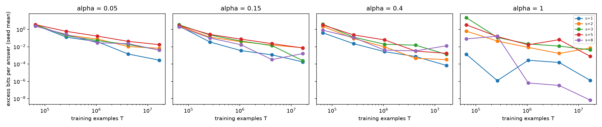

# Results: carry-chain length crossed with alignment (`16_carry_alignment_crossed_arithmetic`)

Carry-chain length c is a structural demand, not Kolmogorov complexity; the law variable is s = c + 1. Intervals are 95% seed-block bootstrap intervals (20,000 draws); p-val=n/a.

## 16b (primary, GPU transformers, 8-digit)

eps* = 0.1 bits per answer; 3 seeds (10 distinct bootstrap resamples).

| Gate | Question | Estimate | Verdict |
|---|---|---|---|
| G1 | Chain length is a real data cost (model-free M_s at top alpha, largest model) | M_s 1.65 [1, 4.5] | **NOT_ESTABLISHED** |
| G2 | Chain length adds held-out value beyond alignment | M_K_coef: 4.04% [2.48%, 5.30%]; held-out level 8.61%; invalid 0 | **NOT_ESTABLISHED** |
| G3a | Coefficient picture | kappa 0.476 [0.448, 0.528]; gamma1 -0.0457 [-0.108, 0.0602]; exp vs coef -1.33% [-1.67%, -1.11%] | **SUPPORTED** |
| G3b | Exponent picture | kappa 0.476 [0.448, 0.528]; gamma1 -0.0457 [-0.108, 0.0602]; exp vs coef -1.33% [-1.67%, -1.11%] | **NOT_ESTABLISHED** |
| G4 | Alignment dominates in units of data (E and E_mf) | E 1.06 [0.905, 1.44]; E_mf 0.997 at eps* 0.1 | **NOT_ESTABLISHED** |
| G5 | Same C3 verdict as exact complexity (Experiments 11, 12) | this: coefficient; others: {'Experiment 11': 'undecided', 'Experiment 12': 'undecided'}; reason: Experiment 11 undecided | **NOT_ESTABLISHED** |
| G6 | Bigger models shrink the chain multiplier | M_s(25M)/M_s(1M) 1.38 [1.22, 1.65]; monotone False | **NOT_ESTABLISHED** |
| G7 | Chain cost needs a sequential output format | log M_s(plain)/log M_s(reversed) -14.8 [-47.9, 2.53] | **NOT_ESTABLISHED** |

**Held-out RMSE (log2 bits), all held-out rows:**

| Law | RMSE | Invalid forecasts |
|---|---|---|
| `M0_scale` | 2.04 [1.96, 2.11] | 0 |
| `M_align_eff` | 1.94 [1.86, 2.01] | 0 |
| `M_align_add` | 5.53 [5.45, 5.6] | 264 |
| `M_K_coef` | 1.86 [1.82, 1.9] | 0 |
| `M_K_exp` | 1.88 [1.85, 1.92] | 0 |
| `M_K_both` | 1.85 [1.82, 1.88] | 0 |

**Fitted `M_K_both` per seed (fit rows):**

| Seed | kappa | gamma0 | gamma1 | eta | beta |
|---|---|---|---|---|---|
| 16101 | 0.448 | 2.012 | -0.090 | 0.399 | 0.428 |
| 16202 | 0.528 | 2.044 | 0.060 | 0.344 | 0.305 |
| 16303 | 0.452 | 2.270 | -0.108 | 0.273 | 0.279 |

**Draft gates of the protocol (reported, not gated):** law-based M_s 1.97 [1.64, 2.32]; M_alpha 2.81 [2.51, 3.21]; range ratio R 1.59 [1.31, 2.07]; rho 1.01 [1.01, 1.02]; gap ratio Delta(4194304)/Delta(65536) -0.000599 [-0.00501, 0.00266].

**Multiplier curves (law-based):** eps 0.03: M_s 2.1, E 0.9641283803430857; eps 0.1: M_s 1.97, E 1.0559734922913848; eps 0.3: M_s 1.86, E 1.1565035486428585; eps 1.0: M_s 1.74, E 1.2912181797401119

**Sensitivity:** {"s_equals_c": {"M_s": 0.7758589991915262, "eta": 0.24052620602422867}, "exact_match_error": {"gamma1": -0.05674454581640475, "kappa": 0.5105064590553141}}

**Per-digit excess at the last checkpoint (top alpha):** {"plain|c0": [3.1576466012961625e-06, 1.760065832980657e-07, 2.3918477045153155e-07, 4.138540840208922e-08, 0.0001969368836413475, 1.9292248125455145e-06, 2.5800447550927283e-07, 1.102257285173862e-07, 1.8284523151533102e-07], "plain|c1": [2.5116615975969123e-07, 0.0020866605316555626, 0.00024713128150495237, 4.270864143819447e-05, 3.46898283007442e-05, 0.00044441772841356613, 0.0004259539177490702, 0.0012693790461650143, 3.6655529263382887e-07], "plain|c2": [7.171681478546303e-05, 0.000429733384873253, 0.0011048287398751251, 0.0011241737633821052, 0.00013521228711538223, 0.002832094263279653, 0.0015607697164954498, 0.0005412761521700057, 1.8986935489425725e-05], "plain|c4": [2.0795479821593065e-05, 0.0018873909840820507, 0.0017511575783229249, 0.0010701476541283637, 0.0006161476025575989, 0.0002113392443007214, 0.00024004750392200264, 0.00020623376651336992, 1.7722322242334762e-05], "plain|c7": [5.120591037659233e-07, 4.6289385061624074e-08, 1.2032699463276792e-08, 5.353232867337561e-09, 6.620135509426279e-09, 8.202206714357985e-09, 4.505007468700912e-09, 4.4349401753780974e-08, 6.248971565592048e-09], "reversed|c0": [2.1129988743376534e-09, 1.2764978705948575e-09, 1.2216970811448416e-09, 1.5765810793878876e-09, 1.4468511443267875e-09, 1.4592687619136306e-09, 1.4704778531890497e-09, 1.5857646163667045e-09, 3.1380883620013817e-09], "reversed|c1": [6.303864103596246e-10, 1.5763370579056888e-09, 1.566725322981003e-09, 1.4100113188819079e-09, 9.395478016171617e-10, 1.2834678788903167e-09, 1.6154358038513799e-09, 1.785497488994849e-09, 6.76369419676781e-10], "reversed|c2": [0.0004585458075308406, 0.00012953210329903102, 1.0539841760402743e-05, 2.5801467339543127e-06, 0.00010815937406381555, 1.4088039233353623e-05, 1.707670122725025e-06, 4.741803628595969e-06, 3.0177259101348215e-06], "reversed|c4": [5.7951843605413174e-08, 6.406308347768181e-08, 6.475349929448172e-06, 4.887064264948313e-07, 3.3271738327152334e-06, 1.477114196142742e-07, 1.8304311202733826e-05, 1.8631975453592164e-06, 0.0022672657436702127], "reversed|c7": [4.349472219915122e-06, 2.4017270568007517e-05, 2.9655517508381905e-06, 1.7302404479719404e-09, 5.8386932525072637e-05, 4.232814297459684e-09, 1.7655168926589379e-09, 5.585478000005799e-06, 2.3333454638059566e-10]}

**Independent fitter:** AGREE (max relative difference 7.36e-09).

## 16a (secondary, CPU MLP, 3-digit)

eps* = 4.95 bits per answer; 8 seeds (6435 distinct bootstrap resamples).

| Gate | Question | Estimate | Verdict |
|---|---|---|---|
| G1 | Chain length is a real data cost (model-free M_s at top alpha, largest model) | M_s 1.01 [0.992, 1.03] | **NOT_ESTABLISHED** |
| G2 | Chain length adds held-out value beyond alignment | M_K_exp: 0.03% [-0.04%, 0.11%]; held-out level -0.01%; invalid 0 | **NOT_ESTABLISHED** |
| G3a | Coefficient picture | kappa -3.41e-05 [-0.00499, 0.00414]; gamma1 -0.00347 [-0.0216, 0.0134]; exp vs coef 0.02% [-0.03%, 0.08%] | **NOT_ESTABLISHED** |
| G3b | Exponent picture | kappa -3.41e-05 [-0.00499, 0.00414]; gamma1 -0.00347 [-0.0216, 0.0134]; exp vs coef 0.02% [-0.03%, 0.08%] | **NOT_ESTABLISHED** |
| G4 | Alignment dominates in units of data (E and E_mf) | E 22.4 [18.1, 28.9]; E_mf 9.62 at eps* 4.95 | **SUPPORTED** |
| G5 | Same C3 verdict as exact complexity (Experiments 11, 12) | this: unresolved; others: {'Experiment 11': 'undecided', 'Experiment 12': 'undecided'}; reason: this experiment undecided | **NOT_ESTABLISHED** |

**Held-out RMSE (log2 bits), all held-out rows:**

| Law | RMSE | Invalid forecasts |
|---|---|---|
| `M0_scale` | 1.87 [1.81, 1.92] | 0 |
| `M_align_eff` | 1.71 [1.66, 1.76] | 0 |
| `M_align_add` | 3.01 [2.86, 3.15] | 225 |
| `M_K_coef` | 1.71 [1.66, 1.76] | 0 |
| `M_K_exp` | 1.71 [1.66, 1.76] | 0 |
| `M_K_both` | 1.71 [1.66, 1.76] | 0 |

**Fitted `M_K_both` per seed (fit rows):**

| Seed | kappa | gamma0 | gamma1 | eta | beta |
|---|---|---|---|---|---|
| 16101 | 0.007 | 0.926 | -0.047 | 0.375 | 1.911 |
| 16202 | 0.001 | 0.981 | -0.021 | 0.384 | 1.815 |
| 16303 | 0.006 | 0.951 | 0.029 | 0.380 | 1.874 |
| 16404 | -0.009 | 0.925 | 0.009 | 0.370 | 1.668 |
| 16505 | -0.013 | 0.996 | 0.019 | 0.365 | 1.785 |
| 16606 | 0.005 | 0.863 | -0.034 | 0.404 | 1.864 |
| 16707 | 0.002 | 0.990 | 0.007 | 0.408 | 1.852 |
| 16808 | 0.001 | 0.935 | 0.009 | 0.390 | 2.226 |

**Draft gates of the protocol (reported, not gated):** law-based M_s 1.03 [1.02, 1.03]; M_alpha 3.2 [3.12, 3.29]; range ratio R 51.3 [39, 65.9]; rho 1 [0.999, 1]; gap ratio Delta(256000)/Delta(25600) -0.708 [-3.16, 1.97].

**Multiplier curves (law-based):** eps 0.03: M_s 1.8, E 0.9804733053105771; eps 0.1: M_s 1.58, E 1.2658993134948746; eps 0.3: M_s 1.4, E 1.723801618169306; eps 1.0: M_s 1.22, E 2.855920368896297

**Sensitivity:** {"s_equals_c": {"M_s": 0.8814136693125153, "eta": 0.5015173938230046}, "exact_match_error": {"gamma1": -0.1259853891085998, "kappa": 0.06501181202857556}}

**Per-digit excess at the last checkpoint (top alpha):** {"mlp|cascade": [0.01856124654015626, 0.04041482680101715, 0.0028184790341988985, 4.205605782844566e-12], "mlp|isolated": [0.32509182737717235, 0.1551288984973647, 0.007373645944051167, 1.490781238658744e-10], "mlp|nocarry": [0.01580908712251037, 0.0216046319654539, 0.0030038276896150124, 5.528662273032869e-14]}

**Independent fitter:** AGREE (max relative difference 2.23e-07).

**Column-carry rates per mix (confound, logged):**

| Target | alpha | units | tens |
|---|---|---|---|
| cascade | 0.1 | 0.3250 | 0.3250 |
| cascade | 0.33 | 0.4975 | 0.4975 |
| cascade | 0.6 | 0.7000 | 0.7000 |
| cascade | 0.9 | 0.9250 | 0.9250 |
| isolated | 0.1 | 0.5000 | 0.5000 |
| isolated | 0.33 | 0.5000 | 0.5000 |
| isolated | 0.6 | 0.5000 | 0.5000 |
| isolated | 0.9 | 0.5000 | 0.5000 |
| nocarry | 0.1 | 0.6750 | 0.6750 |
| nocarry | 0.33 | 0.5025 | 0.5025 |
| nocarry | 0.6 | 0.3000 | 0.3000 |
| nocarry | 0.9 | 0.0750 | 0.0750 |

