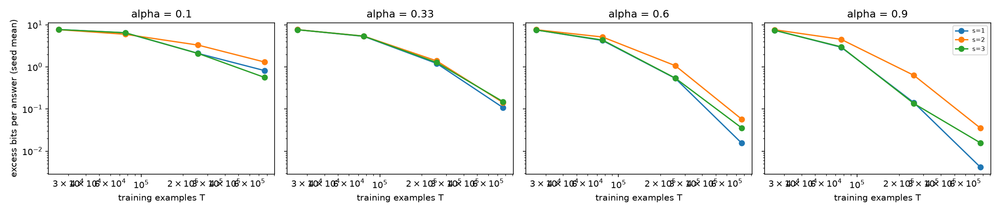

# Results: carry-chain length crossed with alignment (`16_carry_alignment_crossed_arithmetic`)

Carry-chain length c is a structural demand, not Kolmogorov complexity; the law variable is s = c + 1. Intervals are 95% seed-block bootstrap intervals (20,000 draws); p-val=n/a.

## 16b (primary, GPU transformers, 8-digit)

transformer: pending, not run.

## 16a (secondary, CPU MLP, 3-digit)

eps* = 4.95 bits per answer; 8 seeds (6435 distinct bootstrap resamples).

| Gate | Question | Estimate | Verdict |
|---|---|---|---|
| G1 | Chain length is a real data cost (model-free M_s at top alpha, largest model) | M_s 1.01 [0.992, 1.03] | **NOT_ESTABLISHED** |
| G2 | Chain length adds held-out value beyond alignment | M_K_exp: 0.03% [-0.04%, 0.11%]; held-out level -0.01%; invalid 0 | **NOT_ESTABLISHED** |
| G3a | Coefficient picture | kappa -3.41e-05 [-0.00499, 0.00414]; gamma1 -0.00347 [-0.0216, 0.0134]; exp vs coef 0.02% [-0.03%, 0.08%] | **NOT_ESTABLISHED** |
| G3b | Exponent picture | kappa -3.41e-05 [-0.00499, 0.00414]; gamma1 -0.00347 [-0.0216, 0.0134]; exp vs coef 0.02% [-0.03%, 0.08%] | **NOT_ESTABLISHED** |
| G4 | Alignment dominates in units of data (E and E_mf) | E 22.4 [18.1, 28.9]; E_mf 9.62 at eps* 4.95 | **SUPPORTED** |
| G5 | Same C3 verdict as exact complexity (Experiments 11, 12) | this: unresolved; others: {'Experiment 11': 'undecided', 'Experiment 12': 'undecided'}; reason: this experiment undecided | **NOT_ESTABLISHED** |

**Held-out RMSE (log2 bits), all held-out rows:**

| Law | RMSE | Invalid forecasts |
|---|---|---|
| `M0_scale` | 1.87 [1.81, 1.92] | 0 |
| `M_align_eff` | 1.71 [1.66, 1.76] | 0 |
| `M_align_add` | 3.01 [2.86, 3.15] | 225 |
| `M_K_coef` | 1.71 [1.66, 1.76] | 0 |
| `M_K_exp` | 1.71 [1.66, 1.76] | 0 |
| `M_K_both` | 1.71 [1.66, 1.76] | 0 |

**Fitted `M_K_both` per seed (fit rows):**

| Seed | kappa | gamma0 | gamma1 | eta | beta |
|---|---|---|---|---|---|
| 16101 | 0.007 | 0.926 | -0.047 | 0.375 | 1.911 |
| 16202 | 0.001 | 0.981 | -0.021 | 0.384 | 1.815 |
| 16303 | 0.006 | 0.951 | 0.029 | 0.380 | 1.874 |
| 16404 | -0.009 | 0.925 | 0.009 | 0.370 | 1.668 |
| 16505 | -0.013 | 0.996 | 0.019 | 0.365 | 1.785 |
| 16606 | 0.005 | 0.863 | -0.034 | 0.404 | 1.864 |
| 16707 | 0.002 | 0.990 | 0.007 | 0.408 | 1.852 |
| 16808 | 0.001 | 0.935 | 0.009 | 0.390 | 2.226 |

**Draft gates of the protocol (reported, not gated):** law-based M_s 1.03 [1.02, 1.03]; M_alpha 3.2 [3.12, 3.29]; range ratio R 51.3 [39, 65.9]; rho 1 [0.999, 1]; gap ratio Delta(256000)/Delta(25600) -0.708 [-3.16, 1.97].

**Multiplier curves (law-based):** eps 0.03: M_s 1.8, E 0.9804733053105771; eps 0.1: M_s 1.58, E 1.2658993134948746; eps 0.3: M_s 1.4, E 1.723801618169306; eps 1.0: M_s 1.22, E 2.855920368896297

**Sensitivity:** {"s_equals_c": {"M_s": 0.8814136693125153, "eta": 0.5015173938230046}, "exact_match_error": {"gamma1": -0.1259853891085998, "kappa": 0.06501181202857556}}

**Per-digit excess at the last checkpoint (top alpha):** {"mlp|cascade": [0.01856124654015626, 0.04041482680101715, 0.0028184790341988985, 4.205605782844566e-12], "mlp|isolated": [0.32509182737717235, 0.1551288984973647, 0.007373645944051167, 1.490781238658744e-10], "mlp|nocarry": [0.01580908712251037, 0.0216046319654539, 0.0030038276896150124, 5.528662273032869e-14]}

**Independent fitter:** AGREE (max relative difference 2.23e-07).

**Column-carry rates per mix (confound, logged):**

| Target | alpha | units | tens |
|---|---|---|---|
| cascade | 0.1 | 0.3250 | 0.3250 |
| cascade | 0.33 | 0.4975 | 0.4975 |
| cascade | 0.6 | 0.7000 | 0.7000 |
| cascade | 0.9 | 0.9250 | 0.9250 |
| isolated | 0.1 | 0.5000 | 0.5000 |
| isolated | 0.33 | 0.5000 | 0.5000 |
| isolated | 0.6 | 0.5000 | 0.5000 |
| isolated | 0.9 | 0.5000 | 0.5000 |
| nocarry | 0.1 | 0.6750 | 0.6750 |
| nocarry | 0.33 | 0.5025 | 0.5025 |
| nocarry | 0.6 | 0.3000 | 0.3000 |
| nocarry | 0.9 | 0.0750 | 0.0750 |

