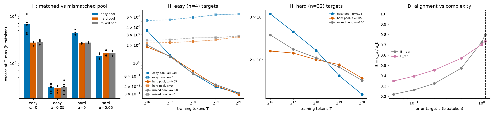

# Results: Experiment 17, Putnam vs GSM8K (hard-to-easy) and Putnam vs poetry (disjoint support), synthetic

Protocol: `PROTOCOL.md` (frozen in commit 121179af before any gated run). 96 gated runs, 3 seeds, T up to 2^20 tokens, 354k-parameter transformer, Experiment 13-small's GINC-style HMMs. Every number below is regenerated by `expt_v1/verify.py`.

## Takeaway

1. **Training only on hard concepts did not lose to easy-only training on easy targets. Zero-shot, it won by a lot.** The prediction was the opposite. Without any target data, the excess on easy (n = 4) targets was 2.75 bits/token after hard-only training and 6.71 after easy-only training (0/6 pairs favour easy). The mixed pool (2.84) matched hard-only. Easy-only training also got *worse* on new easy targets as it trained longer (5.2 → 6.7): it overfits a narrow pool. Hard data did not lose on hard targets either: zero-shot it beat easy data there as well (2.63 vs 4.49, 6/6 pairs).
2. **Much of that zero-shot win is support coverage, not "difficulty".** Each n = 4 concept emits only 11–15 of the 32 tokens, and a new easy target uses a different subset. Each n = 32 concept emits 31–32. A model trained only on easy concepts has never learned to spread mass over the tokens the new target needs. In this family "harder" also means "broader". The two can't be separated here without a coverage-matched easy pool.
3. **With 5% target data, which pool you train on barely matters for easy targets** (0.31 easy, 0.29 hard, 0.31 mixed; NOT_ESTABLISHED). **For hard targets, the easy pool wins by T = 2^20** (1.44 vs 1.68 bits/token, 6/6 pairs), although the hard pool led until about 2^18. Cheap filler data leaves capacity for the target, while hard filler competes for it. So no pool wins everywhere: the ranking flips with α and T. That is "not a total order" in a weak sense. The pre-registered gates H1 and H2 are still NOT_ESTABLISHED, because the zero-shot result goes the other way.
4. **Disjoint support (Putnam/poetry):** zero-shot, data on disjoint tokens buys nothing (excess 27.9 vs 2.8 bits/token, D1 SUPPORTED). With some target data, disjoint data *beats* same-token data (at α = 0.05, far − near = −0.22 bits/token, 9/12 pairs). It interferes less. **Alignment still does not dominate complexity under genuine mismatch:** E_far = 0.73 (every seed < 1), below E_near = 0.80. That reproduces Experiment 13-small's 0.80. D2 is NOT_ESTABLISHED (reverse) and D3 is NOT_ESTABLISHED (−0.07).

What it means for G5: the strong form of the alignment hypothesis does not rescue E > 1. Within the family and across disjoint support alike, complexity moves the data bill more than alignment does at this scale. Brando's intuition still holds zero-shot: Putnam data alone buys no poetry, and alignment matters absolutely there. But once a little target data is in the mix, misaligned data is cheap filler, not a tax.

## Tables (generated by `expt_v1/report.py`, checked by `verify.py`)

### Arm H (primary): hard -> easy, same family (T_max = 1,048,576 tokens)

Δ = excess(mismatched pool) − excess(matched pool) at T_max, bits/token; positive = the matched pool wins. Intervals: two-stage bootstrap over seeds and targets.

| Targets | α | mismatched − matched | 95% interval | pairs > 0 | log2 ratio | excess: easy pool | hard pool | mixed pool | verdict |
|---|---|---|---|---|---|---|---|---|---|
| easy (n = 4) | 0 | -3.961 | [-6.347, -1.978] | 0/6 | -1.210 | 6.712 | 2.752 | 2.839 | MISMATCHED_POOL_BETTER |
| easy (n = 4) | 0.05 | -0.014 | [-0.065, 0.032] | 3/6 | -0.061 | 0.307 | 0.293 | 0.311 | NOT_ESTABLISHED |
| hard (n = 32) | 0 | 1.854 | [1.497, 2.273] | 6/6 | 0.764 | 4.488 | 2.634 | 2.757 | MATCHED_POOL_BETTER |
| hard (n = 32) | 0.05 | -0.238 | [-0.297, -0.183] | 0/6 | -0.220 | 1.439 | 1.677 | 1.642 | MISMATCHED_POOL_BETTER |

**H1 hard does not subsume easy: NOT_ESTABLISHED. H2 crossover: NOT_ESTABLISHED.**

Worth of each pool in target-only tokens (median over seeds of the α = 1 tokens reaching the same excess; "<" below the first checkpoint, ">" beyond the last):

| Target | α | easy pool | hard pool | mixed pool |
|---|---|---|---|---|
| hmm_n004_t1 | 0 | <64k | <64k | <64k |
| hmm_n004_t1 | 0.05 | 66k | <64k | 65k |
| hmm_n004_t2 | 0 | <64k | <64k | <64k |
| hmm_n004_t2 | 0.05 | <64k | <64k | <64k |
| hmm_n032_t1 | 0 | <64k | <64k | <64k |
| hmm_n032_t1 | 0.05 | 72k | <64k | <64k |
| hmm_n032_t2 | 0 | <64k | <64k | <64k |
| hmm_n032_t2 | 0.05 | 80k | <64k | 66k |

Δ at every checkpoint (mean over pairs, bits/token):

| Targets | α | 2^16 | 2^17 | 2^18 | 2^19 | 2^20 |
|---|---|---|---|---|---|---|
| easy | 0 | -3.057 | -3.144 | -3.563 | -4.055 | -3.961 |
| easy | 0.05 | -1.681 | -0.057 | 0.070 | 0.023 | -0.014 |
| hard | 0 | 1.271 | 1.156 | 1.428 | 1.841 | 1.854 |
| hard | 0.05 | 0.912 | 0.475 | 0.184 | -0.190 | -0.238 |

### Arm D (secondary): disjoint support (ε* = 1.13 bits/token)

| Quantity | Estimate | 95% interval | Verdict |
|---|---|---|---|
| D1 zero-shot excess, far − near (far 27.860, near 2.798) | 25.062 | [24.771, 25.395] (12/12 > 0) | SUPPORTED |
| excess at T_max, far − near, α = 0.05 | -0.220 | [-0.331, -0.114] (3/12 > 0) | reported |
| excess at T_max, far − near, α = 0.4 | -0.030 | [-0.053, -0.008] (3/12 > 0) | reported |
| E_near = e_α/e_K (M_K_both, K in bits) | 0.801 | seed [0.799, 0.804]; per seed 0.799, 0.804, 0.801 | reported |
| E_far = e_α/e_K (M_K_both, K in bits) | 0.734 | seed [0.693, 0.757]; per seed 0.693, 0.753, 0.757 | NOT_ESTABLISHED (reverse: E_far < 1) |
| D3 E_far − E_near | -0.067 | per seed -0.105, -0.051, -0.043 | NOT_ESTABLISHED |
| η (M_align_eff), near / far | 0.974 / 0.790 | — | reported |
| model-free E_near (T* interpolated; 0 α pairs, 0 K pairs, 12 censored) | n/a | — | reported |
| model-free E_far (T* interpolated; 2 α pairs, 0 K pairs, 10 censored) | n/a | — | reported |

E across the error target:

| ε | 0.05 | 0.1 | 0.2 | 0.5 | 1 | 1.13 |
|---|---|---|---|---|---|---|
| E_near | 0.220 | 0.262 | 0.325 | 0.474 | 0.726 | 0.801 |
| E_far | 0.349 | 0.395 | 0.455 | 0.570 | 0.704 | 0.734 |

Cell means of excess at T_max (bits/token):

| Pool | n | α | excess |
|---|---|---|---|
| easy | 32 | 0.00 | 4.488 |
| easy | 32 | 0.05 | 1.439 |
| easy | 4 | 0.00 | 6.712 |
| easy | 4 | 0.05 | 0.307 |
| far | 32 | 0.00 | 28.003 |
| far | 32 | 0.05 | 1.248 |
| far | 32 | 0.40 | 0.923 |
| far | 4 | 0.00 | 27.717 |
| far | 4 | 0.05 | 0.265 |
| far | 4 | 0.40 | 0.134 |
| hard | 32 | 0.00 | 2.634 |
| hard | 32 | 0.05 | 1.677 |
| hard | 4 | 0.00 | 2.752 |
| hard | 4 | 0.05 | 0.293 |
| near | 32 | 0.00 | 2.757 |
| near | 32 | 0.05 | 1.642 |
| near | 32 | 0.40 | 0.983 |
| near | 4 | 0.00 | 2.839 |
| near | 4 | 0.05 | 0.311 |
| near | 4 | 0.40 | 0.135 |
| none | 32 | 1.00 | 0.799 |
| none | 4 | 1.00 | 0.107 |

Training-pool excess at T_max (sanity: every run learned its own pool): mean 0.744, max 1.749 bits/token over 672 pool-concept evaluations.

## Deviations and run notes

- None from the frozen protocol. The grid ran in two resume-safe chunks (48 runs in 6,211 s, then 48 in 5,199 s; cumulative 11,410 s of the 21,600 s cap). The box carried a background load of 5–9 from other jobs, so throughput was 4.4–5.9k train tokens/s per worker. Wall time only, results unaffected. No run diverged. Every run learned its own pool (pool excess at T_max: mean 0.74, max 1.75 bits/token).
- Not pre-registered, reported after seeing results: distinct emitted tokens per concept (n = 4: 11–15 of 32; n = 8: 21; n = 16: 28–29; n = 32: 31–32), from `results/tasks.json`. This is the coverage reading in Takeaway 2.
- The model-free E (interpolated T*) is n/a in both arms: at α = 0.05 the target-only curve censors most matches below 2^16.

## Limits

Synthetic HMMs, 354k parameters and at most 2^20 tokens are far from Putnam and GSM8K. Here "easy" vs "hard" is certified state count, and it is confounded with token coverage (Takeaway 2). Three seeds. The natural follow-ups are (a) the same arm with a coverage-matched easy pool (n = 4 concepts constrained to cover all 32 tokens), which separates difficulty from breadth, and (b) the real-LLM Putnam-vs-GSM8K arm in `experiments/gpu/`.
