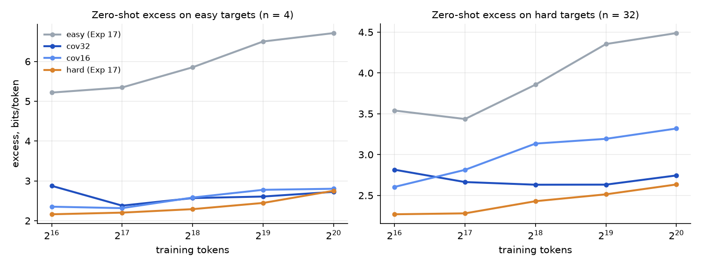

# Results: Experiment 17b, coverage-matched easy pools for Experiment 17's arm H (hard → easy), synthetic

Protocol: `PROTOCOL_exp17b.md` (frozen in commit a101e88f before any gated run). 30 new gated runs (2 pools × 3 seeds × 5 runs), T up to 2^20 tokens, Experiment 17's 354k-parameter transformer, targets, compute and seeds; the hard, easy, mixed and α = 1 runs are Experiment 17's, reused. Every number below is regenerated by `expt_v2_coverage/verify_v2.py`.

## Takeaway

1. **Once the easy pool covers the tokens, hard-only training no longer beats easy-only training zero-shot on easy targets.** Primary answer (Q): **NO RELIABLE DIFFERENCE.** Zero-shot excess on new easy (n = 4) targets at T = 2^20: 2.72 bits/token after training on the coverage-matched cov32 pool, 2.75 after hard-only training (matched-pool advantage +0.03, 95% interval [−0.38, 0.35], 3/6 pairs). Experiment 17's easy pool left 6.71. The secondary pool gives the same answer (cov16 2.80; −0.05 [−0.17, 0.07], 2/6).
2. **Coverage closed the whole gap, not part of it.** Share of Experiment 17's zero-shot gap closed: 1.01 [0.94, 1.18] for cov32 and 0.99 [0.96, 1.02] for cov16. The prediction (at least half) held for both pools. So Experiment 17's ~4 bits/token "hard data transfers better" win was a token-coverage confound, not difficulty.
3. **Per-concept breadth was not needed either** (post hoc, not gated). cov16 is Experiment 17's exact easy family, 16 tokens per concept (per-concept token perplexity 10.9 vs the old pool's 9.3, the hard pool's 23.9), and it closes the gap as fully as cov32 does. What changed is the pool: every token emitted by 4 of 8 concepts (pool token perplexity 29.4 vs 25.2). This reading came after the results and the disclosed pre-freeze candidate was per-concept breadth.
4. **Hard-only still leads early, and the lead fades with training** (reported, not gated). On easy targets zero-shot, the hard pool is ahead of cov32 by 0.71 bits/token at 2^16 and by 0.16 at 2^19, and level at 2^20. Part of the convergence is the hard pool getting worse as it trains (2.17 → 2.75), as every pool here does zero-shot.
5. **With 5% target data, pool choice still barely matters on easy targets** (cov32 0.28, cov16 0.31, hard 0.29, easy 0.31). **On hard targets both cheap n = 4 pools beat the hard pool at T = 2^20** (cov32 1.51, cov16 1.45 vs hard 1.68 bits/token, 0/6 pairs for hard each), as predicted and as in Experiment 17. Zero-shot on hard targets the hard pool beats cov16 (0.69, 6/6) but not cov32 (0.11 [−0.02, 0.24], 4/6).
6. Gates: H1′ (hard does not subsume easy) and H2′ (crossover) are NOT_ESTABLISHED for both pools.

What it means for the difficulty confound: in this family "harder" training data looked better zero-shot only because it also covered the alphabet better. With coverage matched, 4-state and 32-state training pools are interchangeable for easy targets, and with a little target data the cheap 4-state pools are better for hard targets too. There is still no evidence here that difficulty itself is what transfers.

## Tables (generated by `expt_v2_coverage/report_v2.py`, checked by `verify_v2.py`)

### Gates

| Pool | Q: hard-only still beats it zero-shot on easy targets? | H1′ hard does not subsume easy | H2′ crossover |
|---|---|---|---|
| cov32 (primary) | NO RELIABLE DIFFERENCE | NOT_ESTABLISHED | NOT_ESTABLISHED |
| cov16 | NO RELIABLE DIFFERENCE | NOT_ESTABLISHED | NOT_ESTABLISHED |

### Contrasts at T_max = 1,048,576 tokens (positive = the matched pool wins)

| Pool | Targets | α | matched − mismatched advantage | 95% interval | pairs > 0 | log2 ratio | verdict |
|---|---|---|---|---|---|---|---|
| cov32 | easy (n = 4) | 0 | 0.027 | [-0.375, 0.351] | 3/6 | 0.034 | NOT_ESTABLISHED |
| cov32 | easy (n = 4) | 0.05 | 0.010 | [-0.000, 0.023] | 4/6 | 0.061 | NOT_ESTABLISHED |
| cov32 | hard (n = 32) | 0 | 0.111 | [-0.024, 0.242] | 4/6 | 0.058 | NOT_ESTABLISHED |
| cov32 | hard (n = 32) | 0.05 | -0.165 | [-0.204, -0.132] | 0/6 | -0.149 | MISMATCHED_POOL_BETTER |
| cov16 | easy (n = 4) | 0 | -0.051 | [-0.168, 0.068] | 2/6 | -0.029 | NOT_ESTABLISHED |
| cov16 | easy (n = 4) | 0.05 | -0.017 | [-0.046, 0.006] | 1/6 | -0.067 | NOT_ESTABLISHED |
| cov16 | hard (n = 32) | 0 | 0.685 | [0.545, 0.816] | 6/6 | 0.333 | MATCHED_POOL_BETTER |
| cov16 | hard (n = 32) | 0.05 | -0.223 | [-0.286, -0.147] | 0/6 | -0.200 | MISMATCHED_POOL_BETTER |

### Mean excess at T_max by training pool (bits/token; 3 seeds × 2 targets)

| Targets | α | easy (Exp 17) | cov32 | cov16 | hard (Exp 17) | mixed (Exp 17) |
|---|---|---|---|---|---|---|
| easy | 0 | 6.712 | 2.724 | 2.803 | 2.752 | 2.839 |
| easy | 0.05 | 0.307 | 0.283 | 0.310 | 0.293 | 0.311 |
| hard | 0 | 4.488 | 2.744 | 3.319 | 2.634 | 2.757 |
| hard | 0.05 | 1.439 | 1.512 | 1.454 | 1.677 | 1.642 |

Zero-shot (α = 0) excess per target at T_max, mean over seeds (`hmm_n004_t1` uses token 18, which the Exp 17 easy pool never emits):

| Target | easy (Exp 17) | cov32 | cov16 | hard (Exp 17) | mixed (Exp 17) |
|---|---|---|---|---|---|
| hmm_n004_t1 | 5.039 | 2.283 | 2.727 | 2.680 | 2.964 |
| hmm_n004_t2 | 8.386 | 3.166 | 2.879 | 2.824 | 2.714 |
| hmm_n032_t1 | 4.206 | 2.622 | 3.397 | 2.649 | 2.817 |
| hmm_n032_t2 | 4.770 | 2.867 | 3.241 | 2.619 | 2.698 |

Share of the Exp 17 zero-shot gap closed on easy targets, (ε_easy − ε_P)/(ε_easy − ε_hard), and ε_easy − ε_P:

| Pool | gap closed (α = 0) | 95% interval | easy − P, α = 0 | easy − P, α = 0.05 |
|---|---|---|---|---|
| cov32 | 1.007 | [0.936, 1.180] | 3.988 [2.349, 6.052] | 0.025 [-0.020, 0.083] |
| cov16 | 0.987 | [0.956, 1.023] | 3.910 [2.031, 6.302] | -0.002 [-0.070, 0.069] |

Advantage at every checkpoint (mean over pairs, bits/token; positive = matched pool wins):

| Pool | Targets | α | 2^16 | 2^17 | 2^18 | 2^19 | 2^20 |
|---|---|---|---|---|---|---|---|
| cov32 | easy | 0 | -0.714 | -0.175 | -0.278 | -0.161 | 0.027 |
| cov32 | easy | 0.05 | -0.358 | -0.070 | 0.040 | 0.013 | 0.010 |
| cov32 | hard | 0 | 0.546 | 0.384 | 0.202 | 0.119 | 0.111 |
| cov32 | hard | 0.05 | 0.468 | 0.040 | -0.031 | -0.171 | -0.165 |
| cov16 | easy | 0 | -0.191 | -0.112 | -0.292 | -0.330 | -0.051 |
| cov16 | easy | 0.05 | -0.001 | 0.136 | -0.021 | -0.037 | -0.017 |
| cov16 | hard | 0 | 0.335 | 0.533 | 0.706 | 0.680 | 0.685 |
| cov16 | hard | 0.05 | 0.298 | 0.278 | 0.090 | -0.158 | -0.223 |

Worth of each new pool in target-only tokens (median over seeds; "<" below 2^16, ">" beyond 2^20):

| Target | α | cov32 | cov16 |
|---|---|---|---|
| hmm_n004_t1 | 0 | <64k | <64k |
| hmm_n004_t1 | 0.05 | 70k | 65k |
| hmm_n004_t2 | 0 | <64k | <64k |
| hmm_n004_t2 | 0.05 | <64k | <64k |
| hmm_n032_t1 | 0 | <64k | <64k |
| hmm_n032_t1 | 0.05 | 69k | 74k |
| hmm_n032_t2 | 0 | <64k | <64k |
| hmm_n032_t2 | 0.05 | 75k | 76k |

Training-pool excess at T_max (sanity: every new run learned its own pool): mean 0.185, max 0.283 bits/token over 240 pool-concept evaluations.

## Deviations and run notes

- None from the frozen protocol. The grid ran in one resume-safe chunk, 30/30 runs, cumulative 6,912 s of the 21,600 s cap, 3 workers. Experiment 21's grid (AT-540) ran on the same 4 cores at the same time (load 9–12), so throughput was 2.2–3.3k train tokens/s per worker. Wall time only, results unaffected (seeded). No run diverged. Every new run learned its own pool (pool excess at T_max: mean 0.19, max 0.28 bits/token).
- Not pre-registered, reported after seeing results: the pool-level reading in Takeaway 3.
- Numbering: this is "Experiment 17b" in Experiment 17's folder, because `experiments/18_*` and Experiment 19 already exist.

## Limits

Same as Experiment 17: synthetic HMMs, 354k parameters, at most 2^20 tokens, three seeds, two targets per difficulty. Coverage is matched in support, not in effective breadth or entropy: cov32 runs 0.2–0.5 bits/token above h_ref, and its token distribution is half as broad as the hard pool's. The new concepts' disjoint emission sets make their states visible from their tokens, which the targets' states are not. The gate is at T_max only; the hard pool's early lead (Takeaway 4) is descriptive.
