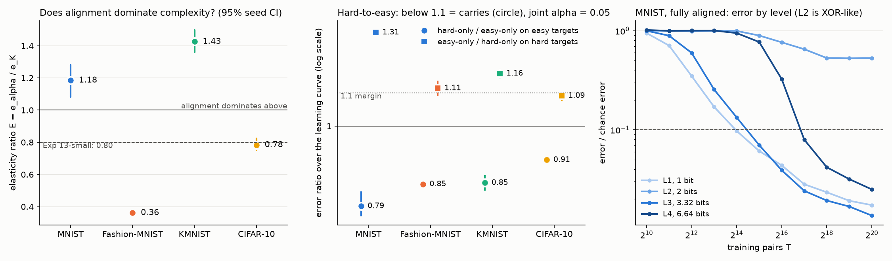

# Results: vision replication of complexity versus alignment and hard-to-easy transfer (Experiment 18)

Status: results. Protocol frozen in commit 9cd4eef4 (after two disclosed pilots, Section 6.1); cluster versions Section 6.2; verification fixes Section 8.1. 1,072 of 1,072 runs, four seeds, Sherlock `normal` CPU partition. Every number below is read from `expt_v1/results/analysis.json`, and `expt_v1/verify.py` checks that (results in `expt_v1/results/verify.json`).

## Takeaway

1. **Experiment 13-small's direction does not replicate as a general rule; it splits by dataset.** On MNIST ($E$ = 1.18 [1.08, 1.28]) and KMNIST (1.43 [1.36, 1.50]) alignment dominates complexity (G4 `SUPPORTED`, headline `OPPOSITE`); on Fashion-MNIST (0.36 [0.35, 0.37]) and CIFAR-10 (0.78 [0.75, 0.82]) complexity dominates (`SAME_DIRECTION`, as in Experiment 13-small's 0.80). $E$ also moves with the error threshold it is read at (MNIST 1.34 at $\varepsilon$ = 0.05 down to 0.97 at 0.4; KMNIST 0.96 up to 1.57). The pattern follows how costly the hardest labels are for the network: where the L4 sums are easy to learn (MNIST, error/chance 0.03 at $\alpha$ = 1) alignment dominates, where they are hard (Fashion-MNIST 0.24, CIFAR-10 0.56) complexity does. So which axis "dominates" is a property of the task, learner and threshold, not a fixed ordering.
2. **Complexity is real everywhere, but a complexity law forecasts held-out data only on the harder datasets.** G1 `SUPPORTED` in all four (data cost of L4 over L1 at $\alpha$ = 1: MNIST 7.5×, KMNIST 5.2×, CIFAR-10 15.9×, Fashion-MNIST 73.5×). G2 `SUPPORTED` on Fashion-MNIST (+35.7%) and CIFAR-10 (+19.5%), `NOT_ESTABLISHED` on MNIST (−19.7%) and KMNIST (−46.5%), where the alignment-only law forecasts the held-out rows better.
3. **Hard-only training carries the easy end at matched compute in all four datasets (GH1 `CARRIES`).** On the two held-out easy targets, with 5% target data, hard-only error is 0.80× easy-only on MNIST, 0.85× on Fashion-MNIST and KMNIST and 0.91× on CIFAR-10 over the learning curve (0.72 to 0.74× at the last checkpoint); with a linear probe on frozen features 0.36× to 0.87×. Mixed pools track hard-only on hard targets (0.99 to 1.04×). Easy-only fails to carry the hard end on MNIST (1.31×) and KMNIST (1.16×), GH2 `SUPPORTED`; on Fashion-MNIST (1.11 [1.09, 1.14]) and CIFAR-10 (1.09 [1.08, 1.10]) GH2 is `NOT_ESTABLISHED`.
4. **What carries is what the network learned, not nominal difficulty.** Here the additive hard pool must identify both class indices, which determines every easy target, while the easy pool (parities, thresholds) does not: the coverage effect Experiment 17b found, not difficulty as such. The control says so directly: the hard-mod pool has the same label complexity (6.64 bits) and is just as sufficient on paper, but its XOR-like mod-10 targets learn slowly, and it does worse than easy-only on easy targets (1.34× on MNIST, 1.18× KMNIST, 1.10× CIFAR-10, 1.02× Fashion-MNIST) and 1.2 to 1.7× worse than the additive hard pool.
5. **Equal bits, very different learnability, in both directions.** The 2-bit XOR-like targets of L2 (parity of $a+b$; $[a \ge 5] \oplus [b \ge 5]$) are still at chance at $\alpha$ = 1 after $2^{20}$ pairs on KMNIST (error/chance 0.996, 0.995) and CIFAR-10 (0.993, 0.989), and $[a \ge 5] \oplus [b \ge 5]$ on MNIST (1.01), while the 6.64-bit sums of L4 learn on every dataset (MNIST 0.025, KMNIST 0.153, CIFAR-10 0.487). $(a+b) \bmod 10$, also 6.64 bits, trained alone at $\alpha$ = 1 leaves chance in 3 of 4 MNIST seeds, 4 of 4 Fashion-MNIST, 0 of 4 KMNIST and 0 of 4 CIFAR-10. Exact label complexity in bits does not order difficulty for these networks; the levels' ordering only holds where the target has first-order signal from each image. The learning-regime filter keeps those plateau rows out of the fits, so the elasticity grid's complexity axis rests mainly on L1, L3 and L4. This is the difficulty-confound point in a second modality.
6. **Mismatch type matters a lot** (MNIST, 2 seeds, descriptive). Stroke thickening or thinning barely costs data ($\eta$ 0.19 to 0.23, $E$ 0.30 to 0.32); rotation, half scale and swapping in Fashion-MNIST or KMNIST cost much more ($\eta$ 0.66 to 0.96, $E$ 0.89 to 1.17). The Fashion-MNIST swap has the largest $\eta$, as predicted.

**Predictions (Section 5.1, amended before any gated run) against the gates.** Right: G1 `SUPPORTED` in all four; $M_K$ within 3 to 10× on MNIST and KMNIST; CIFAR-10 `SAME_DIRECTION`; GH1 `CARRIES` everywhere; the swaps have the largest $\eta$ and $E$. Wrong: headline `SAME_DIRECTION` with $E$ 0.4 to 0.9 on the MNIST family (MNIST and KMNIST came out `OPPOSITE`, Fashion-MNIST same direction but 0.36); Fashion-MNIST $M_K$ (73.5×, not 3 to 10×); GH2 holds in 2 of 4; the mod-10 anchor left the plateau in most MNIST and all Fashion-MNIST seeds; no prediction foresaw the L2 XOR targets staying at chance; hard-mod features were about as good as random ones for the held-out probes over the curve, not worse.

## Elasticity grid (main arm, rotation mismatch)

| Dataset | runs | eps* | G1 M_K (L4/L1, alpha=1) | G1 | G2 RMSE cut | G2 | E (K in bits) | E (K as classes) | E model-free | G4 | vs Exp 13-small |
|---|---|---|---|---|---|---|---|---|---|---|---|
| MNIST | 128/128 | 0.1 | 7.53 [6.38, 8.87] | SUPPORTED | -19.7% [-24.3, -16] | NOT_ESTABLISHED | 1.18 [1.08, 1.28] | 1.69 | 1.18 (at eps 0.1) | SUPPORTED | OPPOSITE |
| Fashion-MNIST | 128/128 | 0.37 | 73.5 [69.7, 78.2] | SUPPORTED | 35.7% [33.6, 37.6] | SUPPORTED | 0.362 [0.345, 0.374] | 0.624 | 0.398 (at eps 0.37) | NOT_ESTABLISHED | SAME_DIRECTION |
| KMNIST | 128/128 | 0.29 | 5.21 [4.82, 5.82] | SUPPORTED | -46.5% [-53.3, -38.9] | NOT_ESTABLISHED | 1.43 [1.36, 1.5] | 2.12 | 1.34 (at eps 0.29) | SUPPORTED | OPPOSITE |
| CIFAR-10 | 128/128 | 0.6 | 15.9 [13.4, 18.9] | SUPPORTED | 19.5% [17.7, 21.6] | SUPPORTED | 0.783 [0.75, 0.823] | 1.03 | 0.489 (at eps 0.6) | NOT_ESTABLISHED | SAME_DIRECTION |

Error/chance at alpha = 1 and the largest checkpoint, per target (mean of 4 seeds; K in bits):

| Dataset | par_a (L1, K 1) | b_ge5 (L1, K 1) | par_sum (L2, K 2) | ge5_xor (L2, K 2) | id_a (L3, K 3.32) | id_b (L3, K 3.32) | sum19 (L4, K 6.64) | diff19 (L4, K 6.64) |
|---|---|---|---|---|---|---|---|---|
| MNIST | 0.016 | 0.0188 | 0.279 | 1.01 | 0.0138 | 0.0134 | 0.0254 | 0.0245 |
| Fashion-MNIST | 0.053 | 0.108 | 0.0851 | 0.208 | 0.117 | 0.11 | 0.222 | 0.219 |
| KMNIST | 0.0948 | 0.0869 | 0.996 | 0.995 | 0.0722 | 0.0668 | 0.153 | 0.153 |
| CIFAR-10 | 0.262 | 0.361 | 0.993 | 0.989 | 0.266 | 0.278 | 0.487 | 0.484 |

Elasticities per seed (e_alpha = eta, e_K = d ln T*/d ln K at K_ref), model-free T* censoring, rows dropped by the learning-regime filter (eps > 0.8), and G3 (reported, not gated):

- **MNIST:** e_alpha 0.786, 0.765, 0.786, 0.829; e_K 0.637, 0.648, 0.757, 0.631; M_alpha (law, 20^eta) 10.7; E at eps 0.05/0.1/0.2/0.4: 1.34, 1.18, 1.06, 0.966; T* cells ok/left/right 99/0/29; fit rows dropped 422; G3 rho(exp/coef) 0.885; independent fitter agrees: True.
- **Fashion-MNIST:** e_alpha 0.824, 0.947, 0.961, 0.995; e_K 2.46, 2.51, 2.6, 2.75; M_alpha (law, 20^eta) 16.3; E at eps 0.05/0.1/0.2/0.4: 0.338, 0.346, 0.354, 0.363; T* cells ok/left/right 117/0/11; fit rows dropped 270; G3 rho(exp/coef) 1.26; independent fitter agrees: True.
- **KMNIST:** e_alpha 0.986, 1.01, 0.981, 0.988; e_K 0.64, 0.757, 0.709, 0.678; M_alpha (law, 20^eta) 19.5; E at eps 0.05/0.1/0.2/0.4: 0.957, 1.1, 1.29, 1.57; T* cells ok/left/right 74/0/54; fit rows dropped 508; G3 rho(exp/coef) 0.752; independent fitter agrees: True.
- **CIFAR-10:** e_alpha 1.07, 1.13, 1.13, 1.21; e_K 1.29, 1.5, 1.38, 1.63; M_alpha (law, 20^eta) 30; E at eps 0.05/0.1/0.2/0.4: inf, inf, 8.1, 1.18; T* cells ok/left/right 68/0/60; fit rows dropped 454; G3 rho(exp/coef) 1.22; independent fitter agrees: True.

## Mismatch-type sweep (MNIST, seeds 18101 and 18202, descriptive)

| Mismatch | runs | eta per seed | E | M_alpha model-free by level (L1, L2, L3, L4) | eps at T_max, alpha 0.05 (L1..L4) |
|---|---|---|---|---|---|
| rot90 | 48 | 0.768, 0.747 | 1.12 | 16.9, 2.89, 11.1, 8.78 | 0.0624, 1, 0.0536, 0.096 |
| scale05 | 48 | 0.711, 0.663 | 0.887 | 14.1, 2.54, 5.65, 7.69 | 0.0564, 0.776, 0.0398, 0.0875 |
| thick | 48 | 0.187, 0.222 | 0.301 | 2.64, 1.2, 1.58, 1.38 | 0.0232, 0.512, 0.0216, 0.0387 |
| thin | 48 | 0.231, 0.2 | 0.316 | 2.3, 1.41, 1.59, 1.62 | 0.0251, 0.531, 0.0185, 0.0355 |
| swapF | 48 | 0.956, 0.897 | 1.17 | 25.1, 2.8, 11.7, 9.37 | 0.0675, 0.145, 0.0498, 0.197 |
| swapK | 48 | 0.885, 0.848 | 1.16 | 21.1, 2.89, 15, 9.37 | 0.0602, 1, 0.0514, 0.123 |

## Hard-to-easy arm (matched compute)

rho_HE = error of hard-only over error of easy-only on the two held-out easy targets; rho_EH = easy-only over hard-only on the two held-out hard targets. S = over the whole learning curve (primary); last = at the largest checkpoint.

| Dataset | readout | runs | rho_HE (S) | rho_HE (last) | GH1 | rho_EH (S) | rho_EH (last) | GH2 | mixed/easy on easy (S) | mixed/hard on hard (S) |
|---|---|---|---|---|---|---|---|---|---|---|
| MNIST | joint alpha=0.05 | 100/100 | 0.795 [0.774, 0.827] | 0.742 | CARRIES | 1.31 [1.3, 1.32] | 1.49 | SUPPORTED | 0.798 | 1.03 |
| MNIST | linear probe | 100/100 | 0.36 [0.352, 0.368] | 0.0494 | CARRIES | 2.41 [2.37, 2.46] | 16.2 | SUPPORTED | 0.386 | 1.04 |
| Fashion-MNIST | joint alpha=0.05 | 100/100 | 0.846 [0.842, 0.851] | 0.724 | CARRIES | 1.11 [1.09, 1.14] | 1.36 | NOT_ESTABLISHED | 0.842 | 0.989 |
| Fashion-MNIST | linear probe | 100/100 | 0.604 [0.591, 0.617] | 0.217 | CARRIES | 1.4 [1.37, 1.43] | 3.1 | SUPPORTED | 0.635 | 1.02 |
| KMNIST | joint alpha=0.05 | 100/100 | 0.85 [0.833, 0.867] | 0.734 | CARRIES | 1.16 [1.15, 1.18] | 1.49 | SUPPORTED | 0.88 | 1.04 |
| KMNIST | linear probe | 100/100 | 0.655 [0.646, 0.666] | 0.222 | CARRIES | 1.4 [1.39, 1.41] | 4.07 | SUPPORTED | 0.683 | 1.05 |
| CIFAR-10 | joint alpha=0.05 | 100/100 | 0.907 [0.9, 0.914] | 0.733 | CARRIES | 1.09 [1.08, 1.1] | 1.32 | NOT_ESTABLISHED | 0.923 | 1.02 |
| CIFAR-10 | linear probe | 100/100 | 0.866 [0.861, 0.871] | 0.617 | CARRIES | 1.12 [1.12, 1.13] | 1.45 | SUPPORTED | 0.891 | 1.03 |

Mean error/chance over the learning curve, per pool and held-out target (joint alpha = 0.05):

- **MNIST:** easy on a_mod3 0.321; easy on a7_xor_b2 0.374; easy on a7b 0.37; easy on a_lt_b 0.347; hard on a_mod3 0.254; hard on a7_xor_b2 0.299; hard on a7b 0.279; hard on a_lt_b 0.269; mixed on a_mod3 0.244; mixed on a7_xor_b2 0.314; mixed on a7b 0.277; mixed on a_lt_b 0.288; hard_mod on a_mod3 0.362; hard_mod on a7_xor_b2 0.59; hard_mod on a7b 0.39; hard_mod on a_lt_b 0.393
- **Fashion-MNIST:** easy on a_mod3 0.483; easy on a7_xor_b2 0.663; easy on a7b 0.676; easy on a_lt_b 0.45; hard on a_mod3 0.438; hard on a7_xor_b2 0.523; hard on a7b 0.584; hard on a_lt_b 0.421; mixed on a_mod3 0.428; mixed on a7_xor_b2 0.53; mixed on a7b 0.584; mixed on a_lt_b 0.411; hard_mod on a_mod3 0.512; hard_mod on a7_xor_b2 0.65; hard_mod on a7b 0.704; hard_mod on a_lt_b 0.495
- **KMNIST:** easy on a_mod3 0.613; easy on a7_xor_b2 0.738; easy on a7b 0.677; easy on a_lt_b 0.626; hard on a_mod3 0.507; hard on a7_xor_b2 0.644; hard on a7b 0.575; hard on a_lt_b 0.546; mixed on a_mod3 0.525; mixed on a7_xor_b2 0.667; mixed on a7b 0.595; mixed on a_lt_b 0.569; hard_mod on a_mod3 0.627; hard_mod on a7_xor_b2 1.01; hard_mod on a7b 0.764; hard_mod on a_lt_b 0.804
- **CIFAR-10:** easy on a_mod3 0.879; easy on a7_xor_b2 0.913; easy on a7b 0.887; easy on a_lt_b 0.827; hard on a_mod3 0.792; hard on a7_xor_b2 0.835; hard on a7b 0.815; hard on a_lt_b 0.758; mixed on a_mod3 0.804; mixed on a7_xor_b2 0.851; mixed on a7b 0.829; mixed on a_lt_b 0.775; hard_mod on a_mod3 0.997; hard_mod on a7_xor_b2 0.97; hard_mod on a7b 0.934; hard_mod on a_lt_b 0.932

## Same K, different learnability: the mod-10 pool and anchor (descriptive)

The hard-mod pool trains on four mod-10 targets with the same K (6.64 bits) as the additive hard pool; the mod-10 anchor trains (a+b) mod 10 alone at alpha = 1, beside the L4 target a+b (same K) of the main grid.

| Dataset | a+b at alpha=1, eps at T_fit (L4 mean) | (a+b) mod 10 anchor: seeds off the plateau | its eps at T_max per seed | hard-mod / easy-only on easy (joint, S) | hard-mod / hard on easy (joint, S) | probe eps on held-out targets: random init | probe eps: hard-mod pool (S mean) |
|---|---|---|---|---|---|---|---|
| MNIST | 0.0318 | 3/4 | 1, 0.0304, 0.0331, 0.0326 | 1.34 [1.29, 1.38] | 1.68 | 0.848, 0.954, 0.898, 0.728 | 0.81, 0.914, 0.836, 0.732 |
| Fashion-MNIST | 0.243 | 4/4 | 0.216, 0.251, 0.241, 0.222 | 1.02 [1.01, 1.03] | 1.2 | 0.583, 0.807, 0.833, 0.497 | 0.559, 0.697, 0.71, 0.46 |
| KMNIST | 0.189 | 0/4 | 0.999, 0.754, 0.999, 1 | 1.18 [1.15, 1.2] | 1.39 | 0.97, 1.08, 0.969, 0.999 | 0.968, 1.05, 0.979, 0.998 |
| CIFAR-10 | 0.563 | 0/4 | 0.999, 0.994, 1.01, 0.626 | 1.1 [1.09, 1.11] | 1.21 | 1.06, 1.05, 0.984, 0.988 | 1.01, 1.01, 0.991, 0.988 |

Held-out targets in the probe columns, in order: a_mod3, a7_xor_b2, a7b, a_lt_b.

## Compute

1,072 runs, one CPU core each, on Sherlock's `normal` partition (no GPU hours, no API credits): 267 core-hours of training (CIFAR-10 149, MNIST 56, Fashion-MNIST 32, KMNIST 30), submitted 10-19-2026 13:03 and finished 15:36 the same day. Nodes: Intel Xeon E5-2640 v4 (792 runs), AMD EPYC 8224P (209), Intel Xeon Gold 5118 (71). Analysis and verification on the local 4-core box.

## Deviations

Section 6.1 (before the freeze): L4 targets and the hard pool changed from mod-10 to additive targets of the same $K$ after the pilots showed the mod-10 targets sit at chance; the mod-10 pool and anchor kept as descriptive arms; longer runs. Section 6.2 (after the freeze, before any gated run): Sherlock software versions, checked bit-identical locally. Section 8.1 (after the runs): probe-error cross-CPU tolerance 0.01 and determinism taken from the remote retraining; the three affected probe values do not change any verdict.

## Limits

Four seeds (35 distinct seed-block resamples). Small CNNs (58k and 145k parameters) at CPU scale. Label arithmetic over class indices is abstract for Fashion-MNIST and CIFAR-10, so their L4 targets are partly a test of memorising an arbitrary table. CIFAR-10's L4 targets reach only 0.56 of chance at $\alpha$ = 1, so its $\varepsilon^\star$ sits at the cap (0.60) and its elasticities are read high on the curve; its $E$ at $\varepsilon \le 0.1$ is undefined (censored). Many model-free $T^\star$ cells are right-censored at low $\alpha$ (MNIST 29 of 128, KMNIST 54, CIFAR-10 60), and the learning-regime filter drops rows near chance from every fit. One primary mismatch type (rotation) for the elasticity grid; the sweep has two seeds. In the H arm, informational sufficiency of the hard pool is built in (Takeaway 4), so GH1 is not a test of difficulty on its own. Error rates on 4,096 evaluation pairs.

## Files

Protocol `PROTOCOL.md`; code `expt_v1/`; per-run results `expt_v1/results/{main,H,mis}/*.json` (weights in `ckpt/` stay outside git; tarball sha256 7ba63cc9ee565b20dc921eadcc146c47d4c2f501e430cb093228f4a07154d7de); `expt_v1/results/analysis.json`, `verify_remote.json`, `verify.json`, `sensitivity_8_1.json`; figure `vision_results.png`.

**TLDR-end:** [tdc: Expt 18 results] Vision replication (1,072 CPU runs): alignment dominates complexity on MNIST/KMNIST (E 1.18, 1.43) but not on Fashion-MNIST/CIFAR-10 (0.36, 0.78), so Exp 13-small's direction is dataset-dependent; hard-only training carries easy targets in all four datasets (0.80 to 0.91× easy-only error), but an equally complex, slow-to-learn mod-10 pool does not, so transfer follows learned coverage, not difficulty.
