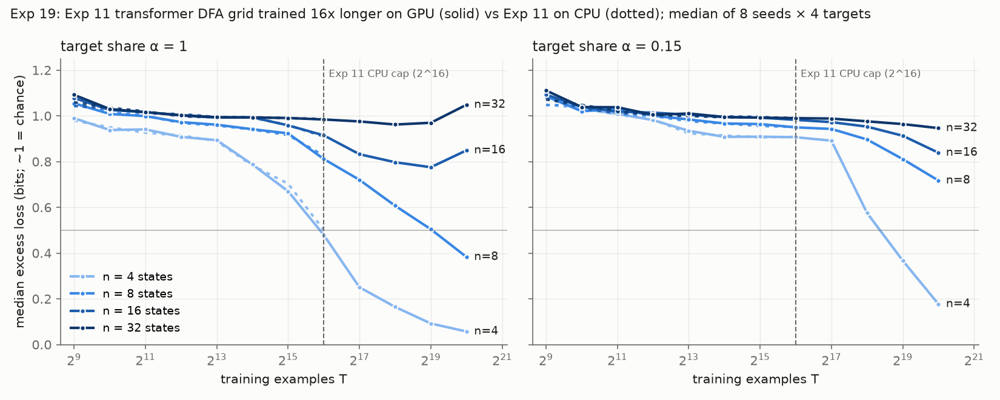

# Results: Experiment 11's transformer DFA grid trained 16x longer on a GPU (`19_dfa_transformer_gpu_converged`)

Run on 10-19-2026 on one Sherlock GPU (NVIDIA GeForce RTX 2080 Ti, node sh03-12n15), job 48471518, 1:03:49 of wall time, **1.06 GPU-hours**. All 512 cells of Experiment 11's grid (8 seeds x 16 target automata x 4 target shares α) trained side by side to T = 2^20 examples, 16 times Experiment 11's 2^16. The protocol, prediction and convergence criterion were frozen at commit 5b00f295 before any run.

## Takeaway

**Under-training does not explain E < 1 for this transformer, but the pre-registered test could not formally settle it: the grid did not converge, and the reason is that the large automata stalled, not that the data ran out.**

- **E at the like-for-like error target (0.5 bits) doubled, and stayed far below 1.** E = 0.165 [0.160, 0.171] with K in bits (Experiment 11 on CPU: 0.083 [0.078, 0.090]; Experiment 13-small on HMMs: 0.80 [0.79, 0.83]). E with K in states is 0.120 [0.116, 0.124]; the model-free E is 0.53 (at 0.7 bits). Sixteen times more training moved E from 0.08 to 0.16, nowhere near the 1 that "alignment dominates" needs.
- **The pre-registered verdict is "the caveat is not removed".** Only 61% of α = 1 runs (78 of 128) and 37% of all runs met the convergence criterion; the grid needed 90% and 75%. The budget rule stopped training at 2^20 because the next octave (another ~62 minutes) would have passed the 105-minute cap.
- **The large automata are not data-starved; the transformer fails on them.** At α = 1 the median n = 4 target reached 0.057 bits (98.6% accuracy) and n = 8 reached 0.38 bits and was still falling. The n = 16 and n = 32 targets sat near chance (0.85 and 1.05 bits) and got *worse* in the last doubling: 30 of 32 n = 32 runs and 15 of 32 n = 16 runs rose by more than 0.02 bits from 2^19 to 2^20. The pre-registered criterion counts a run whose loss rose as converged, so most of the 78 "converged" α = 1 runs are stalled or degrading. Excluding rising runs, 16 of 128 converged. Rising loss appears almost only at α = 1 (54 of 512 runs overall), which points at optimization with a constant 10^-3 learning rate on pure-target data, not at a shortage of examples.
- **So what this run measures for large K is the 2-layer transformer's failure, which inflates the complexity cost e_K and pushes E down.** PROTOCOL Section 5 asks for this to be said plainly: most n ≥ 16 runs stalled well above 0.1 bits (56 of 64 at α = 1), so the complexity effect here is a property of this learner and its optimizer, not a data cost. Experiment 13-small (a learner that trained) remains the better estimate of E, and it is also below 1.
- **Gates moved because the small automata now learn.** G1 (complexity costs data) and G2 (K improves held-out forecasts) are now SUPPORTED, and G3b says complexity changes the exponent (C3 = "exponent"); in Experiment 11 every gate was NOT_ESTABLISHED. These rest on n = 4 and n = 8 learning and n ≥ 16 stalling, so they carry the same learner caveat.

**Next step:** one cheap diagnostic, before any more data: rerun the α = 1 cells only (16 targets x 4 seeds) to 2^20 with a decaying learning rate (cosine to 0). If n = 16 then learns, the stall is the optimizer and the grid is worth rerunning with that schedule; if not, the transformer arm is retired and the LSTM arm (which learned n = 4-16 on CPU in Experiment 11) carries the DFA question.

**Diagnostic done (10-19-2026, AT-494, 0.108 GPU-h): retire the transformer arm.** With cosine decay the alpha = 1 cells ended at 0.851 bits (n = 16) and 1.127 (n = 32) at 2^20, slightly worse than a same-stream constant control; see `diag_cosine_lr/RESULTS.md`.

## Pre-registered predictions versus outcome

| Prediction (PROTOCOL Section 2) | Outcome |
|---|---|
| P1. At α = 1, n = 4 and n = 8 reach ≤ 0.1 bits by 2^20 in most seeds; n = 32 does not reach 0.3 bits | Partly wrong. n = 4: 24 of 32 runs ≤ 0.1 bits (yes). n = 8: 6 of 32 (no; median 0.38 bits, still falling). n = 32: 0 of 32 below 0.3 bits (yes) |
| P2. The criterion is met at α = 1, mostly because n ≥ 16 runs flatten ("stalled") | Wrong on the first half: 61% < 90%. Right that n ≥ 16 runs stall (56 of 64 "converged" above 0.1 bits), but many by rising loss, not by flattening |
| P3 (headline). E stays below 1 with upper bound below 1; rises above 0.083; stays in [0.1, 0.8] | Every number as predicted: 0.165 [0.160, 0.171]. The yes/no verdict it was meant to feed needs a converged grid, so formally it is "not removed" |
| P4. G5 stays NOT_ESTABLISHED | Right. The n = 32 vs n = 4 gap at α = 1 widened (ρ = 2.15 [2.10, 2.19]) |
| P5. η < 1 (distractors transfer) persists | Mostly. η from M_align_eff 0.80 [0.78, 0.82] and from the refit-both law 0.93 [0.91, 0.96]; from the G2 K law 1.01 [0.97, 1.05], which includes 1 |

## Learning curves

Median excess loss (bits; about 1 bit is chance) over 8 seeds x 4 targets per automaton size. The Experiment 19 column at 2^16 reproduces Experiment 11 closely, which is the check that the GPU ensemble, fresh data and new length schedule did not change the learner.

| α | n | Exp 11 at 2^16 | Exp 19 at 2^16 | 2^18 | 2^19 | 2^20 | accuracy at 2^20 |
|---|---|---|---|---|---|---|---|
| 1 | 4 | 0.501 | 0.479 | 0.165 | 0.092 | 0.057 | 0.986 |
| 1 | 8 | 0.826 | 0.811 | 0.607 | 0.504 | 0.383 | 0.867 |
| 1 | 16 | 0.910 | 0.915 | 0.797 | 0.775 | 0.849 | 0.738 |
| 1 | 32 | 0.986 | 0.984 | 0.962 | 0.970 | 1.048 | 0.621 |
| 0.15 | 4 | 0.908 | 0.907 | 0.575 | 0.367 | 0.177 | 0.940 |
| 0.15 | 8 | 0.951 | 0.950 | 0.897 | 0.811 | 0.717 | 0.744 |
| 0.15 | 16 | 0.984 | 0.982 | 0.953 | 0.913 | 0.839 | 0.686 |
| 0.15 | 32 | 0.990 | 0.990 | 0.976 | 0.964 | 0.946 | 0.605 |

## Elasticity ratio E at every error target

Law-based (M_K_both on all points), seed-block 95% intervals. e_α = 0.932 at every level.

| ε* (bits) | E, K in bits | E, K in states | e_K (bits) |
|---|---|---|---|
| **0.5 (primary; like-for-like with Exp 11)** | **0.165 [0.160, 0.171]** | 0.120 [0.116, 0.124] | 5.65 |
| 0.3 | 0.097 [0.095, 0.101] | 0.071 [0.069, 0.073] | 9.57 |
| 0.1 | 0.052 [0.050, 0.054] | 0.038 [0.037, 0.039] | 17.99 |
| 0.03 | 0.034 [0.033, 0.035] | 0.025 [0.024, 0.026] | 27.21 |

Model-free E_mf = 0.53 at 0.7 bits (the fallback level, since the primary-ε* rule was not met: at α = 1 only 6 of 16 targets reach 0.5 bits in the median seed). Range ratio R = 0.161 [0.153, 0.169] (alignment multiplier 2.0x, complexity multiplier 12.5x).

## Gate table

| Gate | Estimate | 95% interval | Verdict (Exp 11) |
|---|---|---|---|
| G1 complexity costs data: M_K = T*(n = 32)/T*(n = 4) at α = 1, ε* 0.5 | 12.5 | seed [11.6, 13.4]; two-stage [2.5, 40.9]; 78 of 128 α = 1 runs right-censored | **SUPPORTED** (NOT_ESTABLISHED) |
| G2 K improves held-out forecasts (M_K_exp over M_align_eff) | 14.1% | [13.5%, 15.0%] | **SUPPORTED** (NOT_ESTABLISHED) |
| G3a coefficient (κ > 0) | κ = −0.363 | [−0.381, −0.348] | NOT_ESTABLISHED |
| G3b exponent (γ1 < 0, exponent law beats coefficient law by ≥ 5%) | γ1 = −0.039; gain 6.8% | γ1 [−0.041, −0.038]; gain [6.4%, 7.3%] | **SUPPORTED** (NOT_ESTABLISHED); C3 = exponent |
| G4 alignment dominates (E > 1) | 0.165 bits, 0.120 states, E_mf 0.53 | see above | NOT_ESTABLISHED |
| G5 complexity gap shrinks with training | ρ = 2.15 | [2.10, 2.19] | NOT_ESTABLISHED |
| G6 alignment floor | a1 = 0.251 bits; held-out gain −1.5% | a1 [0.246, 0.257]; gain [−1.9%, −1.2%] | NOT_ESTABLISHED |
| G7 Spearman(γ_j, τ_j) | −0.10 | seed [−0.12, −0.04]; two-stage [−0.61, 0.45] | NOT_ESTABLISHED |

## Convergence census at T_top = 2^20

"Converged" is the pre-registered criterion (ε(T_top) ≤ 0.02 bits, or ε(T_top/2) − ε(T_top) ≤ 0.02 bits, which a rising loss also satisfies). "≤ 0.1 bits" counts every run below 0.1 bits at T_top, converged or not.

| n | α = 1: converged / ≤ 0.1 bits / rose > 0.02 | α = 0.4 | α = 0.15 | α = 0.05 |
|---|---|---|---|---|
| 4 | 12 / 24 / 3 | 2 / 14 / 1 | 0 / 2 / 0 | 1 / 0 / 0 |
| 8 | 10 / 6 / 4 | 2 / 1 / 0 | 0 / 0 / 0 | 3 / 0 / 0 |
| 16 | 24 / 0 / 15 | 10 / 0 / 0 | 6 / 0 / 0 | 18 / 0 / 0 |
| 32 | 32 / 0 / 30 | 24 / 0 / 1 | 19 / 0 / 0 | 26 / 0 / 0 |

Each cell is 32 runs. Converged: 78 of 128 at α = 1 (60.9%), 189 of 512 overall (36.9%).

## GPU budget

- This run: **1.06 GPU-hours** (sacct, job 48471518, 3,829 s on one GPU). Two earlier submits failed within 21 seconds each (a virtual-environment collision and the torch pin), under one GPU-minute together. The CPU post job (48471519, 15:30) used no GPU.
- The cap was min(105 min, (5.9 − AT-441's use) × 60 − 15 min) = 105 minutes. `budget.py` read only AT-441's first pilot array (0.06 GPU-hours) instead of its full 3.65 H100-hours; the cap was 105 minutes either way, so the run is unaffected. Counting the earlier Lean SFT seeds (2.12) and AT-441 (3.65), about 6.8 of Brando's 8 GPU-hours are used and about 1.2 remain.
- No seeds were dropped and no cells were skipped: the subset rule did not fire (at 2^12 the measured speed put all 8 seeds past 2^19 inside the cap). Cells not run: the 2^21 and 2^22 checkpoints of all 512 cells, cut by the budget rule.
- The scheduler gave an RTX 2080 Ti (the job asked for any GPU). A V100 or faster would likely have reached 2^21 inside the same cap; given the stall above, that would not have changed the verdict.

## Deviations from PROTOCOL.md

1. **Software versions.** torch 2.6.0+cu124, numpy 2.2.6, scipy 1.16.3, Python 3.12.1 in a separate venv (`$SCRATCH/tdc_gpu/venv_exp19`), not torch 2.14.1: Sherlock runs glibc 2.17, and no 2.14.1 wheel installs there. Seeded initialization is bit-identical to 2.14.1 (3 seeds checked) and `test_ensemble.py` passes 6 of 6 on these versions.
2. **T_top = 2^20, not 2^22,** by the pre-registered budget rule.
3. **Convergence criterion flaw, found after the run.** The criterion treats a loss that rose in the last doubling as converged. The verdict is unchanged (the grid fails the criterion either way), but the census above reports rising runs separately.
4. **Post-hoc additions, not in the frozen sources:** `compare_results.py` (numeric comparison of two results directories) and `plot_results.py` (the figure). Neither feeds any reported number.

## Verification

- **On Sherlock (the machine that produced the numbers), `verify.py --replay all`: PASS.** Sources match the manifest; the test set is identical to Experiment 11's; 6,144 of 6,144 metrics rows recomputed from the saved predictions (max accuracy difference 0.0); all 512 final checkpoints replayed on the CPU through Experiment 11's `model.evaluate` (max difference 1.0e-7 bits in the mean, 5.9e-5 bits per string); analysis stages 1-2 and `summary.py` rerun with identical forecasts hash, gates, E, analysis, T* table and summary (`results/verification.json`).
- **Independent rerun on a second machine (4-core CPU, same torch/numpy/scipy versions), `verify.py --replay all`:** checks 1-4 identical to Sherlock (sources, test set, 6,144/6,144 rows, 512 replays with the same maximum differences). Check 5 asks for byte-identical JSON across machines and reports FAIL there (`results/local_rerun/verify_local.json`), because floating-point summation order differs between CPUs. Numerically every number agrees: all gates identical; T* table within 2.5e-15 relative; every reported number in `analysis.json` and `summary.json` (E, intervals, gains, η) within 6e-8 absolute and 1e-7 relative; frozen forecasts within 3e-8 relative; raw fitted law parameters within 3e-6 relative (`results/local_rerun/numdiff.txt`). The frozen-forecast hash differs only through those last digits.

## Artifacts

- `expt_v1/results/`: `metrics.csv`, `analysis.json`, `summary.json`, `fits.json`, `forecasts_frozen.json` (sha256 3ce67f8e…), `tstar.csv`, `convergence_runs.json`, `run_state.json`, `budget_at_start.json`, `gpu_usage.json`, `verification.json`, logs, Slurm logs of all three train submits and the post job, and `local_rerun/`.
- Kept out of git, as the frozen `.gitignore` set: `predictions/T_*.npz` (per-string predictions at all 12 checkpoints, 2^9 to 2^20, 101 MB) and `checkpoints/T_1048576.npz` (213 MB, over GitHub's file limit; sha256 c171a396…). Both are in `exp19_full.tgz` (sha256 1336c2ed…) on Sherlock at `$SCRATCH/tdc_gpu/exp19_results` (purged after 90 days without access). Every file's hash, these included, is in `ARTIFACT_SHA256.json`; verify.py checks 2 and 3 need them unpacked into `expt_v1/results/`.

**TLDR-end:** [tdc: Expt 19 results] Experiment 11's 512-run DFA grid trained 16x longer (to 2^20) on one Sherlock GPU in 1.06 GPU-hours. E at 0.5 bits doubled from 0.083 to 0.165 [0.160, 0.171], still far below 1 (Exp 13-small: 0.80). The grid did not converge (61% of α = 1 runs vs 90% needed), so the pre-registered verdict is "caveat not removed"; but n = 16 and 32 stalled near chance and got worse in the last doubling, so what holds E down is the transformer failing on large automata, not too little data. G1, G2, G3b now SUPPORTED. verify.py PASS on Sherlock; every reported number reproduced on a second machine to 1e-7 relative.
