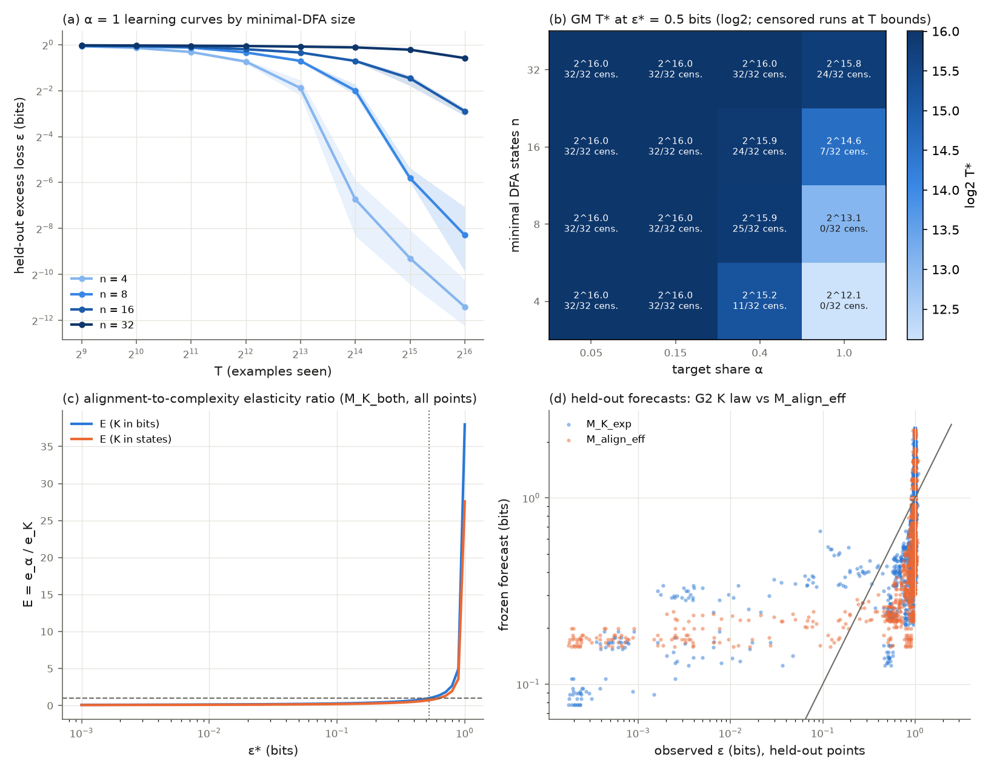

# Results: exact DFA complexity versus data alignment with an LSTM learner (`20_dfa_lstm_complexity_vs_alignment`)

Run on 10-19/20-2026 on a shared 4-core CPU box. All 512 of 512 gated runs completed (8 seeds × 16 targets × 4 target shares α) in 8,231 s of grid wall time. The learner is the 84,290-parameter one-layer LSTM. Tasks, data, mixes, seeds, checkpoints, analysis code and gate thresholds are Experiment 11's, and the protocol was frozen at commit d3ab980b before any gated run. K is exact for the DFA description language (minimal-DFA size n, by Hopcroft and Moore), K_bits = 20, 56, 144, 352.

## Takeaway

**With a learner that does learn these languages, complexity is real and costs data. Alignment does not dominate: mixing in other tasks cost the LSTM far more than its share of the data. Three of the eight gates pass: G1 (seen data), G3b and G6.**

- **Complexity costs data (G1 SUPPORTED, not prospective).** At α = 1, reaching 0.5 bits takes 13.0 times as many examples for n = 32 as for n = 4 (seed interval 12.6 to 13.4; two-stage 7.5 to 20.6). That is a lower bound, because 31 of 32 n = 32 runs never reach 0.5 bits. These α = 1 runs repeat Experiment 11's exploratory arm, which had already been seen.
- **Complexity moves the exponent, not the coefficient (G3b SUPPORTED, prospective).** In M_K_both the learning-curve exponent falls by γ1 = −0.142 per doubling of K_bits (interval −0.146 to −0.137). The exponent-only law beats the coefficient-only law on held-out cells by 5.3% (interval 4.8% to 5.8%), just over the 5% bar. κ is negative (−1.17), so the description-length picture (G3a) fails. C3 reads as the exponent (quanta) picture. The margin over the bar is thin, and every law fits these curves poorly (held-out RMSE 1.2 to 1.9 in log2 bits, a typical miss of a factor of 2 to 4).
- **Target share sets a floor within this budget (G6 SUPPORTED, prospective).** Adding a1(1 − α) to the K law gives a1 = 0.84 bits (interval 0.83 to 0.85) and cuts held-out error by 23% (interval 21% to 25%). Every run at α = 0.05 and 0.15 is flagged as plateaued, at every n, and ends at 0.85 to 1.0 bits. A floor inside 2^16 examples cannot be told apart from learning that would start later.
- **Alignment does not dominate (G4 NOT_ESTABLISHED, prospective).** The elasticity ratio is E = 0.93 with K in bits (interval 0.91 to 0.94) and 0.67 in states, below the bar of E > 1. Per log unit, complexity costs a little more data than misalignment. The model-free E_mf is 1.96 at the 0.7-bit fallback, but 72% to 78% of its pairs are censored.
- **Distractors hurt (post hoc).** The effective-data exponent is η = 1.56 in the K law (interval 1.46 to 1.69), above 1, which reads as interference; M_align_eff alone gives 0.99. A direct check agrees. An n = 4 target at α = 0.4 has seen 26,214 target examples by 2^16 and sits at a median 0.49 bits. On its own, the same target is at 0.004 bits after 16,384 examples. The penalty shrinks as n grows, because large automata are not learned either way.
- **G2 NOT_ESTABLISHED** (the K law improves held-out error by 8.2% against the 10% bar), **G5 NOT_ESTABLISHED** (at α = 1 the n = 32 minus n = 4 gap grows from 0.36 to 0.67 bits, because n = 4 goes to about 0) and **G7 NOT_ESTABLISHED** (Spearman −0.17).

## What was prospective (PROTOCOL Section 2)

The 128 α = 1 cells reproduce Experiment 11's exploratory LSTM arm (verify step 10 below). Gates that use only α = 1 rows were therefore not prospective. Predictions were written in PROTOCOL Section 5 before any α < 1 run.

| Gate | Prospective? | Prediction | Verdict | Prediction right? |
|---|---|---|---|---|
| G1 complexity is real | no (α = 1 seen) | SUPPORTED | SUPPORTED | yes |
| G2 K adds value beyond alignment | yes | SUPPORTED | NOT_ESTABLISHED (8.2% < 10%) | no |
| G3a coefficient (MDL) | yes | unresolved | NOT_ESTABLISHED | (see G3b) |
| G3b exponent (quanta) | yes | unresolved | SUPPORTED | no |
| G4 alignment dominates | yes | NOT_ESTABLISHED, E < 1 | NOT_ESTABLISHED, E = 0.93 | yes |
| G5 gap shrinks | no (α = 1 seen) | NOT_ESTABLISHED | NOT_ESTABLISHED | yes |
| G6 alignment floor | yes | NOT_ESTABLISHED | SUPPORTED | no |
| G7 quanta mechanism | no (α = 1 seen) | not predicted | NOT_ESTABLISHED | n/a |
| η | yes | below 1 (transfer) | 1.56, above 1 (interference) | no |

## Experiment 20 (LSTM) next to Experiment 11 (transformer)

| Quantity | Exp 11 transformer | Exp 20 LSTM |
|---|---|---|
| G1 M_K at 0.5 bits | 1.55, NOT_ESTABLISHED | 13.0, SUPPORTED |
| G2 held-out gain of the K law | 7.2%, NOT_ESTABLISHED | 8.2%, NOT_ESTABLISHED |
| G3 γ1 per doubling of K_bits; exp-over-coef gain | −0.011; 2.6%, unresolved | −0.142; 5.3%, exponent (G3b) |
| G4 E (bits / states); E_mf | 0.083 / 0.060; 4.3 | 0.93 / 0.67; 1.96 |
| G5 ρ | 5.9 | 1.86 |
| G6 a1; held-out gain | 0.043 bits; 0.3% | 0.84 bits; 23%, SUPPORTED |
| G7 Spearman(γ_j, τ_j) | 0.01 | −0.17 |
| η (K law) | 0.71 (transfer) | 1.56 (interference) |

Mean ε(2^16) in bits by level and α (Exp 20 LSTM / Exp 11 transformer):

| n | α = 0.05 | α = 0.15 | α = 0.4 | α = 1 |
|---|---|---|---|---|
| 4 | 0.96 / 0.89 | 0.85 / 0.85 | 0.33 / 0.73 | 0.0004 / 0.54 |
| 8 | 1.00 / 0.97 | 0.94 / 0.95 | 0.50 / 0.89 | 0.003 / 0.73 |
| 16 | 1.01 / 0.97 | 0.97 / 0.97 | 0.66 / 0.96 | 0.13 / 0.88 |
| 32 | 1.00 / 0.98 | 0.99 / 0.98 | 0.95 / 0.98 | 0.67 / 0.97 |

Below the resolution floor (10^-3 bits): 1.9% of all checkpoint rows, all at α = 1 (21% of n = 4 rows and 9% of n = 8 rows there), so the censored residual matters only for the smallest automata. All three ε* levels are reported in the target table below. With the LSTM the n = 4 to 16 targets reach 0.1 bits at α = 1, so the 0.3- and 0.1-bit columns are informative too.

Post hoc effective-data check (not pre-registered; results/comparison.json): the median over seeds and targets of log2[ε(α, 2^16) / ε(α = 1, α·2^16)], both floored at 10^-3 bits. Positive values mean the mixed run is worse than its own target examples predict.

| n | α = 0.05 | α = 0.15 | α = 0.4 |
|---|---|---|---|
| 4 | 0.55 | 4.20 | 8.20 |
| 8 | 0.15 | 1.38 | 4.85 |
| 16 | 0.13 | 0.36 | 0.43 |
| 32 | 0.03 | 0.08 | 0.08 |

## Deviations from PROTOCOL.md

1. **Two chunks.** The grid ran as two resume-safe chunks: 394 cells in 6,626 s, then 118 cells in 1,605 s. The protocol allows any number of chunks, and both are logged in manifest.json and CKPT. No cell was rerun. The box was shared (load average 8 to 10 in the first hour), so early cells took about 170 s instead of the projected 59 s.
2. **One added script.** `compare_exp11.py` writes the reported comparisons (results/comparison.json). Its effective-data check is post hoc and labelled as such. No gate, threshold, split, seed or ε* changed, and analyze.py ran unmodified.
3. **Steps left to the parent task.** No push, README row or pull request was made in this run. The branch is committed locally.

## Limitations

- **The laws fit poorly.** Held-out RMSE is 1.22 to 1.89 in log2 bits for every law, against 0.18 to 0.21 for the transformer, whose curves barely moved. LSTM curves stay near chance and then drop by orders of magnitude within one or two octaves, which no single power law in T follows. The gate verdicts compare these imperfect laws under the frozen rules. G3b in particular passes by 0.3 points over its bar.
- **The floor and the interference are within budget.** At α ≤ 0.15 the target sees at most 9,830 examples, interleaved with 16 other tasks. Whether those runs would learn with more data is not tested here.
- **This is a recurrent learner.** LSTMs simulate DFAs natively, so these verdicts hold for this learner and need not carry over to transformers or language models (Experiment 19 reruns the transformer on GPU).
- **G4 sits near its crossover.** The law-based E rises steeply with ε*: 0.70 at 0.40 bits, 0.93 at the pre-registered 0.5 bits, 1.11 at 0.56 bits and 1.81 at 0.71 bits (analysis.json E.curve; figure panel c). Alignment dominates only for targets close to chance, so the G4 verdict holds at the frozen level and would flip just above it.
- **n = 32 is still mostly unlearned** (mean 0.67 bits at α = 1), so M_K and e_K are lower bounds.
- K is exact only for the DFA description language and this sampler. There is one model size, one learning rate and lengths 8 to 24, and the distractors are unrelated languages.

## Gate table

All gates are reported with equal prominence. Intervals are 95% seed-block bootstrap percentile intervals (20,000 draws over the 8 seeds); "two-stage" also resamples the 4 targets within each level.

| Gate | Statistic | Estimate | 95% interval(s) | Threshold | Verdict |
|---|---|---|---|---|---|
| G1 complexity is real | M_K = GM T*(n=32) / GM T*(n=4) at alpha=1 (ε* = 0.5 bits) | 13 | seed [12.6, 13.4]; two-stage [7.53, 20.6] | >= 2.0, both lower bounds > 1.0 | **SUPPORTED** |
| G2 K adds value beyond alignment | held-out RMSE reduction of M_K_exp over M_align_eff (log2 bits) | 0.082 | [0.075, 0.0894] | >= 10%, lower bound > 0, lower on K=16, 0 invalid | **NOT_ESTABLISHED** |
| G3a coefficient (MDL) | κ in M_K_both; γ1 interval contains 0; RMSE coef ≤ exp | κ = -1.17, γ1 = -0.142 | κ [-1.21, -1.13]; γ1 [-0.146, -0.137] | κ LB > 0 | **NOT_ESTABLISHED** |
| G3b exponent (quanta) | γ1 in M_K_both; M_K_exp gain over M_K_coef | γ1 = -0.142, gain = 0.0527 | γ1 [-0.146, -0.137]; gain [0.0478, 0.0582] | γ1 UB < 0, gain ≥ 5%, LB > 0 | **SUPPORTED** |
| G4 alignment dominates | E = e_alpha / e_K (law-based, M_K_both on all points) at ε* = 0.5 | bits 0.926; states 0.672; E_mf 1.96 (ε* = 0.7) | bits [0.909, 0.943]; states [0.66, 0.685] | E > 1 with lower bound > 1 in both units; E_mf > 1 | **NOT_ESTABLISHED** |
| G5 gap shrinks | rho = g(65536) / g(4096), gap in bits (n=32 minus n=4) at alpha=1 | 1.86 (gap 0.36 → 0.668 bits) | [1.79, 1.93] | g_ref > 0, rho <= 0.5, upper bound < 1.0 | **NOT_ESTABLISHED** |
| G6 alignment floor | a1 in M_K_floor = M_K_exp + a1 (1 - alpha); held-out gain over M_K_exp | a1 = 0.843; gain = 0.23 | a1 [0.833, 0.852]; gain [0.213, 0.248] | a1 lower bound > 0 and gain >= 10% with lower bound > 0 | **SUPPORTED** |
| G7 quanta mechanism | Spearman(gamma_j, tau_j) over 16 targets | -0.174 (partial given log K: 0.287) | seed [-0.206, -0.162]; two-stage [-0.689, 0.358] | >= 0.5 with seed lower bound > 0 | **NOT_ESTABLISHED** |

C3 reading: **exponent (quanta)**.

## Target table

| id | n | K_bits | acceptance | sensitivity | τ | γ_j (α=1) | GM T*(0.5) at α=1 [censored/8] | GM T*(0.3) at α=1 [censored/8] | GM T*(0.1) at α=1 [censored/8] |
|---|---|---|---|---|---|---|---|---|---|
| dfa_n04_t1 | 4 | 20 | 0.455 | 0.158 | 0.73 | 1.549 | 2839 [0] | 4370 [0] | 6684 [0] |
| dfa_n04_t2 | 4 | 20 | 0.500 | 0.204 | 1.30 | 1.843 | 2840 [0] | 4150 [0] | 5458 [0] |
| dfa_n04_t3 | 4 | 20 | 0.500 | 0.253 | 0.53 | 1.715 | 5490 [0] | 6986 [0] | 8915 [0] |
| dfa_n04_t4 | 4 | 20 | 0.571 | 0.405 | 0.58 | 1.696 | 8687 [0] | 9308 [0] | 10795 [0] |
| dfa_n08_t1 | 8 | 56 | 0.390 | 0.169 | 0.84 | 1.410 | 3986 [0] | 5452 [0] | 10533 [0] |
| dfa_n08_t2 | 8 | 56 | 0.500 | 0.300 | 0.92 | 0.949 | 9095 [0] | 12148 [0] | 22288 [0] |
| dfa_n08_t3 | 8 | 56 | 0.459 | 0.353 | 0.59 | 1.561 | 8916 [0] | 9817 [0] | 12078 [0] |
| dfa_n08_t4 | 8 | 56 | 0.647 | 0.402 | 0.65 | 1.287 | 17349 [0] | 18606 [0] | 21626 [0] |
| dfa_n16_t1 | 16 | 144 | 0.481 | 0.306 | 1.26 | 0.884 | 9900 [0] | 15288 [0] | 27440 [0] |
| dfa_n16_t2 | 16 | 144 | 0.573 | 0.375 | 0.65 | 0.113 | 63851 [7] | 65536 [8] | 65536 [8] |
| dfa_n16_t3 | 16 | 144 | 0.421 | 0.391 | 0.88 | 0.718 | 32749 [0] | 36136 [0] | 41891 [0] |
| dfa_n16_t4 | 16 | 144 | 0.439 | 0.475 | 1.32 | 0.952 | 17914 [0] | 22274 [0] | 31933 [0] |
| dfa_n32_t1 | 32 | 352 | 0.390 | 0.377 | 0.90 | 0.032 | 65536 [8] | 65536 [8] | 65536 [8] |
| dfa_n32_t2 | 32 | 352 | 0.485 | 0.431 | 1.26 | 0.271 | 38728 [0] | 47521 [0] | 65351 [7] |
| dfa_n32_t3 | 32 | 352 | 0.448 | 0.447 | 0.63 | 0.031 | 65536 [8] | 65536 [8] | 65536 [8] |
| dfa_n32_t4 | 32 | 352 | 0.443 | 0.463 | 0.81 | 0.018 | 65536 [8] | 65536 [8] | 65536 [8] |

## Held-out RMSE (log2 bits, censored residual) by slice

| law | all (K bits) | K = 16 | α = 0.15 | T = T_max | all (K in states) | invalid forecasts |
|---|---|---|---|---|---|---|
| M0_scale | 1.8912 | 1.3360 | 1.0292 | 3.5150 | 1.8912 | 0 |
| M_align_eff | 1.7311 | 1.2511 | 0.8550 | 3.2043 | 1.7311 | 0 |
| M_align_add | 1.8128 | 1.1565 | 0.1867 | 3.6030 | 1.8128 | 0 |
| M_K_coef | 1.6775 | 1.2049 | 0.9045 | 3.0848 | 1.6778 | 0 |
| M_K_exp | 1.5891 | 1.1606 | 0.7638 | 2.9736 | 1.5891 | 0 |
| M_K_both | 1.5728 | 1.1599 | 0.9459 | 2.9209 | 1.5716 | 0 |
| M_K_floor | 1.2237 | 1.0451 | 0.5452 | 2.1140 | 1.2232 | 0 |

Held-out points: 260 per seed. G2 K law (chosen on fit cells before held-out rows were read): `M_K_exp`. Frozen forecasts SHA-256 `d790466744434de0ce997d946a1760ef714b67941f3107fee17b48a2d5ef5ca4`. Fitter agreement (laws.py vs independent_fit.py): True, max relative forecast difference 8.95e-07.

## Alignment: η and the two alignment laws

- η from M_align_eff: 0.991 [0.975, 1]; from `M_K_exp`: 1.56 [1.46, 1.69]; from the all-points M_K_both refit: 1.59 [1.56, 1.62]. Reading (G2 K law interval versus 1): **interference (distractors hurt)**.
- M_align_eff versus M_align_add held-out RMSE: 1.7311 versus 1.8128; relative reduction 0.0451 [0.0398, 0.0501]; invalid forecasts 0 versus 0.

## Elasticity ratio E and range ratio R

| ε* (bits) | E (K in bits) | 95% interval | E (K in states) | e_α | e_K (bits) |
|---|---|---|---|---|---|
| 0.5 | 0.926 | [0.909, 0.943] | 0.672 | 1.59 | 1.72 |
| 0.3 | 0.539 | [0.528, 0.549] | 0.391 | 1.59 | 2.95 |
| 0.1 | 0.284 | [0.278, 0.289] | 0.206 | 1.59 | 5.61 |

Flip point ε_flip (E = 1) in [1e-3, 1] bits: 0.524. Slope of log K_bits on log n: 1.378. E from a refit with K = n: 0.673 [0.66, 0.685]. Model-free E_mf = 1.96 at ε* = 0.7 (censored fraction per seed [0.73, 0.72, 0.75, 0.78, 0.73, 0.73, 0.73, 0.73]).

Range ratio R = 0.331 [0.325, 0.336]: alignment multiplier T*(α=0.05)/T*(α=1) = 4.29 versus complexity multiplier M_K = 13.

## K versus sensitivity

Regression of seed-mean log2 T*_j(α = 1, 0.5 bits) on standardized log K_bits and standardized sensitivity (16 targets): log K coefficient 0.963 (seed [0.954, 0.974], two-stage [0.619, 1.37]); sensitivity coefficient 0.651 (seed [0.636, 0.667], two-stage [0.17, 1.03]); correlation 0.681, VIF 1.87. Censored T* at α = 1: {'left': 0, 'right': 31}.

## Plateau census and per-length loss

Runs flagged as plateaued (ε(T_max) ≥ 0.8 ε(2^14) and ε(T_max) > 0.1 bits), out of 32 runs per (level, α) cell:

| n | α = 0.05 | α = 0.15 | α = 0.4 | α = 1.0 |
|---|---|---|---|---|
| 4 | 32 | 32 | 16 | 0 |
| 8 | 32 | 32 | 8 | 0 |
| 16 | 32 | 32 | 14 | 1 |
| 32 | 32 | 32 | 32 | 24 |

Per-length loss at α = 1, T = T_max (bits), by level:

| n | 8 | 9 | 10 | 11 | 12 | 13 | 14 | 15 | 16 | 17 | 18 | 19 | 20 | 21 | 22 | 23 | 24 |
|---|---|---|---|---|---|---|---|---|---|---|---|---|---|---|---|---|---|
| 4 | 0.00 | 0.00 | 0.00 | 0.00 | 0.00 | 0.00 | 0.00 | 0.00 | 0.00 | 0.00 | 0.00 | 0.00 | 0.00 | 0.00 | 0.00 | 0.00 | 0.00 |
| 8 | 0.01 | 0.00 | 0.00 | 0.01 | 0.00 | 0.00 | 0.01 | 0.00 | 0.00 | 0.00 | 0.00 | 0.00 | 0.00 | 0.00 | 0.00 | 0.00 | 0.00 |
| 16 | 0.08 | 0.11 | 0.12 | 0.12 | 0.13 | 0.12 | 0.15 | 0.13 | 0.16 | 0.16 | 0.14 | 0.16 | 0.14 | 0.14 | 0.14 | 0.14 | 0.14 |
| 32 | 0.61 | 0.69 | 0.61 | 0.63 | 0.65 | 0.63 | 0.64 | 0.65 | 0.65 | 0.68 | 0.69 | 0.70 | 0.67 | 0.71 | 0.73 | 0.71 | 0.73 |
## Verification

`verify.py`: **PASS**. 1_training_sources_match_manifest = True, 2_tasks_regenerated_identical = True, 2_hopcroft_moore_n_match = 32/32, 3_covariates_exact_and_monte_carlo = 32/32, 4_data_regenerated_identical = 32/32, 4_mixes_regenerated_identical = 512/512, 5_checkpoints_replayed = 4096, 5_max_abs_diff_excess_bits = 0.0, 5_max_abs_diff_accuracy = 0.0, 6_max_abs_diff_predictions = 0.0, 5_metrics_rows = 4096, 7_tstar_identical = True, 8_forecasts_hash_identical = True, 8_fitters_agree = True, 9_gates_identical = True, 9_key_numbers_identical = True, 10_alpha1_rows_compared_with_exp11_lstm_arm = 1024, 10_alpha1_max_abs_diff_vs_exp11_lstm_arm = 0.0.

**TLDR-end:** [tdc: Expt 20 results] 512 of 512 CPU runs with the 84,290-parameter LSTM, Exp 11's tasks, data, mixes, seeds and gates. Complexity costs data (G1 SUPPORTED, M_K = 13.0 at 0.5 bits, but alpha = 1 was already seen in Exp 11's arm). Prospectively, complexity moves the exponent (G3b SUPPORTED, gamma1 = -0.142 per doubling of K_bits, 5.3% over a 5% bar) and target share sets a floor within budget (G6 SUPPORTED, a1 = 0.84 bits, 23% held-out gain). Alignment does not dominate (G4 NOT_ESTABLISHED, E = 0.93, crossing 1 just above 0.5 bits); G2, G5, G7 NOT_ESTABLISHED. Distractors interfere (eta = 1.56, post hoc). All laws fit poorly (held-out RMSE 1.2-1.9 log2 bits). verify.py PASS.
