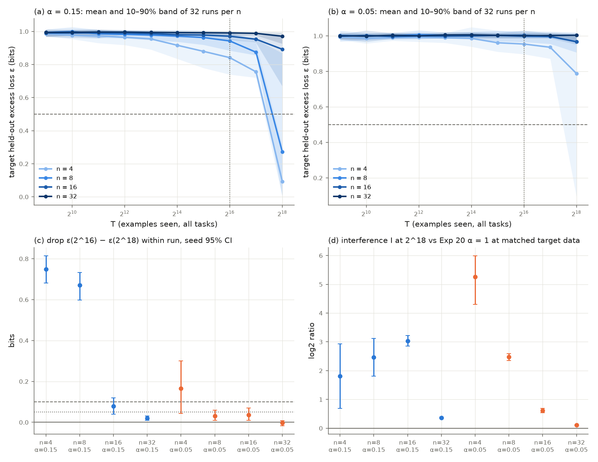

# Results: floor or late learning? Experiment 20's low-share LSTM cells run 4× longer (`21_dfa_lstm_low_alpha_long_budget`)

Run on 10-20-2026 on the shared 4-core CPU box, branch `results/cpu-expts-11-15`, protocol frozen at commit b2f1db7b before any Experiment 21 training. All 256 of 256 runs completed (16 targets × 2 shares × 8 seeds, budget 2^18 examples) in about 21,800 s of grid wall time, inside the frozen 43,200 s cap. `verify.py` result: see Verification below.

## Takeaway

**Experiment 20's alignment floor was a budget artifact where the target has enough data: the stalled runs learn late. Pre-registered overall verdict: LATE_LEARNING (predicted, about 60% confidence).**

- **Late learning at α = 0.15, n = 4 and 8.** Within the same runs, ε falls from 0.842 to 0.093 bits (n = 4, drop 0.748, CI 0.682 to 0.814; 29 of 32 runs cross 0.5 bits) and from 0.942 to 0.272 bits (n = 8, drop 0.671, CI 0.598 to 0.732; 22 of 32 cross). At 2^16 none of these 64 runs had crossed.
- **At 2^16 the network had barely started on any language, distractors included.** The mean distractor loss was 0.991 to 0.997 bits at 2^16 and is 0.894 to 0.919 at 2^18. The Experiment 20 "floor" was the network as a whole not having learned yet, not a limit specific to the target.
- **Mixing still costs more than its share of the data.** Interference I > 0 in every cell: at 2^18 the mixed runs are worse than Experiment 20's pure (α = 1) runs at the same number of target examples (decisive cells: cell means 0.62 to 5.25 in log2 units, every interval above 0). Alignment shows up as a delay, and a large one, not as a floor.
- **The rest is undecided or flat.** n = 16 at α = 0.15 and n = 4, 8, 16 at α = 0.05 start to move by 2^18 (drops 0.03 to 0.17 bits) but meet neither the LATE_LEARNING nor the DESCENDING bar: UNRESOLVED. n = 32 is FLOOR_HOLDS at both shares, but there even α = 1 does not learn the language, so it says nothing about alignment (PROTOCOL Section 4.3).
- **The replicate check holds.** ε(2^16) on the re-drawn string order matches Experiment 20 within 0.008 bits in every cell.

Predictions (PROTOCOL Section 5): overall LATE_LEARNING right; (4, 0.15) and (8, 0.15) right; n = 32 FLOOR_HOLDS right at both shares; interference > 0 in every decisive cell right; replicate within ±0.05 right. Wrong: (16, 0.15) and (4, 0.05) were predicted DESCENDING or LATE_LEARNING, and (8, 0.05) and (16, 0.05) DESCENDING or FLOOR_HOLDS; all four came out UNRESOLVED, their drop intervals straddling the 0.05-bit bar. Cell predictions right: 4 of 8.

**What this changes for Experiment 20.** Its G6 (an alignment floor a1(1 − α)) should be read as "within 2^16 examples" only. At low shares the LSTM's cost of misalignment is a delayed onset whose length grows with n, and for n = 16 at α = 0.15 and n = 8 and 16 at α = 0.05 even 2^18 is too short to tell.

**Next step.** Per Brando (10-20-2026), no further LSTM follow-ups: the same floor-versus-delay question, if pursued, goes to the transformer learner, and any rerun goes to Sherlock CPU nodes.

## Deviations and notes

1. **Concurrent load.** From 04:17 to about 06:20 the grid shared the 4 cores with Experiment 17b (AT-453). Runs are seeded and single-threaded, so results are unaffected (`verify.py` replays checkpoints and retrains the first cell); only wall time changed.
2. **An interrupted chunk.** The third chunk was killed at 06:35, mid-cell, when the worker running it stopped. `run.py --resume` redid the cells in flight (done markers are written last), and it is missing from `run_state.json`'s chunk list (about 1,211 s, 24 cells). Chunks ran at most about 1 h, within the frozen 2 h limit.
3. **Cell cost.** PROTOCOL Section 3.2 item 4 said cell cost does not depend on n. Median cell wall time was 180 to 490 s for most cells, but 815 s for n = 32 at α = 0.05, the last cells run. The cause was not diagnosed, and cell time is not a result.
4. **report.py** was written at 06:15, while the grid was running and before `analysis.json` existed. It only formats `analysis.json` and `metrics.csv` and decides nothing. These notes (takeaway, deviations) were written after the analysis.

## Verification

`verify.py`: **PASS** in 1,966 s. Training sources match the manifest; tasks (Hopcroft = Moore, 32 of 32) and all data regenerate identically and are byte-identical to Experiment 20's; 256 of 256 mixes regenerate, none reuses the pool, and all 256 task-slot sequences through 2^16 equal Experiment 20's; 2,560 checkpoints replay with max |Δ| = 0 in excess bits, accuracy and per-string predictions; cell 11101_dfa_n04_t1_0.15 retrained from scratch matches exactly; metrics.csv equals the cell records; analysis.json recomputes identically and an independent recomputation of the cell means, drops, crossing counts and verdicts agrees; all 256 cells' distractor losses replay identically (the protocol asked for 8). Receipt: `expt_v1/results/verification.json`.

**Overall verdict (PROTOCOL Section 4.3, decided on n ∈ {4, 8, 16}): LATE_LEARNING.** Runs analysed: 256 of 256; missing: 0.

## Cell verdicts (PROTOCOL Section 4.2)

ε in bits, means over the 32 runs of a cell; intervals are 95% seed-block bootstrap (8 seeds, 20,000 draws). Crossed = ε(2^18) ≤ 0.5 bits; moved = drop ≥ 0.1 bits; plateau = ε(2^18) ≥ 0.8 ε(2^16) and > 0.1 bits.

| n | α | ε(2^16) | ε(2^17) | ε(2^18) | drop [95% CI] | crossed 2^16 → 2^18 | moved | plateau | verdict | predicted | right? |
|---|---|---|---|---|---|---|---|---|---|---|---|
| 4 | 0.15 | 0.842 | 0.756 | 0.093 | 0.748 [0.682, 0.814] | 0 → 29 | 29/32 | 3/32 | LATE_LEARNING | LATE_LEARNING | yes |
| 8 | 0.15 | 0.942 | 0.874 | 0.272 | 0.671 [0.598, 0.732] | 0 → 22 | 26/32 | 9/32 | LATE_LEARNING | LATE_LEARNING | yes |
| 16 | 0.15 | 0.971 | 0.953 | 0.892 | 0.079 [0.039, 0.119] | 0 → 0 | 6/32 | 27/32 | UNRESOLVED | DESCENDING or LATE_LEARNING | no |
| 32 | 0.15 | 0.991 | 0.988 | 0.971 | 0.020 [0.010, 0.031] | 0 → 0 | 0/32 | 32/32 | FLOOR_HOLDS | FLOOR_HOLDS | yes |
| 4 | 0.05 | 0.954 | 0.936 | 0.788 | 0.166 [0.044, 0.301] | 0 → 6 | 8/32 | 25/32 | UNRESOLVED | DESCENDING or LATE_LEARNING | no |
| 8 | 0.05 | 0.998 | 0.996 | 0.968 | 0.031 [0.009, 0.059] | 0 → 0 | 3/32 | 31/32 | UNRESOLVED | DESCENDING or FLOOR_HOLDS | no |
| 16 | 0.05 | 1.004 | 0.997 | 0.967 | 0.037 [0.009, 0.069] | 0 → 0 | 3/32 | 29/32 | UNRESOLVED | DESCENDING or FLOOR_HOLDS | no |
| 32 | 0.05 | 1.000 | 1.002 | 1.003 | -0.003 [-0.016, 0.008] | 0 → 0 | 0/32 | 32/32 | FLOOR_HOLDS | FLOOR_HOLDS | yes |

Cell predictions right: 4 of 8. Overall prediction LATE_LEARNING (about 60% confidence): right.

Verdict rules (frozen): LATE_LEARNING if the drop CI lower bound > 0.1 bits and ≥ 8 of 32 crossed; FLOOR_HOLDS if the upper bound < 0.05 bits and ≤ 1 crossed; DESCENDING if the lower bound > 0.05 bits; otherwise UNRESOLVED.

## Reported, not part of the verdict (PROTOCOL Section 4.4)

| n | α | interference I at 2^18 [CI] (median) | I at 2^16 [CI] | replicate: ε(2^16) − Exp 20 [CI] | ε(2^18) − marginals-only floor [CI] | marginals-only floor | GM T*(0.5) in target examples (censored) |
|---|---|---|---|---|---|---|---|
| 4 | 0.15 | 1.81 [0.69, 2.94] (0.21) | 4.12 [3.82, 4.46] | -0.008 [-0.020, 0.001] | -0.895 [-0.961, -0.830] | 0.988 | 21,202 (3/32) |
| 8 | 0.15 | 2.47 [1.81, 3.11] (2.14) | 1.50 [1.44, 1.56] | -0.001 [-0.009, 0.008] | -0.700 [-0.761, -0.625] | 0.972 | 25,449 (10/32) |
| 16 | 0.15 | 3.03 [2.86, 3.22] (3.67) | 0.44 [0.42, 0.46] | -0.002 [-0.009, 0.004] | -0.090 [-0.132, -0.051] | 0.983 | 39,322 (32/32) |
| 32 | 0.15 | 0.36 [0.33, 0.39] (0.16) | 0.08 [0.08, 0.08] | 0.002 [-0.001, 0.006] | -0.009 [-0.021, 0.001] | 0.980 | 39,322 (32/32) |
| 4 | 0.05 | 5.25 [4.30, 5.99] (5.42) | 0.63 [0.60, 0.67] | -0.003 [-0.009, 0.002] | -0.200 [-0.336, -0.078] | 0.988 | 11,932 (26/32) |
| 8 | 0.05 | 2.48 [2.36, 2.59] (2.74) | 0.29 [0.27, 0.32] | 0.002 [-0.004, 0.008] | -0.004 [-0.031, 0.015] | 0.972 | 13,107 (32/32) |
| 16 | 0.05 | 0.62 [0.54, 0.68] (0.51) | 0.17 [0.16, 0.18] | -0.002 [-0.007, 0.003] | -0.016 [-0.049, 0.011] | 0.983 | 13,107 (32/32) |
| 32 | 0.05 | 0.11 [0.09, 0.13] (0.11) | 0.05 [0.05, 0.06] | -0.002 [-0.005, 0.002] | 0.023 [0.011, 0.035] | 0.980 | 13,107 (32/32) |

Replicate check over all cells: mean difference -0.002 bits (prediction: within ±0.05).

Interference I = log2[max(ε(2^18), 10^-3) / ε_α=1(α·2^18)], the reference being Experiment 20's α = 1 run of the same target and seed at the same number of target examples. I > 0: the mixed run is worse than a pure run with equal target data.

### Distractor losses (mean held-out excess loss over the 16 distractors, from saved checkpoints)

| α | T | mean over runs | min run | max run | runs |
|---|---|---|---|---|---|
| 0.05 | 2^18 | 0.919 | 0.613 | 0.993 | 128 |
| 0.05 | 2^16 | 0.991 | 0.976 | 0.994 | 128 |
| 0.15 | 2^18 | 0.894 | 0.661 | 1.010 | 128 |
| 0.15 | 2^16 | 0.997 | 0.986 | 1.018 | 128 |

## Mean learning curves by cell (bits)

| n | α | 2^9 | 2^10 | 2^11 | 2^12 | 2^13 | 2^14 | 2^15 | 2^16 | 2^17 | 2^18 |
|---|---|---|---|---|---|---|---|---|---|---|---|
| 4 | 0.15 | 0.987 | 0.976 | 0.973 | 0.965 | 0.955 | 0.916 | 0.880 | 0.842 | 0.756 | 0.093 |
| 8 | 0.15 | 0.995 | 0.999 | 0.986 | 0.982 | 0.978 | 0.972 | 0.963 | 0.942 | 0.874 | 0.272 |
| 16 | 0.15 | 0.990 | 0.991 | 0.992 | 0.991 | 0.987 | 0.980 | 0.978 | 0.971 | 0.953 | 0.892 |
| 32 | 0.15 | 0.994 | 0.995 | 0.996 | 0.996 | 0.994 | 0.993 | 0.992 | 0.991 | 0.988 | 0.971 |
| 4 | 0.05 | 0.995 | 0.986 | 0.990 | 0.992 | 0.989 | 0.986 | 0.961 | 0.954 | 0.936 | 0.788 |
| 8 | 0.05 | 1.003 | 0.998 | 1.001 | 1.007 | 1.004 | 1.004 | 1.002 | 0.998 | 0.996 | 0.968 |
| 16 | 0.05 | 0.998 | 1.003 | 0.997 | 1.000 | 0.999 | 1.000 | 1.003 | 1.004 | 0.997 | 0.967 |
| 32 | 0.05 | 1.001 | 0.999 | 1.004 | 1.000 | 1.005 | 1.006 | 1.003 | 1.000 | 1.002 | 1.003 |

Experiment 20 reference curves (seen data), mean ε at 2^16 by n: α = 0.4: n=4 0.328, n=8 0.501, n=16 0.661, n=32 0.948; α = 1.0: n=4 0.000, n=8 0.003, n=16 0.135, n=32 0.669.
