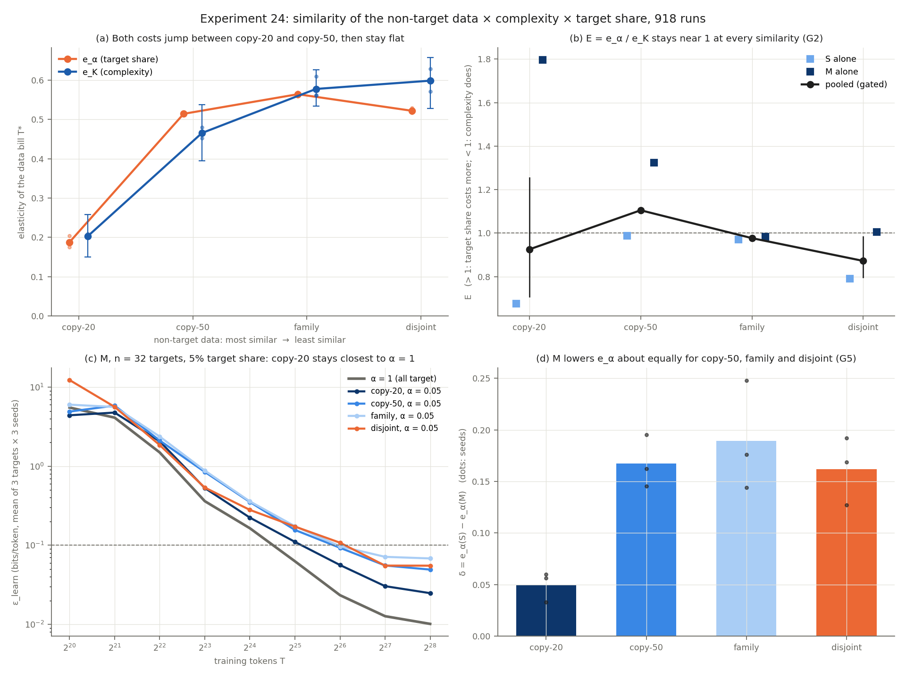

# Results: Experiment 24, similarity of the non-target data × complexity × target share

918 runs (9 targets: n = 8, 32, 64 hidden states, 3 each; 17 mixes: α = 1, and 4 distractor pools × α 0.01, 0.05, 0.2, 0.5; sizes S and M; 3 seeds), each trained to 2^28 tokens. Data bill T* = first crossing of ε* = 0.1 bits/token by ε_learn. Protocol: [PROTOCOL.md](PROTOCOL.md) (frozen at bcb148ff; pilot disclosure 106d7f12, the commit every shard ran). Run log: [CKPT_exp24.md](CKPT_exp24.md).

## Plain-language summary

Each target language got four kinds of "other" training data: near-copies of itself (80% of its rules kept, `copy20`), half-copies (`copy50`), unrelated languages of the same kind (`family`) and languages on a separate vocabulary (`disjoint`). We measured how much the data bill grows when the target gets a smaller share of the data (e_α) and when the target is more complex (e_K).

- **Only near-copies help, and the effect is a cliff, not a ramp.** With `copy20`, cutting the target's share costs little (e_α = 0.188). Already at `copy50` it costs as much as with unrelated data (e_α 0.514, 0.564, 0.522 for `copy50`, `family`, `disjoint`). The gap from `copy20` to `disjoint`, 0.334 [0.307, 0.361], is resolved in every seed. But `family` edges past `disjoint`, so the strict order G1 asks for fails: **G1 NOT_ESTABLISHED**.
- **Near-copies also make complexity cheap, by about the same factor.** e_K is 0.203 with `copy20` and 0.465–0.598 otherwise. It is above 0 at every level in every seed: **G4 SUPPORTED**.
- **So the winner never flips.** E = e_α/e_K is 0.925, 1.1, 0.977, 0.872 from `copy20` to `disjoint`. With disjoint data it is below 1 (0.872 [0.796, 0.984]), the opposite of the prediction. With near-copies it is undetermined (0.925 [0.708, 1.25]). **G2 NOT_ESTABLISHED.** The similarity of the other data sets the overall price of learning the target, not which of the two costs is larger. This agrees with Experiment 13-GPU's crossing-time reading (E ≈ 1).
- **A linear similarity law predicts worse, not better (G3).** On held-out `copy50` runs, adding the shared fraction to the law raises the error by 29% (RMSE 0.41 → 0.53; interval of the reduction [-36%, -24%]). The law places `copy50` halfway between `copy20` and `family`, but `copy50` behaves like `family` (the cliff). **G3 NOT_ESTABLISHED.**
- **The bigger model makes target share cheaper across the board, not for similar data specifically (G5).** δ = e_α(S) − e_α(M) is 0.0498, 0.168, 0.189, 0.162 from `copy20` to `disjoint`. The mean over the three similar levels, 0.136 [0.113, 0.165], does not exceed the disjoint one (A − δ(disjoint) = -0.0263 [-0.0526, -0.00461]). **G5 NOT_ESTABLISHED.**

## Predictions

Laolu's calls (CKPT, commit bfa5ad8f, 11-05-2026 23:54; verdicts only): G1 NOT_ESTABLISHED ✓, G2 SUPPORTED ✗, G3 SUPPORTED ✗, G4 SUPPORTED ✓, G5 SUPPORTED ✗: 2 of 5. **Order disclosure:** the protocol has predictions recorded before the analysis. Training finished hours sooner than estimated, and the autopilot ran the analysis at 21:14, before any predictions were recorded. Laolu had seen no result when making them; the verdicts were in the autopilot log, which the assistant read but did not relay.

## Deviations and disclosures

1. **Compute rules of PROTOCOL Section 7 changed during the run** (11-05-2026 10:21, after 317 of 918 shards). The frozen rules were at most 4 GPUs, ≤ 30% utilization, and "packing two runs per GPU" rejected. To finish sooner the queue then ran up to 3 of its jobs per GPU and also used busy GPUs with ≥ 24 GB free (`MAX_UTIL` 100). This is timing only: no measured quantity, seed, stream or checkpoint changed. Every shard, before and after, was replayed in float64 on its GPU (maximum difference 0), and the merged rerun reproduces every gate. The protocol listed packing as an added risk; it was not flagged as a deviation when made, and is disclosed here.
2. **Launch script fixes after the freeze.** The GPU picker never chose a fully idle GPU (fixed 11-03, 7ee42158). Runtime knobs were added (316e6e63). Neither changes experiment code or config.
3. **Pilot:** the 4× learning-rate multiplier, the top of the frozen grid, won for both sizes; a larger rate might do better (as in 13-GPU).
4. **Predictions were recorded after the analysis ran** (verdicts only, no numbers), before Laolu saw any result.
5. **Censoring at α = 0.01:** for `copy50`, `family` and `disjoint`, 17–18 of 27 runs per size never reached ε* by 2^28: every n = 32 and n = 64 run but one (M, `copy50`). The Tobit fit keeps them as censored; this is the least certain corner of the grid.

## Which PROTOCOL Section 4.6 row matches

None fits cleanly. G1 NOT_ESTABLISHED was written to mean "the share of exact target data matters about equally whatever the rest of the data is". Here similarity matters a lot (Δ resolved, every seed), but only between `copy20` and the rest; G1 fails on the strict order among the three dissimilar levels. With G2 NOT_ESTABLISHED, the closest reading is "similarity moves alignment's price, but not enough to flip which dial dominates", and it moves complexity's price with it.

## Gates (all at equal prominence)

Pooled over sizes (size intercepts, common slopes). Intervals: 95% two-stage bootstrap (seeds, then targets within level), 20,000 draws, 0 degenerate. Every gate also needs each seed's point condition.

| Gate | Estimate | 95% interval | Per seed | Threshold | Verdict |
|---|---|---|---|---|---|
| G1 similarity sets alignment's price | e_α copy-20 0.188, copy-50 0.514, family 0.564, disjoint 0.522; Δ(disjoint − copy-20) 0.334 | Δ [0.307, 0.361] | Δ 0.345, 0.345, 0.312 | monotone (no) and Δ lower > 0 | **NOT_ESTABLISHED** |
| G2 E crosses 1 | E disjoint 0.872, copy-20 0.925 | disjoint [0.796, 0.984]; copy-20 [0.708, 1.25] | (disjoint, copy-20) 0.841, 0.88; 0.871, 0.876; 0.906, 1.02 | disjoint lower > 1 and copy-20 upper < 1 | **NOT_ESTABLISHED** |
| G3 similarity adds predictive value (held-out copy-50) | reduction -29% (RMSE 0.41 → 0.53) | [-36%, -24%] | -31%, -31%, -27% | ≥ 10%, lower > 0 | **NOT_ESTABLISHED** |
| G4 complexity is real at every similarity | e_K copy-20 0.203, copy-50 0.465, family 0.577, disjoint 0.598 | copy-20 [0.15, 0.258]; copy-50 [0.395, 0.537]; family [0.533, 0.625]; disjoint [0.528, 0.656] | all > 0 in every seed | every lower > 0 | **SUPPORTED** |
| G5 bigger models use similar data | A 0.136; A − δ(disjoint) -0.0263 | A [0.113, 0.165]; A − δ(disjoint) [-0.0526, -0.00461] | (A, A − δ(disjoint)) 0.124, -0.0448; 0.166, -0.0256; 0.117, -0.0107 | both lower > 0 | **NOT_ESTABLISHED** |

## Elasticities by similarity and size

K in hidden states (primary). Pooled = the gated fit; S and M = the same Tobit fit within one size.

| Level | e_α pooled | e_α S | e_α M | e_K pooled | e_K S | e_K M | E pooled | E S | E M |
|---|---|---|---|---|---|---|---|---|---|
| copy-20 | 0.188 | 0.213 | 0.163 | 0.203 | 0.315 | 0.0907 | 0.925 | 0.675 | 1.8 |
| copy-50 | 0.514 | 0.594 | 0.426 | 0.465 | 0.601 | 0.322 | 1.1 | 0.987 | 1.32 |
| family | 0.564 | 0.655 | 0.465 | 0.577 | 0.674 | 0.473 | 0.977 | 0.971 | 0.983 |
| disjoint | 0.522 | 0.598 | 0.436 | 0.598 | 0.757 | 0.434 | 0.872 | 0.791 | 1.01 |

With `copy20`, M barely pays for complexity (e_K 0.0907), so its E is 1.8: the near-copies carry most of the target's structure. Per seed, the pooled E at `copy20` is 0.88, 0.876, 1.02.

## Secondary thresholds (reported, not gated)

| ε* | E copy-20 | E copy-50 | E family | E disjoint | Δ (G1) | G3 reduction | A (G5) | A − δ(disjoint) |
|---|---|---|---|---|---|---|---|---|
| 0.05 | 0.674 | 0.918 | 1.02 | 0.816 | 0.246 | -14% | 0.232 | -0.00923 |
| 0.1 | 0.925 | 1.1 | 0.977 | 0.872 | 0.334 | -29% | 0.136 | -0.0263 |
| 0.2 | 1.48 | 1.17 | 0.967 | 0.898 | 0.264 | -15% | 0.134 | -0.0107 |

At all three thresholds `copy20` has the smallest e_α by far and `copy50` sits closer to `family` and `disjoint` than to `copy20` (at 0.2 it is nearer the middle); the G3 reduction is negative and A − δ(disjoint) is near 0 or below. The level of E at `copy20` depends on the threshold (below 1 at 0.05, above 1 at 0.2); E with disjoint data is below 1 at all three.

## Censoring (crossed / right-censored / left-censored, of 27 runs per cell)

| Size | Level | α 0.01 | α 0.05 | α 0.2 | α 0.5 |
|---|---|---|---|---|---|
| S | copy-20 | 27/0/0 | 27/0/0 | 27/0/0 | 27/0/0 |
| S | copy-50 | 9/18/0 | 25/2/0 | 27/0/0 | 27/0/0 |
| S | family | 9/18/0 | 18/9/0 | 27/0/0 | 27/0/0 |
| S | disjoint | 9/18/0 | 22/5/0 | 27/0/0 | 27/0/0 |
| S | α = 1 | 27/0/0 | | | |
| M | copy-20 | 27/0/0 | 27/0/0 | 27/0/0 | 27/0/0 |
| M | copy-50 | 10/17/0 | 27/0/0 | 27/0/0 | 27/0/0 |
| M | family | 9/18/0 | 24/3/0 | 27/0/0 | 27/0/0 |
| M | disjoint | 9/18/0 | 27/0/0 | 27/0/0 | 27/0/0 |
| M | α = 1 | 27/0/0 | | | |

## Other reported quantities

- **Fitted-law E (secondary;** Experiment 13's `M_K_both` per size and level, K in bits): S copy-20 0.372, copy-50 0.678, family 0.765, disjoint 0.712; M copy-20 0.51, copy-50 0.63, family 0.671, disjoint 0.804. As in 13-GPU, the fitted law gives a lower E than the crossing times.
- **K in bits instead of states:** E copy-20 0.979, copy-50 1.17, family 1.03, disjoint 0.922.
- **Task2Vec alignment coefficient** (reported only): it orders the mixes as constructed. At α = 0.05: copy-20 0.923, copy-50 0.868, family 0.820, disjoint 0.757; all-target 0.982. Spearman with ln T* over 792 crossed runs: -0.27 (p = 2.6e-14).
- **Identification:** ε_id = log2(1/α)/128 at every level (0.052 bits at α = 0.01). Exact-Bayes posterior on the target after 16 tokens at α = 0.05: copy-20 0.87, copy-50 0.99, family 1.00, disjoint 1.00. Only near-copies are hard to tell apart from the target.
- **Loss on the run's own distractors at 2^28** (excess, bits/token, α = 0.05): S copy-20 0.043, copy-50 0.049, family 0.052, disjoint 0.050; M copy-20 0.038, copy-50 0.043, family 0.046, disjoint 0.044.
- **Convergence rule (Experiment 23) between 2^26 and 2^28:** 53 of 102 (size, n, level, α) cells converged. The 49 that did not are concentrated at low α (22 at 0.01, 11 at 0.05) and on the larger targets (23 at n = 64, 18 at n = 32, 8 at n = 8). So many runs were still improving at 2^28, which is what the censored likelihood is for.
- **Independent Tobit fitter:** AGREE (worst relative difference 2.5e-05).

## An open question

Even with disjoint distractors, e_α is 0.522, not 1. If only target tokens mattered, a 20 times smaller share would need a 20 times larger total. Here it needs about 4.8 times. 13-GPU's S model gave a similar value (η = 0.61, from its fitted law). One hypothesis, not tested here: part of every run's bill is not target-specific (generic sequence statistics, optimization warm-up), and that part is paid once whatever the share.

## Verification

Per shard, on its GPU right after training: DONE hashes, sources and concepts, training-stream regeneration (SHA-256 and document counts), float64 replay of all 9 checkpoints (< 1e-9 bits); 918 of 918 VERIFIED, maximum difference 0. Merged, on CPU (`verify24.py`, PASS in 715 s): 160 concepts regenerate with certified ranks, held-out documents regenerate, oracle and mixture code lengths agree with the log-space forward algorithm, every VERIFIED marker matches its DONE file, point estimates and verdicts identical on rerun, independent fitter agrees.

## Compute

SNAP skampere2 (8 × H200, shared with other users), 11-03-2026 09:22 to 11-05-2026 21:14. Mean wall time per M shard 400 s alone and about 510–560 s when sharing a GPU. Kept checkpoints: 246 GB on `/dfs/scratch1/laoluog1/tdc_exp24/runs/shards`.

**TLDR-end:** [tdc: Expt 24 results] Non-target data that shares 80% of the target's rules makes both the target-share cost and the complexity cost small, and data sharing 50% or less is as costly as unrelated data. The ratio E stays near 1 at every similarity, so similarity sets the price of learning the target, not which dial dominates; G4 SUPPORTED, G1, G2, G3, G5 NOT_ESTABLISHED; 918 of 918 runs verified.
