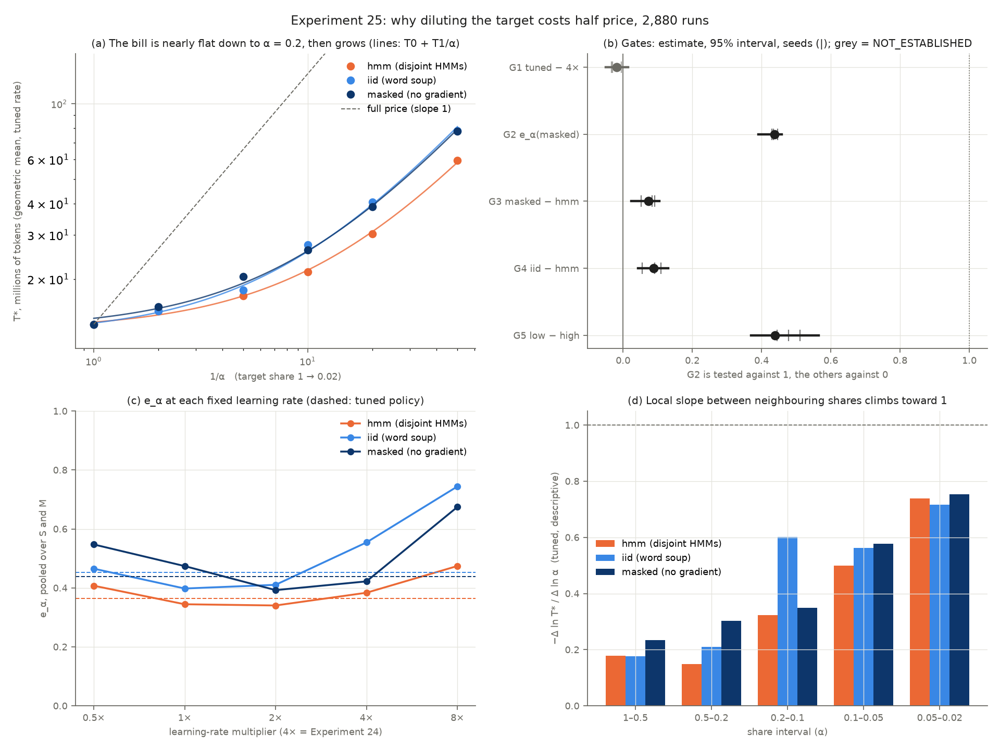

# Results: Experiment 25, why diluting the target with unrelated data costs only half price

2,880 runs (6 targets: Experiment 24's n = 8 and n = 32, 3 each; 16 mixes: α = 1, and 3 kinds of non-target data × α 0.5, 0.2, 0.1, 0.05, 0.02; 5 learning rates, 0.5× to 8×; sizes S and M; 3 seeds), each trained to 2^28 tokens. Data bill T* = first crossing of ε* = 0.1 bits/token by ε_learn. Protocol: [PROTOCOL.md](PROTOCOL.md) (frozen at c0db133d; pre-run amendment d6e6114c, the commit every shard ran). Run log: [CKPT_exp25.md](CKPT_exp25.md).

## Plain-language summary

In Experiment 24, cutting the target's share of the training data 20 times needed only about 4.8 times more training (e_α = 0.52), even when the rest of the data was unrelated. If only target tokens counted it would be 20 times (e_α = 1). Here e_α with the same unrelated languages is 0.365 [0.329, 0.402]. Four explanations were tested.

- **Not the learning rate (G1 NOT_ESTABLISHED).** Giving every cell its own best rate changes e_α by -0.0187 [-0.0501, 0.0151]. Across the five fixed rates e_α stays between 0.34 and 0.474. The protocol's premise was that 4× is too high for all-target data; instead the all-target cells chose 8×, the top of the grid, in 3 of 4 (size, n) cells.
- **Mostly the batch (G2 SUPPORTED).** When the unrelated documents stay in the batch but give no gradient (`masked`), e_α is still only 0.438 [0.391, 0.458], far below 1, in every seed. A smaller share of target documents per step costs much less than proportionally, with nothing learned from the other data. Most of the half price is this.
- **Unrelated languages help a little on top (G3 SUPPORTED).** With real unrelated HMM languages e_α is 0.0731 [0.0245, 0.104] lower than with no gradient at all.
- **That help needs their sequential structure (G4 SUPPORTED).** Word soup with the same word frequencies (`iid`) gives e_α 0.453, 0.0882 [0.0427, 0.131] above `hmm` and close to `masked` (0.438): it helps no more than ignoring the documents.
- **The slope is not one number (G5 SUPPORTED).** Above α = 0.2, e_α is 0.101 [0.0101, 0.165]; below it, 0.54 [0.511, 0.592]. Going from all target data to a 20% share barely costs anything (1.3× the tokens with `hmm`); from 20% to 2% costs 3.48×.

**In one sentence:** most of what a run needs at α = 1 is a fixed number of optimizer steps, not target data, so diluting the target is nearly free until the target documents per batch run short; unrelated languages with real structure then shave a little off the rest.

## Predictions

Laolu's calls (CKPT, commit 9e4912b0, 11-19-2026, before the analysis ran; the autopilot waited for that commit): G1 NOT_ESTABLISHED ✓, G2 SUPPORTED ✓, G3 SUPPORTED ✓, G4 SUPPORTED ✓, G5 SUPPORTED ✓: 5 of 5. Predicted e_α (tuned): `hmm` 0.5 (measured 0.365), `iid` 0.65 (measured 0.453), `masked` 0.8 (measured 0.438). Every verdict matched; every slope came in lower than predicted, and `iid` and `masked` came out nearly equal rather than `masked` the steepest. The predictions were made after a briefing that gave prior ranges for the slopes (disclosed in the CKPT entry); no result had been seen.

## Deviations and disclosures

1. **Pre-run amendment** (PROTOCOL Section 8, d6e6114c): the independent Tobit refit runs to a tight L-BFGS-B tolerance. The first launch halted at its unit tests; no prep, smoke or shard had run.
2. **The tuned learning rate often sits at the edge of the grid:** 33 of 64 (size, n, arm, α) cells chose 0.5× or 8×. PROTOCOL Section 7 kept five rates so the optimum would be inside the grid; for half the cells it is not. G1 is therefore NOT_ESTABLISHED for rates between 0.5× and 8× only. The all-target cells chose 8× in 3 of 4 cells, so a still higher rate might lower α = 1's bill and steepen the slope.
3. **No compute deviation.** The runtime limits of PROTOCOL Section 7 (≥ 24 GB free, ≤ 3 jobs per GPU, ≤ 12 jobs) were never raised; `state/` holds no override.
4. **Comparison with Experiment 24 is not like for like.** Experiment 24's 0.52 used 9 targets (n up to 64) and α from 0.01 to 1. Because the slope steepens at small shares (G5), the single fitted e_α depends on the α range: here (α 0.02–1, n = 8 and 32) the 4× reference gives 0.384, not 0.52.

## Which PROTOCOL Section 4.6 rows match

Three rows hold at once. **G2 SUPPORTED** with G3 only modest: dilution is cheap mainly because a full batch of target documents is more than a step needs, so e_α depends on the batch size, a training choice. **G3 and G4 SUPPORTED:** unrelated HMMs still teach something the target uses, and it needs their sequential structure; "disjoint" data is not irrelevant in this toy, but this is the smaller effect. **G5 SUPPORTED:** e_α is not one number; it approaches 1 at small shares, so one constant slope over α ∈ [0.02, 1] understates it where shares are small. **G1 NOT_ESTABLISHED:** Experiment 24's 0.5 is not an artifact of its single learning rate, within this grid.

## Gates (all at equal prominence)

Tuned learning rate (each cell's best multiplier, chosen again in every bootstrap draw), pooled over sizes. Intervals: 95% two-stage bootstrap (seeds, then targets within level), 20,000 draws, 0 degenerate. Every gate also needs each seed's point condition.

| Gate | Estimate | 95% interval | Per seed | Threshold | Verdict |
|---|---|---|---|---|---|
| G1 one rate biases e_α down: e_α(hmm, tuned) − e_α(hmm, 4×) | -0.0187 | [-0.0501, 0.0151] | -0.0311, -0.033, -0.00494 | lower > 0 | **NOT_ESTABLISHED** |
| G2 not purely token-limited: e_α(masked) | 0.438 | [0.391, 0.458] | 0.447, 0.43, 0.434 | upper < 1 | **SUPPORTED** |
| G3 disjoint HMMs substitute: e_α(masked) − e_α(hmm) | 0.0731 | [0.0245, 0.104] | 0.0918, 0.0843, 0.0528 | lower > 0 | **SUPPORTED** |
| G4 needs sequential structure: e_α(iid) − e_α(hmm) | 0.0882 | [0.0427, 0.131] | 0.0911, 0.11, 0.0547 | lower > 0 | **SUPPORTED** |
| G5 share-independent part: e_α low − e_α high (hmm, hinge at α 0.2) | 0.438 | [0.37, 0.565] | 0.51, 0.479, 0.444 | lower > 0 | **SUPPORTED** |

## Elasticities by arm, learning rate and size

Pooled = the gated fit (size intercepts, common slopes); S and M = the same Tobit fit within one size, tuned.

| Arm | e_α tuned [95%] | e_α S | e_α M | e_α low (α ≤ 0.2) | e_α high (α ≥ 0.2) | e_α 0.5× | e_α 1× | e_α 2× | e_α 4× | e_α 8× | e_K tuned | E tuned |
|---|---|---|---|---|---|---|---|---|---|---|---|---|
| hmm | 0.365 [0.329, 0.402] | 0.454 | 0.276 | 0.54 | 0.101 | 0.407 | 0.344 | 0.34 | 0.384 | 0.474 | 0.574 | 0.636 |
| iid | 0.453 [0.427, 0.473] | 0.568 | 0.338 | 0.632 | 0.183 | 0.465 | 0.398 | 0.41 | 0.554 | 0.744 | 0.644 | 0.703 |
| masked | 0.438 [0.391, 0.458] | 0.513 | 0.363 | 0.584 | 0.218 | 0.547 | 0.474 | 0.392 | 0.422 | 0.675 | 0.364 | 1.2 |

M has the flatter slope in every arm (`hmm`: S 0.454, M 0.276). Per seed, e_α(hmm, tuned) is 0.355, 0.346, 0.381. E = e_α/e_K is reported, not gated; with `masked` it is 1.2 [0.68, 1.91].

## Data bills by share (tuned rate, descriptive)

Geometric mean T* in millions of tokens over 2 sizes × 6 targets × 3 seeds (36 runs per cell; the α = 1 runs are shared by all arms). In parentheses: the cost relative to α = 1.

| Arm | α 1 | α 0.5 | α 0.2 | α 0.1 | α 0.05 | α 0.02 |
|---|---|---|---|---|---|---|
| hmm | 13.2 (1.00×) | 14.9 (1.13×) | 17.1 (1.30×) | 21.4 (1.62×) | 30.3 (2.29×) | 59.6 (4.52×) |
| iid | 13.2 (1.00×) | 14.9 (1.13×) | 18.1 (1.37×) | 27.4 (2.08×) | 40.5 (3.07×) | 78.0 (5.92×) |
| masked | 13.2 (1.00×) | 15.5 (1.18×) | 20.5 (1.55×) | 26.1 (1.98×) | 38.9 (2.95×) | 77.6 (5.88×) |

With the tuned rate no run in these cells is censored. Over all 2,880 runs: 2724 crossed, 156 right-censored (never reached ε* by 2^28), 0 left-censored; all censored runs are at rates the tuning did not choose.

## An exploratory reading: a fixed part and a share-proportional part

Not part of the frozen analysis. H4 wrote the bill as T* ≈ T0 + T1/α. Fitted by least squares in log space to the per-share geometric means above (tuned rate):

| Arm | T0 (fixed, M tokens) | T1 (target part at α = 1, M tokens) | T0 share of the α = 1 bill | RMS error (ln) | S: T0, T1 | M: T0, T1 |
|---|---|---|---|---|---|---|
| hmm | 12.5 | 0.92 | 93% | 0.022 | 8.4, 0.97 | 18.1, 0.83 |
| iid | 12.0 | 1.38 | 90% | 0.036 | 7.4, 1.53 | 18.2, 1.17 |
| masked | 12.6 | 1.33 | 90% | 0.035 | 7.9, 1.23 | 19.6, 1.38 |

The two-term law fits within a few percent. About 93% of the all-target bill is the fixed part, and in the `masked` arm that part cannot be paid by the ignored documents: it is a number of optimizer steps (T0 / 16,384 tokens per step ≈ 803 steps), which every run needs whatever its batch holds. This is the critical-batch-size picture: when a batch holds far more target documents than a step can use, training is step-limited and dilution is free; once α × 128 documents per step runs short, every lost target document must be made up, and the local slope approaches 1. The fitted turnover, α = T1/T0, is about 0.07 for `hmm`. The share-proportional part T1 is 31% smaller with real unrelated languages than with ignored documents (G3), and word soup gives no such saving (G4). The bigger model has the larger fixed part, so its slope over this α range is flatter. A consequence for the series: a single e_α fitted over a range of shares mixes these two regimes and depends on the range and the batch size.

## Learning rate and the α = 1 start

- **The α = 1 start-up penalty of PROTOCOL Section 1.2 reproduces at 4×** (M, n = 8, learning term at 2^20, 2^21, 2^22 tokens: 8.60, 8.69, 2.50 bits at α = 1 vs 2.86, 2.26, 1.02 at `hmm` α = 0.2). At 0.5× α = 1 starts much better (4.45, 0.73, 1.18), but the higher rates still reach ε* sooner: the slow start does not decide T*.
- **Tuned multipliers by arm** (count of the 16 (size, n, α) cells per arm; α = 1 has 4): `none` 0.5× 1, 1× 0, 2× 0, 4× 0, 8× 3; `hmm` 0.5× 2, 1× 1, 2× 3, 4× 5, 8× 9; `iid` 0.5× 6, 1× 6, 2× 4, 4× 3, 8× 1; `masked` 0.5× 2, 1× 0, 2× 2, 4× 7, 8× 9. `masked` and `hmm` lean to high rates; `iid` leans to low ones.
- **Diverged runs:** 0.

## Secondary thresholds (reported, not gated)

| ε* | e_α hmm | e_α iid | e_α masked | G1 | G2 | G3 | G4 | G5 |
|---|---|---|---|---|---|---|---|---|
| 0.05 | 0.517 | 0.568 | 0.537 | 0.0275 | 0.537 | 0.02 | 0.0503 | 0.292 |
| 0.1 | 0.365 | 0.453 | 0.438 | -0.0187 | 0.438 | 0.0731 | 0.0882 | 0.438 |
| 0.2 | 0.253 | 0.35 | 0.313 | 0.0398 | 0.313 | 0.0603 | 0.0966 | 0.442 |

At all three thresholds e_α(masked) is far below 1, `masked` and `iid` sit above `hmm`, and the hinge difference is positive. G1 changes sign with the threshold and stays small.

## Other reported quantities

- **Convergence rule (Experiment 23) between 2^26 and 2^28:** 102 of 320 (size, n, arm, α, rate) cells converged. Many runs were still improving between 2^26 and 2^28, after most had crossed ε*.
- **Identification term ε_id** (bits/token; 0 for `masked`, whose reference is the target alone): α 0.02 0.044, α 0.05 0.034, α 0.10 0.026, α 0.20 0.018, α 0.50 0.008.
- **Loss on the run's own distractors at 2^28** (excess, bits/token, α = 0.05): S hmm 0.037, iid 0.022, masked 23.960; M hmm 0.036, iid 0.025, masked 26.430. `masked` never trains on them, as intended.
- **Independent Tobit fitter:** AGREE (worst relative difference 8.2e-07).

## Verification

Per shard, on its GPU right after training: DONE hashes, sources and concepts, training-stream regeneration, float64 replay of every checkpoint; 2,880 of 2,880 VERIFIED, maximum difference 0. Merged, on CPU (`verify25.py`, PASS in 434 s): 54 concepts regenerate with certified ranks, evaluation documents regenerate, oracle and mixture code lengths agree with the log-space forward algorithm (max difference 2.5e-13 bits), point estimates and verdicts identical on rerun, independent fitter agrees.

## Compute

SNAP skampere2 (8 × H200, shared with other users), 11-08-2026 14:55 to 11-11-2026 10:40; analysis 11-19-2026 after the predictions commit. 662 GPU-hours of job wall time (mean 500 s per S run and 1156 s per M run on shared GPUs, against the protocol's 216-hour estimate from idle-GPU timings). Kept checkpoints (2^28 only): 155 GB on `/dfs/scratch1/laoluog1/tdc_exp25/runs/shards`.

**TLDR-end:** [tdc: Expt 25 results] Diluting a target with unrelated data costs half price mainly because most of a run's bill is a fixed number of optimizer steps: even when the other documents give no gradient, e_α is 0.438. Unrelated languages with real structure shave a little more off (0.0731), word soup does not, the slope climbs toward 1 below a 20% share, and per-cell learning rates do not change it; G2, G3, G4, G5 SUPPORTED, G1 NOT_ESTABLISHED; 2,880 of 2,880 runs verified.
