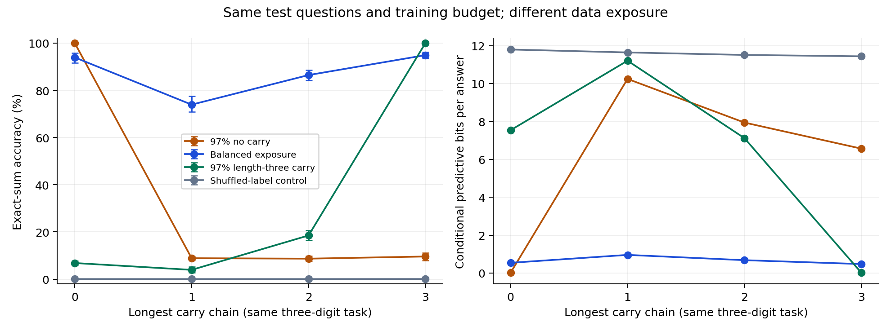

# Fixed-task addition: large exposure effects, retention criterion missed

**Doc link:** <https://github.com/brando90/the-difficulty-confound/blob/main/experiments/archive/01_fixed_width_addition_exposure/RESULTS_addition_exposure.md>

**TLDR:** Balanced training raised length-three-carry exact-sum accuracy from 9.60% to 94.89% and recovered 94.34% [92.74, 95.86] of the predefined baseline gap across eight paired seeds. The stricter prospective criterion **did not pass**: no-carry accuracy fell from 100.00% to 93.92%, a 6.08-point decline exceeding the allowed five points.

## Question and scope

In `experiments/archive/01_fixed_width_addition_exposure/`, does changing training exposure recover most of an apparent difficulty gap while the operational task remains fixed? The task is exact addition of two zero-padded three-digit integers. Every condition uses the same 4,000 held-out unordered pairs and scorer; training data alone change across paired conditions.

This establishes a large exposure effect for one small neural architecture in a synthetic setting. It does not establish that most real-world language-model difficulty is caused by data, nor that latent skills or strategies are invariant.

## Primary result and prospective verdict

| Quantity | Estimate [95% interval] | Test or decision |
|---|---:|---|
| Baseline no-carry minus length-three-carry gap | 90.40 [88.78, 92.15] percentage points | Protocol minimum: 20; p-val=n/a |
| Length-three-carry gain from balanced exposure | 85.29 [83.28, 87.56] percentage points | Descriptive paired effect; p-val=n/a |
| Fraction of the baseline gap recovered | 94.34 [92.74, 95.86]% | Lower endpoint must exceed 50% |
| No-carry accuracy change | -6.08 [-8.39, -4.11] percentage points | Protocol permits a drop of at most 5 points; **FAIL** |
| Gain minus half the baseline gap | 40.09 [38.49, 41.69] percentage points | One-sided exhaustive paired sign-flip p-val=0.00390625 |

Five of six prospective criteria passed. The criterion missed is retention of no-carry performance; balanced length-three-carry accuracy exceeded the required 90%. The shuffled-label control achieved 22/32,000 = 0.06875% exact sums across the fixed test set and eight seeds, below the protocol's 5% threshold. The aggregate protocol verdict is `NOT_ESTABLISHED_IN_THIS_SETUP`. The supporting p-value does **not** override the failed retention criterion.

The test considers the eight paired values “length-three gain minus half of baseline gap.” The null is a nonpositive mean, evaluated at its zero boundary under a symmetry assumption for paired differences; all 256 sign assignments are enumerated. It is an auxiliary diagnostic, not a randomized-treatment permutation guarantee. No other inferential tests were run; descriptive table entries use p-val=n/a. Thresholds were proposed by the agent and frozen before training.

## Fixed test results

Each row contains 1,000 distinct fixed test pairs evaluated under eight independently initialized and data-sampled models: 8,000 predictions, **not 8,000 independent test items**. Across all rows there are 128,000 predictions on 4,000 unique test pairs. Accuracy means exact equality of all four output digits.

| Training distribution | Carry-chain length | Exact sums / predictions | Accuracy %, 95% interval | Across-seed standard deviation, points | Predictive bits / answer, 95% interval |
|---|---:|---:|---:|---:|---:|
| 97% no-carry training | 0 | 8000/8000 | 100.00 [100.00, 100.00] | 0.00 | 0.021 [0.018, 0.024] |
| 97% no-carry training | 1 | 710/8000 | 8.88 [8.08, 9.65] | 1.21 | 10.241 [9.446, 11.048] |
| 97% no-carry training | 2 | 695/8000 | 8.69 [7.50, 9.84] | 1.80 | 7.940 [7.454, 8.443] |
| 97% no-carry training | 3 | 768/8000 | 9.60 [7.85, 11.22] | 2.65 | 6.564 [6.104, 6.997] |
| Balanced training | 0 | 7514/8000 | 93.92 [91.61, 95.89] | 3.34 | 0.540 [0.438, 0.681] |
| Balanced training | 1 | 5914/8000 | 73.92 [70.83, 77.51] | 5.26 | 0.958 [0.853, 1.088] |
| Balanced training | 2 | 6916/8000 | 86.45 [84.15, 88.50] | 3.39 | 0.679 [0.591, 0.799] |
| Balanced training | 3 | 7591/8000 | 94.89 [93.45, 96.25] | 2.19 | 0.475 [0.405, 0.574] |
| 97% length-three-carry training | 0 | 547/8000 | 6.84 [5.79, 7.79] | 1.54 | 7.538 [7.171, 7.972] |
| 97% length-three-carry training | 1 | 315/8000 | 3.94 [2.86, 5.22] | 1.84 | 11.203 [10.277, 11.998] |
| 97% length-three-carry training | 2 | 1481/8000 | 18.51 [16.49, 20.72] | 3.29 | 7.118 [6.595, 7.568] |
| 97% length-three-carry training | 3 | 8000/8000 | 100.00 [100.00, 100.00] | 0.00 | 0.017 [0.016, 0.018] |
| Shuffled-label control | 0 | 5/8000 | 0.06 [0.03, 0.09] | 0.05 | 11.793 [11.676, 11.908] |
| Shuffled-label control | 1 | 5/8000 | 0.06 [0.01, 0.11] | 0.07 | 11.639 [11.590, 11.680] |
| Shuffled-label control | 2 | 5/8000 | 0.06 [0.03, 0.10] | 0.05 | 11.507 [11.425, 11.580] |
| Shuffled-label control | 3 | 7/8000 | 0.09 [0.05, 0.12] | 0.06 | 11.434 [11.312, 11.573] |

Accuracy error bars are 95% paired-seed bootstrap intervals. The right panel shows mean predictive bits; their intervals are in the table. A point interval at 100% means all eight fitted models were perfect on this fixed subset, not certainty about unseen tasks.

## Secondary result: difficulty ordering reverses

With 97% no-carry training examples, no-carry questions score 100.00% [100.00, 100.00] and length-three questions score 9.60% [7.85, 11.22]. With 97% length-three-carry training examples, the same respective test groups score 6.84% [5.79, 7.79] and 100.00% [100.00, 100.00]; p-val=n/a for this descriptive secondary comparison. The group that appears harder changes with exposure, despite identical test questions and the same addition function.

Balanced training also makes length-one chains less accurate than length-three chains. Thus carry-chain length is a proposed structural factor, not an empirically validated monotone scale of difficulty. We retain all intermediate strata, including this nonmonotonicity.

## What complexity adds

For fixed universal machine U, input x, answer y, and task specification s, conditional Kolmogorov complexity K_U(y | x, s)—the shortest program producing y given x and s—does not change across our paired exposure conditions. We did not compute it. A short description is compatible with expensive execution or difficult learning; this experiment does not refute computational complexity.

Our measured quantity is conditional predictive code length under each trained network, excluding the cost of the network and training data. For length-three carries it falls from 6.564 [6.104, 6.997] to 0.475 [0.405, 0.574] bits per answer under balanced exposure; p-val=n/a. This is evidence of improved learner-dependent predictability, not a measurement of Kolmogorov complexity or a complete minimum description length code. [Definitions, sources, and limitations](COMPLEXITY.md).

## Methods and uncertainty

The 29,480-parameter feed-forward neural network uses six decimal digit one-hot encodings, two hidden layers of width 128, and four categorical output heads. All models train from scratch on 16,000 distinct pairs for 3,000 updates with 256 examples per update (768,000 presentations). Initialization and minibatch-position sequences are paired within seeds. Optimizer, representations, update count, test items, and scorer stay fixed.

Eight seeds are the resampling unit. The analysis uses 20,000 paired percentile bootstrap draws with fixed analysis seed 16102026. Intervals describe variation over training initialization and sampled training sets conditional on this one held-out split, architecture, and optimizer. They do not capture uncertainty over task families, architectures, hyperparameters, or population test-set sampling. The table reports standard deviations across per-seed accuracies, not variability across individual correct/incorrect answers.

Validation (1,000 additional pairs) was evaluated only at the final checkpoint and was not used for selection. Its complete per-seed scores are in [metrics.csv](expt_v1/results/metrics.csv); the report's headline numbers use test only. The [locked protocol](PROTOCOL.md) and [original pre-run version](https://github.com/brando90/the-difficulty-confound/blob/db2dc6d46186193cc07f13153b3a36848afc8d74/experiments/01_fixed_width_addition_exposure/PROTOCOL.md) specify every setting and criterion.

## Verification and provenance

- 32/32 training cells completed; 0 interrupted, failed, or unattempted cells. Training wall time: 159.02 seconds on skampere2 using two processor threads, no graphics processor.
- Independent column addition agreed with Python integer addition on 500,500/500,500 possible unordered pairs before training. A second carry-label implementation verified all 500,500 pairs afterward.
- Independently checked 512,000 training rows and 160,000 prediction rows, including validation; zero training/held-out overlap, with swapped pairs excluded by construction.
- All 32 saved tensor checkpoints contain 29,480 finite parameters. Every condition uses the identical test and validation item identities.
- Local analysis of the transferred per-item tables reproduced the remote summary **exactly**. Frozen training-source and configuration hashes match the runtime receipt.
- Python 3.11.12; PyTorch 2.7.0+cu126; NumPy 2.2.6. Training source revision `db2dc6d46186193cc07f13153b3a36848afc8d74`. [Runtime](expt_v1/results/runtime.json), [verification](expt_v1/results/verification.json), [summary](expt_v1/results/summary.json), [cell ledger](expt_v1/results/cells.json).
- The original protocol, training source, and configuration remain byte-for-byte unchanged. Post-run edits only add a generated-document link, this verification script, reporting, and the archive location; no training or analysis formula changed. The frozen protocol's launch-time document link is historical; use the immutable pre-run link above.
- Full training manifests, per-item predictions, learned weights, and source are committed. No remote access is required to recompute the reported numbers. The training console is retained as execution.txt.

## Limits and the next discriminating test

The extreme training distributions deliberately induce different coverage; they do not estimate naturally occurring model training mixtures. They also change digit-pair combinations and answer frequencies. This experiment identifies the total effect of that data-distribution intervention, not carry exposure as its unique mediator. Held-out arithmetic pairs establish generalization beyond exact examples, not transfer to longer numbers or a different task family.

[p 9/10] A separately frozen replication should test a milder exposure grid with a control-performance criterion and feature-matched digit/answer marginals. Its purpose is to learn whether the large target gain survives without the observed control-performance loss; it must retain this first run's failed criterion and cannot retroactively tune it into a success. This follow-up has not been run.
