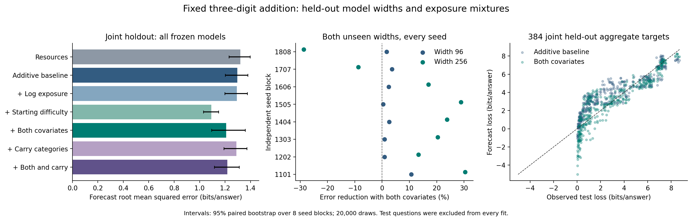

# Results: held-out exposure and difficulty laws

**Doc link:** <https://github.com/brando90/the-difficulty-confound/blob/main/experiments/archive/02_heldout_exposure_difficulty_laws/RESULTS_heldout_laws.md>

**TLDR:** NOT_ESTABLISHED: adding log exposure and independently probed starting difficulty changed joint held-out forecast error by a reduction of 6.80% [-3.52, 14.80]. This is a controlled transfer test of the alignment-law functional form, not validation on Varun's original language models.

Completed on 10-16-2026: 200/200 intervention trajectories and 40 warm starts, eight independent seed blocks, 25.55 training minutes on skampere2, two processor threads. No language-model provider calls. Frozen source: `337149b051256420e82f746712cf00a79316b682`. [Protocol](PROTOCOL.md) · [Configuration](expt_v1/config.json) · [Verification](expt_v1/results/verification.json).



## What was predicted

The outcome is mean correct-answer negative log probability in bits for each maximum carry-chain stratum. Every trained network performs the same exact three-digit addition task. We fit the law on widths 32, 64, 128 and long-carry training fractions .02, .25, .80; withheld widths 96 and 256 and fractions .10 and .50 never contribute outcomes to fitting. The parameter counts are 4,328 (width 32), 10,664 (64), 29,480 (128), 19,048 (96), and 91,688 (256). The two withheld mixtures interpolate between fitting mixtures; width 96 interpolates and width 256 extrapolates in capacity. All five mixtures at a given width and seed share the same balanced 500-update warm start and optimizer reset.

Each seed has 108 calibration aggregates. The primary joint holdout has 48 targets per seed, 384 total, at 300, 1,000 and 3,000 updates and four carry strata. Targets weight each width, mixture, checkpoint, and carry stratum equally; this is not weighting by the natural frequency of carry patterns. These aggregates share 4,000 test questions, not 384 independent training replicates. One thousand separate questions calibrate the laws; another thousand probe starting difficulty. Every training pool excludes all 6,000 held-out questions and their operand swaps. Training examples can overlap across mixture conditions, deliberately preserving the paired comparison.

The transferred baseline is loss = a + b N^(-beta) + c T^(-gamma) - d q. Here N is parameter count, T is intervention updates, and q is the known training fraction of the evaluated stratum. Replacing the original semantic alignment score with q is an explicit adaptation. The full extension adds e log(q) + f D, where D is the starting model's mean loss on its independent probe. The log-exposure term is a nonlinear transformation of q, which the baseline already observes; it adds functional flexibility, not new information. D supplies the new measurement. Obtaining D requires 1,000 probe evaluations per starting model, including each unseen width. It never uses a future outcome. This is supervised neural-network training, not reinforcement learning.

## Primary held-out result

| Forecast model | Root mean squared error, 95% interval | Mean absolute error | Signed bias | Prediction mean | Outcome mean | Negative forecasts / 384 |
|---|---:|---:|---:|---:|---:|---:|
| Resources | 1.3204 [1.2307, 1.3964] | 1.0719 | +0.6595 | 3.7731 | 3.1135 | 0 |
| Additive baseline | 1.2969 [1.2015, 1.3780] | 1.0625 | +0.6595 | 3.7731 | 3.1135 | 8 |
| + Log exposure | 1.2933 [1.1985, 1.3749] | 1.0599 | +0.6528 | 3.7663 | 3.1135 | 8 |
| + Starting difficulty | 1.0920 [1.0304, 1.1484] | 0.8140 | +0.1081 | 3.2216 | 3.1135 | 52 |
| + Both covariates | 1.2087 [1.0941, 1.3590] | 0.8866 | -0.1597 | 2.9539 | 3.1135 | 64 |
| + Carry categories | 1.2892 [1.1917, 1.3717] | 1.0440 | +0.6595 | 3.7731 | 3.1135 | 14 |
| + Both and carry | 1.2179 [1.1157, 1.3111] | 0.9855 | +0.4961 | 3.6096 | 3.1135 | 19 |

Units are bits per answer. Signed bias is prediction minus observation; positive means pessimistic forecasts of loss. Intervals are paired percentile bootstrap intervals over eight independently fitted seed blocks (20,000 draws). They condition on this fixed question set and model family; checkpoints and questions are not resampled as independent runs. p-val=n/a: this is an estimation comparison, not a null-hypothesis test.

The prospective gate requires at least a 10% joint error reduction, positive lower confidence bound, and positive point improvement at both held widths. The 10% practical threshold was chosen in our protocol. The verdict is computed from all three conditions, without selecting a checkpoint or seed.

| Holdout | Full versus additive: relative error reduction, 95% interval | Target aggregates |
|---|---:|---:|
| joint | 6.80% [-3.52, 14.80] | 384 |
| joint_width_96 | 3.38% [1.19, 6.51] | 192 |
| joint_width_256 | 9.48% [-7.60, 24.25] | 192 |
| model_only | 0.40% [-8.63, 6.82] | 576 |
| mixture_only | 3.75% [3.13, 4.40] | 576 |

## Do both covariates help?

A full-model improvement alone cannot establish an independent contribution from each covariate. These secondary ablations keep the same fitting and joint holdout protocol; they are descriptive, with no multiple-comparison significance claims.

| Baseline → augmented | Relative error reduction, 95% interval |
|---|---:|
| resources → additive | 1.78% [1.21, 2.47] |
| additive → exposure | 0.28% [0.02, 0.75] |
| additive → difficulty | 15.80% [10.27, 20.52] |
| exposure → full | 6.54% [-3.81, 14.59] |
| difficulty → full | -10.69% [-20.54, -2.54] |
| structural → full_structural | 5.53% [2.97, 10.42] |

## Interpretation and limits

The primary joint extension missed both the 10% practical threshold and the positive confidence-bound requirement. Both width-specific point estimates were positive. The predeclared starting-difficulty-only ablation reduced joint error by 15.80% [10.27, 20.52] across eight seeds, a secondary result that merits fresh replication. Adding log exposure on top worsened error by 10.69% (relative reduction -10.69% [-20.54, -2.54]). Its pooled calibration error improved from 1.3533 to 1.3399 bits, while held-out error worsened from 1.0920 to 1.2087: extra fit flexibility did not generalize here. p-val=n/a.

The difficulty-only model produced 52/384 negative loss forecasts; the combined model produced 64/384. These physically invalid predictions limit practical use of the unbounded additive form even where its average error improves. We retained them exactly as the frozen protocol required.

- The prediction task, test identities, notation, and evaluation rule are fixed. Width is deliberately varied; conclusions are about a fixed operational task, not proof that latent internal strategies are identical.
- Exposure changes the training distribution and also digit/answer marginals. This identifies the specified distribution intervention, not a uniquely carry-specific mechanism. More diverse language tasks and additional model families remain untested.
- D is a measured property of a starting model on independent questions. It is not an intrinsic, model-independent property of an item, nor an estimate of unknown pretraining frequency. It can capture capacity, optimization, and structural effects as well as learned familiarity; its predictive value alone does not identify exposure as the dominant cause.
- The seven models, exponent grid, coefficient bounds, and decisions were frozen before outcomes. The nonlinear exponent grid is coarse; these are declared adaptations, not the original continuous optimizer. Forecasts are not clipped; negative loss predictions reveal limitations of the additive form.
- Conditional predictive code length measures model-dependent uncertainty. Formal conditional Kolmogorov complexity stays fixed for unchanged input, answer, specification, and universal machine; it is not computable in general. The measured bits exclude the costs of describing the model and data, so they are not a complete minimum-description-length result.
- The joint improvement was not established. The secondary difficulty-only result identifies a useful candidate covariate in this controlled setting, without establishing that difficulty is mostly data across language models.

## Actual alignment-law observations

A companion retrospective analysis was executed on 24 mathematics observations from the original, private alignment repository. Available metadata support a training-breadth proxy; independently measured pre-update difficulty and repeated exposure are absent. Brando authorized publication of the used observations, summary, and predictions on 10-16-2026. Adding the breadth proxy worsened joint held-out error by 1.14% (relative reduction -1.14% [-9.58, 0.57], descriptive interval over four model-size blocks; p-val=n/a). This does not measure actual repeated exposure or starting difficulty. [Companion report and reproducible inputs](RESULTS_actual_math.md). No original-data claim is substituted by the controlled addition result.

## Verification and reproduction

Independent verification passed: 3,000,000 stored per-item predictions, 4,800 aggregates, 10,752 forecasts, all 40 training manifests, all 240 warm/final weight files, zero split overlap, and independently recomputed primary bootstrap. Final weight replay has maximum absolute probability-code-length difference 0 bits on this verification host.

The committed result tables and compressed NumPy per-item arrays are sufficient to reproduce every public number without cluster access. Frozen coefficients and forecasts are saved before the first final-test outcome read in the analysis process. Source, calibration, configuration, and forecast hashes are recorded. Training wrote the final-test files earlier, but the fitting process did not read them before freezing forecasts.

```bash
python experiments/archive/02_heldout_exposure_difficulty_laws/expt_v1/verify_artifacts.py
python experiments/archive/02_heldout_exposure_difficulty_laws/expt_v1/report.py
```

The verifier checks recorded forecasts against frozen coefficients and recomputes the primary interval. Refitting with `analyze.py` requires the recorded numerical environment and refuses to overwrite changed frozen forecasts. A fresh training reproduction must use a new output path: `run.py --output /path/to/new-run`, followed by `analyze.py --output /path/to/new-run`.

Detailed tables: [all metrics](expt_v1/results/forecast_metrics.csv), [all ablations](expt_v1/results/forecast_comparisons.csv), [every seed](expt_v1/results/seed_forecast_metrics.csv), [all scored forecasts](expt_v1/results/scored_forecasts.csv), [frozen coefficients](expt_v1/results/frozen_forecasts.json).
