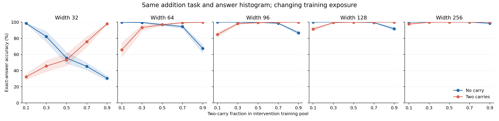

# Answer-matched alignment: complete results

**Doc link:** <https://github.com/brando90/the-difficulty-confound/blob/main/experiments/archive/03_answer_matched_alignment/RESULTS_matched_alignment.md>

**TLDR:** Changing training exposure reverses the carry-stratum difficulty ranking at every width; the frozen rank-reversal criterion is **SUPPORTED**. The separate starting-difficulty prediction law fails, increasing joint held-out root mean squared error from 0.4727 to 292.7941 bits/answer; its criterion is **NOT_ESTABLISHED**.

## What was tested

All 200 trajectories and 40 shared warm starts completed: eight paired seeds, five widths, five training mixtures, three fixed checkpoints. Every condition adds the same three-digit integers with the same reference and notation; only the intervention training distribution changes within each width. Every intervention has 4,680 distinct training pairs and exactly 40 examples for each of 117 answer values. Evaluation has 1,872 fixed questions (936 per carry stratum); calibration and independent starting-difficulty probes each have 936 questions. No pairs or swapped pairs cross splits. Both evaluation strata have identical exact-answer histograms.

The warmup-plus-intervention pool is 6,552 pairs at both primary endpoints; intermediate mixtures have smaller unions. The 9:1 ratio describes the intervention, after 500 balanced warmup updates. [Accounting and remaining input confounds](SAMPLING_NOTES.md). This restricted population uses no-carry and two-carry examples with totals below 1000; it is not the full addition population from the earlier studies.

## Primary intervention result

| Contrast at 3,000 intervention updates | Mean [95% interval], percentage points | Seed standard deviation, points |
|---|---:|---:|
| No-carry advantage with 90% no-carry training | 25.30 [23.14, 27.26] | 3.21 |
| Two-carry advantage with 90% two-carry training | 24.58 [22.88, 26.19] | 2.56 |
| Alignment contrast A | 24.94 [23.27, 26.40] | 2.44 |
| Residual carry main effect S | 0.36 [-0.60, 1.40] | 1.57 |
| No-carry advantage under balanced training | 0.52 [0.22, 0.84] | 0.48 |
| A − absolute S | 24.58 [22.75, 25.97] | — |

Verdict: **SUPPORTED**. The frozen criterion requires both endpoint advantage means at least 10 points, both lower interval bounds above zero, and both advantages positive at each width. Ten points is a prespecified project practical margin, not a literature threshold. Intervals resample eight whole paired seed blocks 20,000 times, averaging widths within seed; they condition on one fixed test set. p-val=n/a: decision uses the interval gate, with no separate significance test. The A/S comparison applies only to this specified intervention and accuracy scale.

| Width | No-carry advantage at q=.1, points | Two-carry advantage at q=.9, points | Balanced no-carry gap, points |
|---|---:|---:|---:|
| 32 | 66.16 | 67.49 | 2.14 |
| 64 | 34.15 | 32.43 | 0.11 |
| 96 | 15.30 | 13.25 | 0.27 |
| 128 | 8.60 | 8.27 | 0.01 |
| 256 | 2.30 | 1.46 | 0.05 |

| Two-carry training fraction | Evaluation stratum | Accuracy [95% interval], % | Seed standard deviation, points |
|---|---|---:|---:|
| 0.1 | No carry | 99.67 [99.59, 99.76] | 0.13 |
| 0.1 | Two carries | 74.37 [72.42, 76.54] | 3.20 |
| 0.5 | No carry | 90.40 [89.20, 91.74] | 1.97 |
| 0.5 | Two carries | 89.88 [88.57, 91.28] | 2.09 |
| 0.9 | No carry | 74.95 [73.21, 76.74] | 2.74 |
| 0.9 | Two carries | 99.53 [99.36, 99.68] | 0.25 |

Accuracy averages five widths within each of eight paired seeds; every stratum has the same 936 fixed evaluation items. [Machine-readable endpoint accuracies](expt_v1/results/endpoint_accuracy.csv).



Shading: 95% paired-seed intervals at each point. Every checkpoint, width, mixture and stratum is retained in [accuracy_summary.csv](expt_v1/results/accuracy_summary.csv); no favorable checkpoint was selected.

## Prospective prediction result

Five fixed log-linear laws fit log calibration loss separately within each seed and exponentiate forecasts, guaranteeing positive predictions. Fits use only widths 32/64/128 and mixtures .1/.5/.9; widths 96/256 and mixtures .3/.7 are held out. Fifty-four calibration cells fit each seed; joint evaluation has 192 targets per law (eight seeds × two widths × two mixtures × three checkpoints × two strata). Starting difficulty is loss on a separate probe after common warmup, before intervention. Coefficients and all 3,840 forecasts were saved before the analysis opened final-test outcomes.

These power-law models test the portability of a starting-difficulty feature. They change the functional form from the previous additive law and do not constitute a fresh test on Varun’s original mathematics data.

| Joint held-out law | Root mean squared error [95% interval], bits/answer | Mean absolute error | Bias | Forecast mean | Observed mean |
|---|---:|---:|---:|---:|---:|
| Resources | 0.4321 [0.2821, 0.5550] | 0.2184 | -0.1534 | 0.3204 | 0.4739 |
| Resources + carry | 0.4314 [0.2824, 0.5541] | 0.2187 | -0.1530 | 0.3209 | 0.4739 |
| Resources + exposure | 0.4735 [0.3215, 0.5997] | 0.2440 | -0.2009 | 0.2729 | 0.4739 |
| Resources + carry + exposure | 0.4727 [0.3212, 0.5990] | 0.2440 | -0.2005 | 0.2733 | 0.4739 |
| Resources + carry + exposure + starting difficulty | 292.7941 [0.3588, 507.0797] | 50.0764 | +49.6998 | 50.1736 | 0.4739 |

Starting-difficulty criterion: **NOT_ESTABLISHED**, relative error reduction **-61835.64% [-140226.76, 27.71]**. Required: at least 10% improvement, a positive lower interval bound, and a positive improvement at both held-out widths. Positive means better; negative means worse. All forecasts were finite and positive. Bias is forecast minus observation; positive means overestimated loss. Intervals resample the eight paired seed blocks; targets within a seed are not independent. p-val=n/a.

| Split | Added feature(s) | Relative error reduction [95% interval], % | Targets per law |
|---|---|---:|---:|
| joint | Starting difficulty beyond structure + exposure | -61835.64 [-140226.76, 27.71] | 192 |
| joint | Exposure beyond structure | -9.58 [-14.25, -7.86] | 192 |
| joint | Structure beyond exposure | 0.16 [-0.03, 0.31] | 192 |
| model_only | Starting difficulty beyond structure + exposure | -97255.94 [-182830.65, -19.01] | 288 |
| model_only | Exposure beyond structure | 16.08 [5.24, 22.10] | 288 |
| model_only | Structure beyond exposure | 0.01 [-0.30, 0.29] | 288 |
| mixture_only | Starting difficulty beyond structure + exposure | 9.78 [3.63, 16.48] | 288 |
| mixture_only | Exposure beyond structure | 6.69 [6.07, 7.20] | 288 |
| mixture_only | Structure beyond exposure | -0.51 [-0.87, -0.24] | 288 |
| joint_width_96 | Starting difficulty beyond structure + exposure | 0.95 [-46.74, 31.65] | 96 |
| joint_width_96 | Exposure beyond structure | -9.86 [-15.01, -8.00] | 96 |
| joint_width_96 | Structure beyond exposure | 0.15 [-0.03, 0.31] | 96 |
| joint_width_256 | Starting difficulty beyond structure + exposure | -990472.38 [-1917590.71, -229.45] | 96 |
| joint_width_256 | Exposure beyond structure | 27.79 [23.95, 33.10] | 96 |
| joint_width_256 | Structure beyond exposure | 0.56 [-0.19, 1.22] | 96 |

All splits and laws: [metrics](expt_v1/results/prediction_metrics.csv), [comparisons](expt_v1/results/prediction_comparisons.csv), [scored forecasts](expt_v1/results/scored_forecasts.csv), [fit coefficients and training IDs](expt_v1/results/frozen_forecasts.json). The incremental exposure and structure contrasts are secondary; no multiple-comparison-adjusted claim is made.

## Post hoc diagnosis of the failed prediction law

The starting-difficulty extension has finite, positive forecasts but fails badly: joint error rises from 0.4727 to 292.7941 bits/answer. Seed 2505 contributes 99.9677% of its joint squared error. Its largest forecast is 2737.3272 bits against 0.0932 observed (width 256, mixture 0.3, 300 updates, two carries).

That seed fits starting difficulty only in [2.5316, 3.9151] bits, whereas held-out starting difficulty reaches 0.5135. Its fitted starting-difficulty exponent is -7.1966; the negative exponent amplifies predictions when extrapolating to lower starting difficulty. All fits have full column rank, and independent forecast reconstruction matches exactly. These observations identify an extrapolation failure route, not evidence of a serialization or floating-point bug.

This diagnostic was added after seeing the failed criterion. It neither removes the offending seed nor changes fitting, forecasts, thresholds or the verdict. Positive output constraints prevent negative predictions but do not make extrapolation reliable. [All eight seed diagnostics](expt_v1/results/posthoc_prediction_diagnostics.csv) · [diagnostic source](expt_v1/diagnose.py).

## Complexity and construct limits

Input marginal audit: total variation distance (half the absolute differences summed over ten digits) between endpoint training distributions, averaged across eight seeds, is 0.6459, 0.5786, 0.0668, 0.6469, 0.5853, 0.1336 for the six input positions (little-endian digits of the first operand, then the second). Zero would mean identical digit marginals; these values quantify the remaining mismatch. [All seed/position distances](expt_v1/results/input_marginal_distances.csv).

Carry-chain length describes a structural demand of standard column addition; it is not Kolmogorov complexity or an asymptotic runtime lower bound. For an identical evaluation item and fixed reference machine, changing training data does not change the shortest-program description of its answer conditional on the input and task. This invariance requires no computation of that uncomputable quantity. [Detailed distinction and sources](../01_fixed_width_addition_exposure/COMPLEXITY.md).

The observed ranking reversal shows that carry structure alone does not determine this learner’s observed difficulty. It does not show that complexity is irrelevant or that data explains most real-world language-model performance. Exact answer matching leaves input-digit marginals and operand distributions unmatched; the intervention changes a whole distribution, not an isolated carry mechanism. The fixed task and evaluator do not establish identical internal strategies. Starting difficulty can encode capacity, optimization and structure as well as familiarity; predictive usefulness is not proof of a data-only mechanism. Conditional answer bits omit model/data transmission costs and are not a full minimum-description-length score.

## Verification and reproduction

Training: 1435.93 seconds (23.93 minutes), two CPU threads on skampere2.stanford.edu; no graphics processor or model-provider calls. Source revision `fd284d4da48c72437356985fda41466b50b36a32`. Protocol commit `34dc473`; no outcome-driven scientific changes or retries.

Verification **PASS**: 500,500 reference pairs checked, 2,400 aggregate rows recomputed from 1,684,800 per-item rows, 200 final weights and 40 warm weights replayed. Maximum final replay loss difference 0.0; all 3,840 forecasts independently reconstructed; maximum forecast difference 0. Paired bootstrap comparisons matched independently. [Machine-readable verification](expt_v1/results/verification.json).

Use Python with NumPy, PyTorch and Matplotlib. Exact runtime versions and source hashes are in [runtime.json](expt_v1/results/runtime.json). From this experiment folder:

```bash
python expt_v1/verify.py
python expt_v1/analyze.py
python expt_v1/diagnose.py
python expt_v1/report.py
```

Training reproduction: run `python expt_v1/run.py --check-only`; for a new execution, copy the frozen source/config into a fresh output directory first. The driver refuses to overwrite an existing run. The complete archived run includes weights, training IDs, per-item predictions/losses, all aggregate tables, forecasts and failure/launch receipts. Three remote Codex login attempts failed before training; the master continued via a persistent ordinary-Python cluster supervisor.

**TLDR-end:** [the-difficulty-confound: experiments/archive/03_answer_matched_alignment] The complete matched-answer study reports both frozen gates and all counterevidence; claims are limited to this controlled addition setup.
