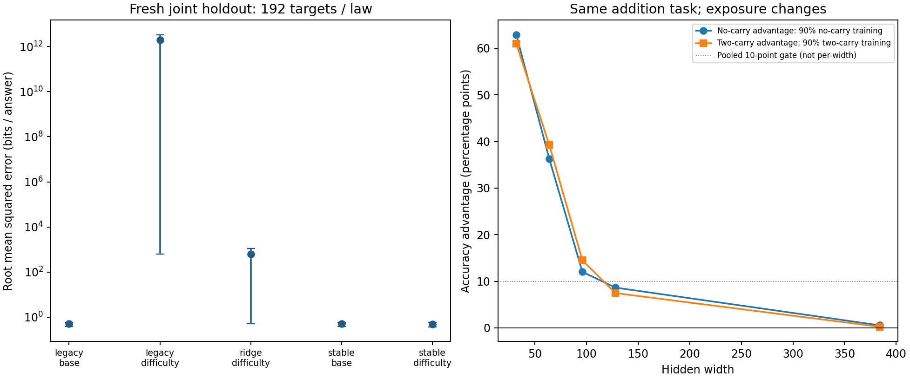

# Fresh held-out addition: extrapolation repair and feature value

**Doc link:** <https://github.com/brando90/the-difficulty-confound/blob/main/experiments/archive/04_monotone_ridge_heldout_addition/RESULTS_stable.md>

**TLDR:** Repair criterion: **SUPPORTED**. Starting-difficulty feature criterion: **NOT_ESTABLISHED**. All 200 trajectories completed; all 3,840 forecasts and failed criteria are retained.

## Setup and decisions

Canonical experiment: `experiments/archive/04_monotone_ridge_heldout_addition/`. Exact three-digit addition and the byte-identical arithmetic reference remain fixed. New seeds, mixtures .2/.8, widths 96/384, and evaluation items exclude every experiment-03 evaluation/probe item. Training still matches 117 answer frequencies exactly, 4,680 pairs per intervention. There are 1,872 final-test questions (936 per carry stratum), 936 calibration questions and 936 separate probe questions. Input-digit marginals remain unmatched. This is supervised learning, not reinforcement learning.

All five laws use model size, updates, carry group and exposure. The three difficulty laws add independently probed starting loss. The old laws use unregularized least squares on log loss; ridge adds a fixed 0.01 standardized-slope penalty. Stable laws also constrain size/updates/exposure slopes to be nonpositive and the difficulty exponent to [0,1]. Those settings were frozen before training. Fit only 54 calibration rows per seed; freeze predictions before opening final-test outcomes.

Primary feature-value gate: stable difficulty versus stable base. Separate repair gate: stable difficulty versus legacy difficulty. Each requires at least 10% relative joint root mean squared error reduction, a positive 95% lower interval, improvement at both held-out widths, and no invalid predictions. The 10% threshold and coefficient bounds are project choices. A repair success does not substitute for feature-value success.

All intervals below are 95% percentile intervals from 20,000 paired bootstrap draws over eight complete seed blocks, conditional on this fixed test set; p-val=n/a. The 192 joint targets per law are correlated observations, not 192 independent replicates. Scores are bits per answer under the factorized model. Mean bias is forecast minus observed; positive means overprediction. No trained model or seed was discarded.

Endpoint warmup-plus-intervention unions are exactly 6,552 unique pairs per seed in both conditions ([counts](expt_v1/results/warmup_union_counts.csv)); intermediate unions differ. Across six operand-digit columns and eight seeds, endpoint input-marginal total variation ranges from 0.064 to 0.656 ([all values](expt_v1/results/input_marginal_total_variation.csv)); zero would mean matching.

## Joint held-out prediction

| Law | Root mean squared error [95% interval] | Mean absolute error | Mean bias | Forecast mean | Observed mean | Invalid / targets |
|---|---:|---:|---:|---:|---:|---:|
| legacy_base | 0.5008 [0.3908, 0.5964] | 0.2592 | -0.1617 | 0.3919 | 0.5537 | 0/192 |
| legacy_difficulty | 1935297769746.7185 [619.4261, 3352033360529.6875] | 290470643364.2482 | +290470643363.9525 | 290470643364.5062 | 0.5537 | 0/192 |
| ridge_difficulty | 629.5063 [0.5000, 1084.7584] | 115.0198 | +114.6947 | 115.2484 | 0.5537 | 0/192 |
| stable_base | 0.5010 [0.3894, 0.5972] | 0.2599 | -0.1629 | 0.3908 | 0.5537 | 0/192 |
| stable_difficulty | 0.4835 [0.3760, 0.5780] | 0.2455 | -0.1589 | 0.3948 | 0.5537 | 0/192 |

Relative error reduction is 100 × (1 − extended error / baseline error); positive is better.

| Baseline → extended | Reduction %, 95% interval |
|---|---:|
| stable_base → stable_difficulty | 3.48 [1.12, 6.24] |
| legacy_difficulty → stable_difficulty | 100.00 [99.90, 100.00] |
| legacy_difficulty → ridge_difficulty | 100.00 [87.43, 100.00] |
| legacy_base → legacy_difficulty | -386418964797857.25 [-804404748170611.00, -97424.85] |
| legacy_base → stable_base | -0.03 [-0.31, 0.54] |
| ridge_difficulty → stable_difficulty | 99.92 [-1.05, 99.96] |

## Every held-out split

| Split | Law | Targets | Root mean squared error [95% interval] |
|---|---|---:|---:|
| joint | legacy_base | 192 | 0.5008 [0.3908, 0.5964] |
| joint | legacy_difficulty | 192 | 1935297769746.7185 [619.4261, 3352033360529.6875] |
| joint | ridge_difficulty | 192 | 629.5063 [0.5000, 1084.7584] |
| joint | stable_base | 192 | 0.5010 [0.3894, 0.5972] |
| joint | stable_difficulty | 192 | 0.4835 [0.3760, 0.5780] |
| model_only | legacy_base | 288 | 0.7437 [0.6675, 0.8154] |
| model_only | legacy_difficulty | 288 | 3090173059685.3613 [960.3237, 5352335659013.3203] |
| model_only | ridge_difficulty | 288 | 980.5344 [0.8562, 1689.8350] |
| model_only | stable_base | 288 | 0.7324 [0.6561, 0.8051] |
| model_only | stable_difficulty | 288 | 0.7322 [0.6586, 0.8036] |
| mixture_only | legacy_base | 288 | 2.9963 [2.9246, 3.0694] |
| mixture_only | legacy_difficulty | 288 | 2.7067 [2.5822, 2.8395] |
| mixture_only | ridge_difficulty | 288 | 2.7594 [2.6489, 2.8549] |
| mixture_only | stable_base | 288 | 2.8938 [2.8274, 2.9626] |
| mixture_only | stable_difficulty | 288 | 2.8760 [2.8178, 2.9396] |
| joint_width_96 | legacy_base | 96 | 0.7043 [0.5454, 0.8418] |
| joint_width_96 | legacy_difficulty | 96 | 3.2963 [1.1009, 5.2991] |
| joint_width_96 | ridge_difficulty | 96 | 0.7612 [0.6101, 0.8937] |
| joint_width_96 | stable_base | 96 | 0.7043 [0.5422, 0.8437] |
| joint_width_96 | stable_difficulty | 96 | 0.6801 [0.5238, 0.8154] |
| joint_width_384 | legacy_base | 96 | 0.0752 [0.0402, 0.1023] |
| joint_width_384 | legacy_difficulty | 96 | 2736924353206.2124 [875.9999, 4740491039988.1465] |
| joint_width_384 | ridge_difficulty | 96 | 890.2560 [0.0764, 1534.0798] |
| joint_width_384 | stable_base | 96 | 0.0764 [0.0412, 0.1038] |
| joint_width_384 | stable_difficulty | 96 | 0.0718 [0.0282, 0.1021] |

## Seed variability and worst forecasts

Eight training seeds, one trajectory per seed/width/mixture; no repeated scoring noise was introduced. The following sample standard deviations describe variation of per-seed joint error, not uncertainty from independent test sets.

| Law | Mean seed error | Seed standard deviation | Minimum | Maximum | Worst prediction / observed |
|---|---:|---:|---:|---:|---:|
| legacy_base | 0.4777 | 0.1609 | 0.2791 | 0.6979 | 0.4994 / 2.5947 |
| legacy_difficulty | 684774164650.8109 | 1935078234228.9812 | 0.6574 | 5473846980878.1934 | 23410128677521.7500 / 0.0262 |
| ridge_difficulty | 248.7776 | 618.1889 | 0.3111 | 1766.8306 | 5789.1945 / 0.0413 |
| stable_base | 0.4771 | 0.1635 | 0.2781 | 0.6995 | 0.5007 / 2.5947 |
| stable_difficulty | 0.4612 | 0.1555 | 0.2781 | 0.6709 | 0.5031 / 2.5947 |

[Every seed and worst-target key](expt_v1/results/seed_prediction_metrics.csv) · [Every coefficient](expt_v1/results/coefficient_table.csv) · [All split comparisons](expt_v1/results/prediction_comparisons.csv).

## Secondary ranking-reversal replication

Frozen replication criterion: **SUPPORTED**. The endpoint advantages must each exceed 10 percentage points, have a positive interval lower bound, and remain positive at every width.

| Contrast | Percentage points [95% interval] |
|---|---:|
| e_low | 24.07 [22.80, 25.46] |
| e_high | 24.48 [22.77, 26.06] |
| alignment | 24.27 [23.15, 25.33] |
| structure | -0.21 [-1.26, 0.85] |
| balanced_gap | 1.86 [1.00, 2.68] |
| alignment_minus_abs_structure | 24.07 [22.60, 25.03] |

`e_low` is no-carry minus two-carry accuracy with 90% no-carry exposure; `e_high` reverses that difference with 90% two-carry exposure. Alignment is their average; structure is half their difference. These are intervention-specific accuracy contrasts, not a universal variance decomposition.

| Width | No-carry advantage at 90% exposure | Two-carry advantage at 90% exposure |
|---|---:|---:|
| 32 | 62.90 | 60.98 |
| 64 | 36.23 | 39.21 |
| 128 | 8.64 | 7.47 |
| 96 | 12.02 | 14.50 |
| 384 | 0.55 | 0.24 |

Final exact-answer accuracies, pooled equally across widths within seed:

| Two-carry training fraction | Carry stratum | Accuracy %, 95% interval |
|---|---:|---:|
| 0.1 | 0 | 99.81 [99.63, 99.93] |
| 0.1 | 2 | 75.74 [74.36, 76.96] |
| 0.5 | 0 | 90.91 [90.06, 91.63] |
| 0.5 | 2 | 89.05 [88.29, 89.70] |
| 0.9 | 0 | 75.15 [73.61, 76.82] |
| 0.9 | 2 | 99.63 [99.55, 99.70] |

## Why experiment 03 blew up

The fitted form is predicted loss = exp(intercept) × parameters^b × updates^c × exp(d × carry indicator) × exposure^e × starting_loss^f. A negative f makes a better starting loss raise the forecast. This is a post hoc diagnosis of already-published development data. It does not alter experiment 03 or choose settings from the new test. Independent reconstruction reproduces its coefficients and every joint difficulty-law forecast. The raw design is full rank, but correlated size/difficulty features permit inverse powers that behave badly outside the fitting support. Positive forecasts alone do not prevent this.

| Seed | Difficulty exponent | Fit starting-loss range | Joint target range | Joint error | Share of squared error % | Standardized condition number |
|---|---:|---:|---:|---:|---:|---:|
| 2101 | -5.4392 | 2.300–3.891 | 0.649–2.900 | 14.8480 | 0.03215 | 23.51 |
| 2202 | -0.9480 | 2.282–3.859 | 0.668–2.619 | 0.3184 | 0.00001 | 14.32 |
| 2303 | -1.5715 | 2.300–4.018 | 0.783–2.728 | 0.5277 | 0.00004 | 12.94 |
| 2404 | 2.7184 | 1.436–3.857 | 0.571–2.856 | 0.2526 | 0.00001 | 7.84 |
| 2505 | -7.1966 | 2.532–3.915 | 0.514–2.519 | 828.0131 | 99.96773 | 13.55 |
| 2606 | 4.8564 | 2.203–3.822 | 0.549–2.922 | 0.4531 | 0.00003 | 30.31 |
| 2707 | 3.4012 | 2.098–3.780 | 0.596–2.549 | 0.2804 | 0.00001 | 25.26 |
| 2808 | 16.2984 | 2.302–3.652 | 0.605–2.593 | 0.3947 | 0.00002 | 12.20 |

Seed 2505 contributes 99.96773% of squared error. Its worst forecast is 2737.327202 versus 0.093230 observed, width 256, mixture 0.3, step 300, carry 2. The repair blocks this specific inverse-difficulty mechanism by construction; held-out accuracy must still be measured.

## Verification, provenance and limitations

Training completed in 15.88 minutes on skampere2.stanford.edu using two CPU threads; no graphics processor or provider calls for model training. Frozen source: `39cd0b78eea437f38b89cbf36928b8e0e9947613`. The original 90-minute cap was preserved. A slow shared-filesystem checkout was replaced by a node-local checkout before training. The Codex executor failed authentication and the personal Claude executor hit its weekly limit before scientific work; the master adopted the existing fixed numerical procedure. Their logs are retained, with no claim that all accounts were exhausted.

Independent verification: 500,500 oracle pairs, 2,400 aggregates reconstructed from 1,684,800 item observations; 200 final and 40 warm models replayed, maximum loss discrepancy 0.0; 3,840 forecasts reconstructed, maximum discrepancy 0. Independent active-set enumeration agrees with every constrained fit, bounds are checked, bootstrap results match, source/input hashes match. [Receipt](expt_v1/results/verification.json).

The study tests these fixed predictive forms on one addition setup. Mixture holdout is interpolation; width 384 tests extrapolation beyond fitting widths. Starting loss is probe-derived and itself depends on capacity and warmup. New item holdout is disjoint from experiment-03 evaluation; new training may contain old evaluation items because these are fresh networks. This does not validate Varun’s original mathematics law, eliminate computational complexity, or establish that data explains most difficulty across tasks. Answer matching does not match input marginals or prove invariant internal strategies. Coefficient shape restrictions are inductive assumptions that can underfit.

[Protocol](PROTOCOL.md) · [Live/completion record](results.md) · [Prior full report](../03_answer_matched_alignment/RESULTS_matched_alignment.md) · [Google companion](https://docs.google.com/document/d/19yNEZTimoCPr9H4D_P-53nN83dBNFz_LY-aFdRa6_Bk/edit).

Figure: left, all five joint prediction errors with paired-seed 95% intervals on a logarithmic axis; right, final accuracy differences under the two endpoint exposure interventions. Points are means across eight seeds at each width. Full tables and failed criteria appear above.
