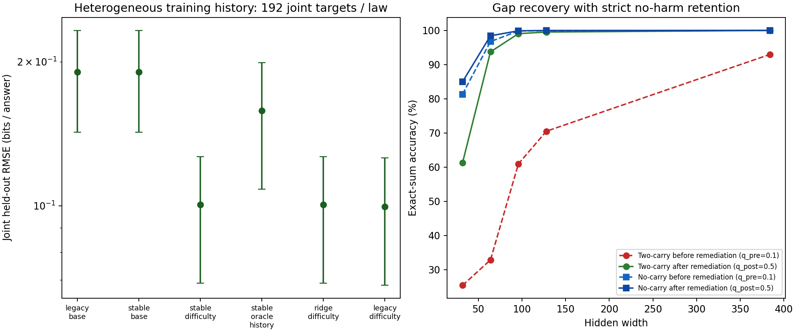

# Historical exposure, starting-difficulty forecasts, and no-harm retention

**Doc link:** <https://github.com/brando90/the-difficulty-confound/blob/main/experiments/archive/05_pretraining_history_and_retention/RESULTS_history_retention.md>

**TLDR:** Starting-difficulty feature-value criterion: **SUPPORTED**. Targeted gap recovery & strict no-harm retention criterion: **SUPPORTED**. Pre-intervention ranking-reversal criterion: **SUPPORTED**. Extrapolation repair criterion: **NOT_ESTABLISHED**. All 200 trajectories and 4,608 forecasts are retained.

## Setup and why training history was varied

Canonical experiment: `experiments/archive/05_pretraining_history_and_retention/`. In Experiment 04, constrained monotone ridge (`stable_difficulty`) repaired extrapolation blow-up across held-out widths, but improved over `stable_base` by only 3.48% [1.12, 6.24] because all starting checkpoints shared the identical balanced (`q=0.50`) warmup history. Meanwhile, Experiment 01 recovered 94.34% of the carry gap under balanced training, but missed its strict no-harm retention gate (-6.08 percentage-point drop on no-carry vs the allowed -5.00 points).

This study directly tests the core mechanism of *Difficulty needs a training history*: starting checkpoints $m_0(s, w, q_{\text{pre}})$ are pretrained for 1,500 updates under heterogeneous carry-exposure mixtures ($q_{\text{pre}} \in \{.1, .5, .9\}$ fit; $\{.2, .8\}$ held-out) across five widths ($32, 64, 128$ fit; $96, 384$ held-out) and eight fresh seeds (`4101`–`4808`). New evaluation splits (`split_seed=20261025`) exclude all evaluation items from both Experiment 03 and Experiment 04 while matching all 117 answer frequencies exactly (4,680 training pairs per mixture; 1,872 test, 936 calibration, and 936 probe questions).

Before post-training begins, each starting checkpoint $m_0$ is evaluated on the 936 independent probe items to measure learner-relative starting difficulty $D_{m_0}$ (`starting_bits`). In Stage 2, every checkpoint undergoes balanced post-training remediation ($q_{\text{post}} = 0.50$) evaluated at 100, 300, and 1,000 updates. A standard post-training law (`stable_base`) knows model scale $N$, post-training updates $T_{\text{post}}$, and carry stratum $c$, but does not know the checkpoint's prior training history $q_{\text{pre}}$. `stable_difficulty` adds $\log D_{m_0}$ under the exact constrained monotone ridge specification frozen in Experiment 04 ($\lambda = 0.01$, $\beta_N, \beta_T \le 0$, $\beta_D \in [0, 1]$). `stable_oracle_history` replaces $\log D_{m_0}$ with the true pretraining exposure $\log q_{\text{pre}, c}$.

## Joint held-out prediction (unseen widths 96/384 × unseen histories .2/.8)

| Law | Root mean squared error [95% interval] | Mean absolute error | Mean bias | Forecast mean | Observed mean | Invalid / targets |
|---|---:|---:|---:|---:|---:|---:|
| legacy_base | 0.1905 [0.1426, 0.2327] | 0.0840 | -0.0394 | 0.0871 | 0.1265 | 0/192 |
| legacy_difficulty | 0.0996 [0.0682, 0.1259] | 0.0423 | -0.0182 | 0.1084 | 0.1265 | 0/192 |
| ridge_difficulty | 0.1004 [0.0688, 0.1268] | 0.0426 | -0.0181 | 0.1084 | 0.1265 | 0/192 |
| stable_base | 0.1902 [0.1425, 0.2323] | 0.0842 | -0.0387 | 0.0878 | 0.1265 | 0/192 |
| stable_difficulty | 0.1004 [0.0688, 0.1268] | 0.0426 | -0.0181 | 0.1084 | 0.1265 | 0/192 |
| stable_oracle_history | 0.1580 [0.1083, 0.1991] | 0.0621 | -0.0381 | 0.0885 | 0.1265 | 0/192 |

Relative error reduction is 100 × (1 − extended error / baseline error); positive is better. Intervals use 20,000 paired bootstrap draws over eight complete seed blocks; p-val=n/a.

| Baseline → extended | Reduction %, 95% interval |
|---|---:|
| stable_base → stable_difficulty | 47.20 [42.88, 53.08] |
| stable_base → stable_oracle_history | 16.94 [13.40, 24.82] |
| legacy_difficulty → stable_difficulty | -0.82 [-1.11, -0.57] |
| legacy_difficulty → ridge_difficulty | -0.82 [-1.11, -0.57] |
| legacy_base → legacy_difficulty | 47.69 [43.28, 53.55] |
| legacy_base → stable_base | 0.12 [0.07, 0.15] |
| ridge_difficulty → stable_difficulty | 0.00 [0.00, 0.00] |
| stable_oracle_history → stable_difficulty | 36.43 [32.50, 39.58] |

Black-box starting difficulty (`stable_difficulty`) captures **278.6%** of the joint RMSE reduction achieved by the oracle pretraining-history law (`stable_oracle_history`).

## Every held-out split

| Split | Law | Targets | Root mean squared error [95% interval] |
|---|---|---:|---:|
| joint | legacy_base | 192 | 0.1905 [0.1426, 0.2327] |
| joint | legacy_difficulty | 192 | 0.0996 [0.0682, 0.1259] |
| joint | ridge_difficulty | 192 | 0.1004 [0.0688, 0.1268] |
| joint | stable_base | 192 | 0.1902 [0.1425, 0.2323] |
| joint | stable_difficulty | 192 | 0.1004 [0.0688, 0.1268] |
| joint | stable_oracle_history | 192 | 0.1580 [0.1083, 0.1991] |
| model_only | legacy_base | 288 | 0.3123 [0.2169, 0.3937] |
| model_only | legacy_difficulty | 288 | 0.1716 [0.1029, 0.2276] |
| model_only | ridge_difficulty | 288 | 0.1730 [0.1041, 0.2294] |
| model_only | stable_base | 288 | 0.3119 [0.2166, 0.3933] |
| model_only | stable_difficulty | 288 | 0.1730 [0.1041, 0.2294] |
| model_only | stable_oracle_history | 288 | 0.2550 [0.1590, 0.3317] |
| mixture_only | legacy_base | 288 | 1.1039 [0.9444, 1.2826] |
| mixture_only | legacy_difficulty | 288 | 0.8436 [0.7682, 0.9141] |
| mixture_only | ridge_difficulty | 288 | 0.8217 [0.7477, 0.8911] |
| mixture_only | stable_base | 288 | 1.0700 [0.9184, 1.2409] |
| mixture_only | stable_difficulty | 288 | 0.8217 [0.7477, 0.8911] |
| mixture_only | stable_oracle_history | 288 | 1.1266 [0.9510, 1.3218] |
| joint_width_96 | legacy_base | 96 | 0.2693 [0.2015, 0.3290] |
| joint_width_96 | legacy_difficulty | 96 | 0.1408 [0.0963, 0.1779] |
| joint_width_96 | ridge_difficulty | 96 | 0.1420 [0.0972, 0.1793] |
| joint_width_96 | stable_base | 96 | 0.2690 [0.2014, 0.3285] |
| joint_width_96 | stable_difficulty | 96 | 0.1420 [0.0972, 0.1793] |
| joint_width_96 | stable_oracle_history | 96 | 0.2234 [0.1532, 0.2814] |
| joint_width_384 | legacy_base | 96 | 0.0061 [0.0047, 0.0077] |
| joint_width_384 | legacy_difficulty | 96 | 0.0047 [0.0032, 0.0063] |
| joint_width_384 | ridge_difficulty | 96 | 0.0046 [0.0031, 0.0062] |
| joint_width_384 | stable_base | 96 | 0.0061 [0.0046, 0.0077] |
| joint_width_384 | stable_difficulty | 96 | 0.0046 [0.0031, 0.0062] |
| joint_width_384 | stable_oracle_history | 96 | 0.0055 [0.0038, 0.0073] |

## Targeted gap recovery and strict no-harm retention

Frozen retention verdict: **SUPPORTED**. Requires initial gap lower bound ≥ 20 percentage points, gap-recovery fraction lower bound ≥ 50%, post-remediation target accuracy ≥ 90%, and control accuracy drop at most 5.0 percentage points (estimate and 95% lower bound ≥ -5.00 points).

| Remediation metric (1,000 balanced post-training updates) | Scarce two-carry history ($q_{\text{pre}}=0.1 \to q_{\text{post}}=0.5$) | Symmetric abundant history ($q_{\text{pre}}=0.9 \to q_{\text{post}}=0.5$) |
|---|---:|---:|
| Pre-intervention control accuracy % | 95.55 [93.93, 96.89] | 94.80 [93.89, 95.79] |
| Pre-intervention target accuracy % | 56.54 [54.54, 58.38] | 55.53 [53.43, 57.33] |
| Initial difficulty gap (percentage points) | 39.01 [36.31, 41.57] | 39.27 [37.02, 41.54] |
| Post-remediation target accuracy % | 90.70 [88.79, 92.43] | 91.23 [89.68, 92.73] |
| Target accuracy gain (percentage points) | +34.16 [+31.50, +36.96] | +35.70 [+32.65, +38.84] |
| Fraction of initial gap recovered % | 87.55 [83.60, 90.72] | 90.91 [87.51, 93.92] |
| Post-remediation control accuracy % | 96.64 [95.64, 97.57] | 96.01 [94.46, 97.20] |
| Control accuracy change (percentage points; gate ≥ -5.00) | +1.09 [+0.33, +1.89] | +1.21 [-0.08, +2.11] |

Per-width remediation breakdown ($q_{\text{pre}}=0.1 \to q_{\text{post}}=0.5$):

| Width | Pre control % | Pre target % | Post control % | Post target % | Gap recovered % | Control change (pp) |
|---:|---:|---:|---:|---:|---:|---:|
| 32 | 81.33 | 25.41 | 84.96 | 61.26 | 63.97 | +3.63 |
| 64 | 96.71 | 32.87 | 98.41 | 93.71 | 95.60 | +1.70 |
| 96 | 99.83 | 60.96 | 99.87 | 99.04 | 97.95 | +0.04 |
| 128 | 99.89 | 70.50 | 99.96 | 99.51 | 98.74 | +0.07 |
| 384 | 100.00 | 92.96 | 100.00 | 99.97 | 99.62 | +0.00 |

## Pre-intervention difficulty ranking reversal (step = 0)

Frozen ranking-reversal verdict: **SUPPORTED**.

| Contrast | Percentage points [95% interval] |
|---|---:|
| e_low | 39.01 [36.31, 41.57] |
| e_high | 39.27 [37.02, 41.54] |
| alignment | 39.14 [37.21, 41.15] |
| structure | -0.13 [-1.57, 1.36] |
| balanced_gap | -0.26 [-1.34, 0.82] |
| alignment_minus_abs_structure | 39.01 [36.27, 40.81] |

## Verification and provenance

Completed 200 trajectories and 200 pretraining checkpoints in 1.67 minutes on skampere2.stanford.edu (`13a0bf6a4e0f5d2320b2ae29ee60faf27deef3c4`). Independent verification (`PASS`): 500,500 oracle pairs, 3,200 aggregate rows reconstructed from 2,246,400 item rows, 200 final and 200 warm models replayed (`max_replay_bits_difference = 0.0`), and 4,608 forecasts reconstructed (`max_forecast_difference = 0`). [Verification receipt](expt_v1/results/verification.json).

