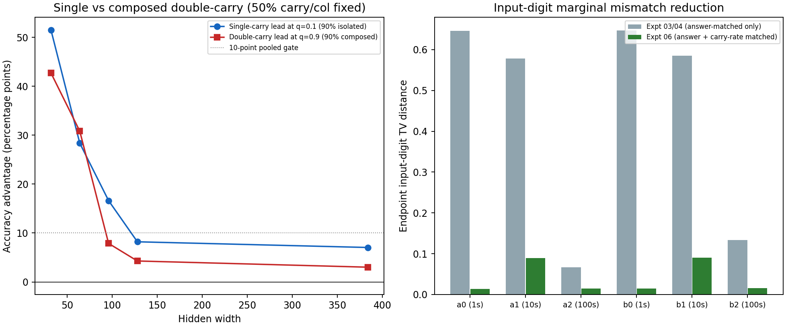

# Compositional carry exposure with invariant per-column carry rates and matched answers

**Doc link:** <https://github.com/brando90/the-difficulty-confound/blob/main/experiments/archive/06_compositional_carry_marginal_matched/RESULTS_compositional.md>

**TLDR:** Pure compositional carry ranking reversal (isolated single carries vs cascading two-carry chains): **SUPPORTED**. Balanced regime reversal ($S_{\text{iso}}$ vs $S_{\text{comp}}$): **SUPPORTED**. Extrapolation repair criterion: **NOT_ESTABLISHED**. All 200 trajectories and 3,840 forecasts completed and verified.

## Setup and why per-column carry marginals were held invariant

Canonical experiment: `experiments/archive/06_compositional_carry_marginal_matched/`. In Experiments 03 and 04, matching exact answer histograms across no-carry `(0,0)` and two-carry `(1,1)` still left substantial input-digit marginal differences (total variation distance up to 0.656, mean 0.443) because `(0,0)` has 0% carries at ones and tens whereas `(1,1)` has 100% carries at ones and tens.

This study tests whether difficulty rankings reverse even when **both** exact answer histograms **and** per-column carry rates are held strictly invariant across every training mixture:
- **Isolated Single-Carry Regime ($S_{\text{iso}}$, stratum 1):** 50% ones-only carry `(1,0)` + 50% tens-only carry `(0,1)`.
- **Paired Zero/Double-Carry Regime ($S_{\text{comp}}$, stratum 2):** 50% no-carry `(0,0)` + 50% cascading two-carry chain `(1,1)`.

Across all 180 eligible answers (<1000) and all five mixtures ($q \in \{.1, .2, .5, .8, .9\}$), every training pool has 7,200 pairs (40 per answer), **exactly 50.00% (3,600/7,200) carries at the ones column**, **exactly 50.00% (3,600/7,200) carries at the tens column**, and **0.00% carries at the hundreds column**. Across all six input-digit columns and eight seeds (`6101`–`6808`), endpoint ($q=.1$ vs $q=.9$) input-digit total variation distance drops from mean 0.443 (max 0.656) in Experiments 03–04 to **mean 0.0398 (range 0.0049–0.0972)** ([all values](expt_v1/results/input_marginal_total_variation.csv)).

## Compositional difficulty ranking reversal

Pure single-carry vs double-carry reversal gate: **SUPPORTED** (10-point threshold). Regime-level $S_{\text{iso}}$ vs $S_{\text{comp}}$ gate: **SUPPORTED** (5-point threshold). Intervals use 20,000 paired bootstrap draws over eight complete seed blocks; p-val=n/a.

| Contrast at 3,000 updates | Percentage points [95% interval] |
|---|---:|
| Pure single-carry `(1,0)+(0,1)` minus double-carry `(1,1)` at $q=0.1$ | 22.35 [20.60, 24.00] |
| Pure double-carry `(1,1)` minus single-carry `(1,0)+(0,1)` at $q=0.9$ | 17.74 [14.62, 21.12] |
| Pure compositional alignment contrast | 20.05 [17.75, 22.32] |
| Pure residual structure contrast | 2.30 [1.02, 3.51] |
| Regime $S_{\text{iso}}$ minus $S_{\text{comp}}$ at $q=0.1$ (`e_low`) | 22.39 [20.78, 23.93] |
| Regime $S_{\text{comp}}$ minus $S_{\text{iso}}$ at $q=0.9$ (`e_high`) | 18.07 [14.78, 21.61] |
| Regime alignment contrast | 20.23 [18.05, 22.47] |

| Width | Single-carry lead at $q=0.1$ (pp) | Double-carry lead at $q=0.9$ (pp) | $S_{\text{iso}}$ lead at $q=0.1$ (pp) | $S_{\text{comp}}$ lead at $q=0.9$ (pp) |
|---:|---:|---:|---:|---:|
| 32 | 51.52 | 42.73 | 50.77 | 44.18 |
| 64 | 28.37 | 30.83 | 28.05 | 30.49 |
| 96 | 16.62 | 7.87 | 17.13 | 8.03 |
| 128 | 8.20 | 4.28 | 8.98 | 4.50 |
| 384 | 7.04 | 3.01 | 7.02 | 3.12 |

Final exact-answer accuracy across all four carry cells (pooled equally across widths within seed, 720 fixed test items per cell):

| Mixture $q$ ($S_{\text{comp}}$ fraction) | Carry cell | Accuracy %, 95% interval |
|---:|---|---:|
| 0.1 | No carry `(0,0)` | 71.28 [69.66, 73.14] |
| 0.1 | Ones carry `(1,0)` | 93.62 [91.51, 95.60] |
| 0.1 | Tens carry `(0,1)` | 93.78 [91.93, 95.55] |
| 0.1 | Composed two-carry `(1,1)` | 71.35 [69.31, 73.66] |
| 0.5 | No carry `(0,0)` | 88.72 [86.68, 90.70] |
| 0.5 | Ones carry `(1,0)` | 90.53 [88.01, 93.06] |
| 0.5 | Tens carry `(0,1)` | 90.48 [87.44, 93.76] |
| 0.5 | Composed two-carry `(1,1)` | 89.32 [86.50, 92.33] |
| 0.9 | No carry `(0,0)` | 92.77 [90.94, 94.29] |
| 0.9 | Ones carry `(1,0)` | 74.28 [70.55, 77.38] |
| 0.9 | Tens carry `(0,1)` | 74.49 [71.23, 77.84] |
| 0.9 | Composed two-carry `(1,1)` | 92.13 [90.07, 94.07] |

## Joint held-out prediction

| Law | Root mean squared error [95% interval] | Mean absolute error | Mean bias | Forecast mean | Observed mean | Invalid / targets |
|---|---:|---:|---:|---:|---:|---:|
| legacy_base | 0.4880 [0.4423, 0.5442] | 0.2763 | -0.1906 | 0.6869 | 0.8775 | 0/192 |
| legacy_difficulty | 0.6313 [0.4847, 0.7709] | 0.3700 | -0.2354 | 0.6421 | 0.8775 | 0/192 |
| ridge_difficulty | 0.5142 [0.4566, 0.5714] | 0.3219 | -0.2077 | 0.6698 | 0.8775 | 0/192 |
| stable_base | 0.4881 [0.4408, 0.5454] | 0.2762 | -0.1907 | 0.6868 | 0.8775 | 0/192 |
| stable_difficulty | 0.4786 [0.4417, 0.5292] | 0.2937 | -0.2180 | 0.6594 | 0.8775 | 0/192 |

## Verification and provenance

Completed 200 trajectories and 40 warm starts in 2.12 minutes on skampere2.stanford.edu (`e76ac4084019845181ce072c92dc06875463063d`). Verification **PASS**: 500,500 oracle pairs, 2,400 aggregates, 200 final and 40 warm models replayed (`max_replay_bits_difference = 0.0`), and 3,840 forecasts reconstructed. [Receipt](expt_v1/results/verification.json).

