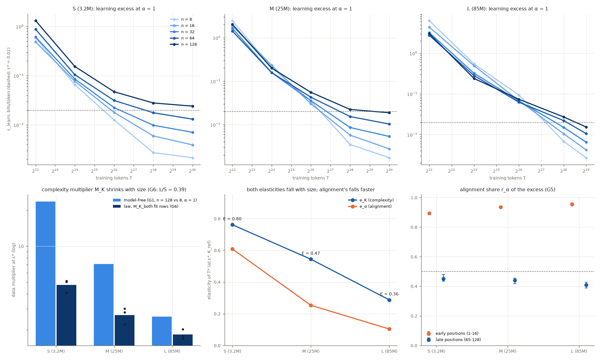

# Results: Experiment 13-GPU, GINC-style HMM mixtures, complexity versus alignment at three model sizes

Arm 13-GPU: 360 runs (3 sizes × 5 levels × 2 targets × 4 α × 3 seeds), decoder-only transformers S/M/L (3.2M / 25M / 85M non-embedding parameters), bfloat16 training, float64 evaluation. Protocol: [PROTOCOL.md](PROTOCOL.md) (frozen at 19a77724; 13-GPU implementation notes and GPU pilot disclosure in Section 7); run log: [CKPT_ginc_hmm.md](CKPT_ginc_hmm.md); 13-small: [RESULTS_ginc_hmm.md](RESULTS_ginc_hmm.md).

## Plain-language summary

We trained three sizes of transformer (3M, 25M and 85M parameters) on made-up languages whose complexity we know exactly, mixed with ten other languages at four target shares, and measured how many training tokens each needed to get within 0.02 bits per word of perfect.

- **Complexity costs data at every size (G1).** The hardest concepts (128 hidden states) need 7.6 times the data of the easiest (8 states), in every seed.
- **Bigger models pay much less for complexity (G6, new).** That multiplier falls from 4.75 (S) to 2.66 (M) to 1.83 (L); L's is 0.39 of S's.
- **Alignment still does not dominate (G4).** Bigger models also care less about the target's share of the data, and that falls even faster than the complexity cost: for L, 20 times fewer target documents raise the data bill only 1.3 times, because L learns the target from the related languages. So by the fitted law, E = e_α/e_K falls with size (0.80 → 0.47 → 0.36). Read directly off the learning curves, E is about 1.0–1.2; the two readings disagree, so G4 is NOT_ESTABLISHED, not reversed.
- **Alignment acts early in a document, complexity late (G5)**, more strongly than in 13-small (0.93 vs 0.44).
- **The K law forecasts held-out rows 14% better in every seed (G2)**, but not on the held-out complexity level itself (0.581 vs 0.576), so G2 is NOT_ESTABLISHED. Complexity acts on both the coefficient and the exponent (κ 0.30, γ1 −0.019, both resolved), so C3 is unresolved (G3a, G3b).

## Predictions recorded before the gates were computed

Laolu's calls (CKPT, commit b1acee65, 10-24-2026 16:20, with 306 of 360 shards finished and no outcome read): G1 SUPPORTED ✓, G2 NOT_ESTABLISHED ✓, G3a NOT_ESTABLISHED ✓, G3b SUPPORTED ✗ (NOT_ESTABLISHED), G4 NOT_ESTABLISHED ✓, G5 SUPPORTED ✓, G6 SUPPORTED ✓: 6 of 7.

## Deviations and disclosures

1. **n = 128 concepts:** the frozen generator found none in 1,000 candidates; a per-level extension stream supplied them (PROTOCOL Section 7, 13-GPU implementation notes). Every other level and the band calibration are as frozen.
2. **Written after the freeze:** the 13-GPU code, gate interpretation (pooled verdict of record, every-seed rule), the N-law baseline and β starts. All committed before any GPU run (2c625111); the pilot ran at that commit rather than at the freeze, because the code did not exist at the freeze.
3. **Pilot:** the 2× multiplier, the top of the frozen grid, won for every size; a larger rate might do better.
4. **Hardware:** SNAP skampere1 (A100) and, from 10-24-2026 04:31, skampere2 (H200), all GPUs shared with other users; two GPU types (recorded per shard; every checkpoint replayed in float64).
5. **Operations:** `launch/snap.sh` exited silently (SIGPIPE under pipefail) and was replaced by `launch/snap_autopilot/`; the autopilot halted for 2 h 2 min after the pilot because `--check-only` rewrote a tracked receipt; no run, seed or checkpoint was dropped or rerun.
6. **Censoring:** at ε* = 0.02, half the runs (184 of 360) never reached ε* by their last checkpoint; model-free quantities cap them there and law-based ones extrapolate.
7. **ε_id = log2(1/α)/128 exactly:** the distractors give the targets almost no probability, so identification is trivial; the early-position alignment share (G5) is mostly ε_id plus slower early learning, not a test of identification difficulty.

## Which PROTOCOL Section 6 row matches

- "G1 SUPPORTED, G4 fails": complexity rivals or beats alignment in the fitted law at every size; η falls from 0.61 (S) to 0.10 (L), so with scale alignment works less through target-specific data and the related concepts carry most of the learning.
- G6 SUPPORTED: a bigger model shrinks the complexity multiplier, monotonically; the reverse outcome (≥ 1.5) is ruled out.

## Gates (all at equal prominence)

ε* = 0.02 bits/token on the learning term ε_learn = ε − ε_id. Pooled = all three sizes in one fit (the full N laws of PROTOCOL Section 4.1): the verdict of record. S / M / L = the same gate within one size (S = SUPPORTED, NE = NOT_ESTABLISHED). Intervals: 95% seed-block bootstrap (3 seeds, 20,000 draws, 10 distinct resamples); every gate also requires each seed's point estimate on the supported side.

| Gate | Pooled estimate | 95% interval (seed blocks) | Threshold (and every seed) | Verdict of record | S / M / L |
|---|---|---|---|---|---|
| G1 complexity is real: model-free M_K, n = 128 vs 8 at α = 1 | 7.57 (per seed 7.16, 7.21, 8.39) | seed [7.16, 8.39]; two-stage [6.48, 8.63] | ≥ 2, both lower bounds > 1 | **SUPPORTED** | S / S / S |
| G2 K law (N_K_coef) beats N_align_eff on held-out rows | 14% RMSE reduction (per seed 12.8%, 14.2%, 15%) | [12.8%, 15%] | ≥ 10%, lower bound > 0, lower RMSE on n = 32 rows (0.581 vs 0.576), 0 invalid | **NOT_ESTABLISHED** | NE / NE / NE |
| G3a coefficient picture | κ 0.297, γ1 -0.0194 | κ [0.29, 0.304], γ1 [-0.0239, -0.0143] | κ > 0, γ1 interval ∋ 0, RMSE coef (0.58) ≤ exp (0.629) | **NOT_ESTABLISHED** | NE / NE / NE |
| G3b exponent picture | γ1 -0.0194; exp vs coef -8.29% | [-9.29%, -7.67%] | γ1 upper < 0, reduction ≥ 5% with lower > 0 | **NOT_ESTABLISHED** | NE / NE / NE |
| G4 alignment dominates (E = e_α/e_K) | E bits 0.575, states 0.544; model-free E_mf 1.19 (at ε = 0.04) | bits [0.567, 0.586]; states [0.536, 0.555] | all > 1, lower bounds > 1 | **NOT_ESTABLISHED** | NE / NE / NE |
| G5 alignment early, complexity late | r_α early 0.927, late 0.437 | early [0.926, 0.928]; late [0.428, 0.453] | early lower > 0.5, late upper < 0.5 | **SUPPORTED** | S / S / S |
| G6 (secondary) bigger models pay less for complexity | M_K(L)/M_K(S) = 0.386 (per seed 0.493, 0.353, 0.33); M_K S 4.75, M 2.66, L 1.83 | [0.33, 0.493] | ≤ 0.67, upper < 1, monotone | **SUPPORTED** | — |

C3 (coefficient or exponent): **unresolved** (κ > 0 and γ1 < 0 are both resolved: complexity acts on both).

## Why E falls with size while G6 says bigger models pay less for complexity

E is a ratio of two elasticities of the data bill T* (fitted `M_K_both` per size, all rows, at ε* and K_ref). Both fall with model size; the alignment one falls faster, so the ratio falls although complexity costs less.

| Size | e_K (complexity) | e_α = η (alignment) | E = e_α/e_K | M_α = 20^η | law M_K (n = 128 vs 8) | model-free M_K | E_mf |
|---|---|---|---|---|---|---|---|
| S (3.2M) | 0.761 | 0.608 | 0.799 [0.77, 0.836] | 4.5 | 4.75 | 23.6 | 1.18 (ε 0.04) |
| M (25M) | 0.544 | 0.253 | 0.466 [0.436, 0.506] | 1.91 | 2.66 | 7.09 | 1.01 (ε 0.02) |
| L (85M) | 0.287 | 0.104 | 0.361 [0.323, 0.389] | 1.29 | 1.83 | 2.59 | 1.15 (ε 0.02) |

For L, cutting the target share from 1 to 0.05 (20 times fewer target documents at the same total) raises the fitted data bill only 1.29×: the larger model learns the target mostly from the distractor concepts of the same family. The law-based and the model-free E disagree (law < 1 at every size; model-free ≈ 1.0–1.2 at 2ε* or ε*), which is why G4 is NOT_ESTABLISHED rather than reversed.

## Censoring

At ε* = 0.02 bits/token, 184 of 360 (size, seed, target, α) runs never reached ε* by their last checkpoint (their model-free T* is set to that checkpoint), and 7 of the 90 α = 1 target-seed-size cells used by G1. Law-based quantities extrapolate for those runs.

## Draft-protocol versions (reported, not gated; pooled)

- Law-based M_K (N_K_both): 2.53 [2.36, 2.67].
- Range ratio R = log M_α / log M_K: 0.752 [0.744, 0.756].
- Gap ratio Δ(T_last fit)/Δ(T_first) at α = 1: -0.0213 [-0.0341, -0.0161] (Δ -1.01 → 0.0214 bits/token).
- Bonferroni G2: coef 14% (lower 12.8%), exp 6.86% (lower 6.16%); ρ = 1.08 [1.08, 1.09].

## Held-out RMSE of every pooled law (log2 ε)

| Law | primary | no offset | K = n | K = K_bits − log2 n! | invalid | level only | α only | T only |
|---|---|---|---|---|---|---|---|---|
| N_align_eff | 0.675 | 1.01 | 0.675 | 0.675 | 0 | 0.651 | 0.838 | 0.6 |
| N_K_coef | 0.58 | 0.948 | 0.58 | 0.58 | 0 | 0.651 | 0.556 | 0.597 |
| N_K_exp | 0.629 | 0.97 | 0.629 | 0.629 | 0 | 0.659 | 0.74 | 0.555 |
| N_K_both | 0.576 | 0.962 | 0.576 | 0.576 | 0 | 0.65 | 0.559 | 0.583 |
| N_AS_coef | 3.07 | 7.5 | 3.07 | 3.07 | 260 | 4.18 | 1.58 | 4.01 |
| N_AS_exp | 3.11 | 7.51 | 3.11 | 3.11 | 262 | 4.42 | 1.66 | 3.81 |
| N_AS_both | 3.11 | 7.51 | 3.11 | 3.11 | 258 | 4.42 | 1.63 | 3.82 |

Independent fitter (L-BFGS-B, different starts), every scope, seed and law: **AGREE**.

## Fitted pooled laws per seed (fit rows)

- **N_K_both**: seed 13101: logA 0.217, logB -6.5, beta 0.001, eta 0.217, kappa 0.29, gamma1 -0.0143, gamma0 1.22; seed 13202: logA 0.17, logB -6.42, beta 0.001, eta 0.237, kappa 0.296, gamma1 -0.02, gamma0 1.22; seed 13303: logA 0.147, logB -6.3, beta 0.001, eta 0.244, kappa 0.304, gamma1 -0.0239, gamma0 1.24
- **N_AS_both**: seed 13101: a 178, b -178, c0 2.22, d 0.185, beta 0.001, kappa 0.157, gamma1 -0.13, gamma0 1.43; seed 13202: a 171, b -171, c0 2.2, d 0.279, beta 0.001, kappa 0.152, gamma1 -0.118, gamma0 1.35; seed 13303: a 150, b -150, c0 2.21, d 0.282, beta 0.001, kappa 0.172, gamma1 -0.173, gamma0 1.47
- Effective-data form vs alignment-scaling form (N_K_both vs N_AS_both) held-out RMSE reduction: 81.5% [78.9, 83].

## Multiplier curves (pooled)

| ε* | M_K (law) | M_K (model-free) | M_α = 20^η | E (bits) | E 95% | right-censored α = 1 cells |
|---|---|---|---|---|---|---|
| 0.01 | 2.62 | 6.35 | 2.01 | 0.545 | [0.539, 0.554] | 34 |
| 0.02 | 2.53 | 7.57 | 2.01 | 0.575 | [0.567, 0.586] | 7 |
| 0.05 | 2.4 | 1.85 | 2.01 | 0.62 | [0.605, 0.635] | 0 |
| 0.1 | 2.32 | 1.29 | 2.01 | 0.659 | [0.637, 0.678] | 0 |
| 0.2 | 2.23 | 0.994 | 2.01 | 0.703 | [0.674, 0.727] | 0 |

## Position decomposition (Section 4.5)

| Scope | slice | r_α of ε | r_α of ε_learn | r_α of ε_id |
|---|---|---|---|---|
| pooled | early | 0.927 [0.926, 0.928] | 0.589 [0.589, 0.59] | 1 [1, 1] |
| pooled | middle | 0.457 [0.449, 0.472] | 0.457 [0.449, 0.472] | 1 [1, 1] |
| pooled | late | 0.437 [0.428, 0.453] | 0.437 [0.428, 0.453] | 1 [1, 1] |
| pooled | all | 0.689 [0.688, 0.69] | 0.479 [0.473, 0.489] | 1 [1, 1] |
| S | early | 0.894 [0.891, 0.898] | 0.599 [0.593, 0.605] | 1 [1, 1] |
| S | middle | 0.471 [0.455, 0.502] | 0.471 [0.455, 0.502] | 1 [1, 1] |
| S | late | 0.451 [0.434, 0.479] | 0.451 [0.434, 0.479] | 1 [1, 1] |
| S | all | 0.65 [0.642, 0.657] | 0.49 [0.478, 0.51] | 1 [1, 1] |
| M | early | 0.935 [0.929, 0.941] | 0.599 [0.573, 0.614] | 1 [1, 1] |
| M | middle | 0.458 [0.438, 0.47] | 0.458 [0.438, 0.47] | 1 [1, 1] |
| M | late | 0.44 [0.418, 0.455] | 0.44 [0.418, 0.455] | 1 [1, 1] |
| M | all | 0.704 [0.683, 0.715] | 0.483 [0.459, 0.497] | 1 [1, 1] |
| L | early | 0.955 [0.95, 0.965] | 0.561 [0.53, 0.596] | 1 [1, 1] |
| L | middle | 0.429 [0.412, 0.454] | 0.429 [0.412, 0.454] | 1 [1, 1] |
| L | late | 0.41 [0.387, 0.429] | 0.41 [0.387, 0.429] | 1 [1, 1] |
| L | all | 0.739 [0.718, 0.776] | 0.453 [0.431, 0.483] | 1 [1, 1] |

## Excess at each run's last checkpoint (all positions, mean over targets and seeds, bits/token)

| n | S α=0.05 | S α=0.15 | S α=0.4 | S α=1.0 | M α=0.05 | M α=0.15 | M α=0.4 | M α=1.0 | L α=0.05 | L α=0.15 | L α=0.4 | L α=1.0 |
|---|---|---|---|---|---|---|---|---|---|---|---|---|
| 8 | 0.0613 | 0.0358 | 0.0168 | 0.00215 | 0.0562 | 0.033 | 0.0161 | 0.00172 | 0.0528 | 0.0326 | 0.0159 | 0.0027 |
| 16 | 0.0725 | 0.0443 | 0.022 | 0.00392 | 0.0638 | 0.0393 | 0.0203 | 0.00276 | 0.06 | 0.0376 | 0.0204 | 0.0042 |
| 32 | 0.0917 | 0.052 | 0.0274 | 0.00707 | 0.077 | 0.0457 | 0.0239 | 0.00533 | 0.0678 | 0.0433 | 0.0226 | 0.00651 |
| 64 | 0.115 | 0.0672 | 0.0371 | 0.0131 | 0.0969 | 0.0574 | 0.0326 | 0.0103 | 0.0815 | 0.0506 | 0.03 | 0.0106 |
| 128 | 0.15 | 0.0889 | 0.0519 | 0.024 | 0.12 | 0.0719 | 0.0431 | 0.0187 | 0.0992 | 0.0623 | 0.0361 | 0.0154 |

## Mechanism analyses (reported, not gated)

- Quanta test, Spearman(γ at α = 1, stationary tail exponent) over the 10 targets: S -0.321 (p 0.365), M 0.236 (p 0.511), L 0.309 (p 0.385).
- ε_id versus α: residual sum of squares, linear in (1 − α) 0.000987 vs log2(1/α) 6.22e-30: ε_id = log2(1/α)/128 exactly (distractors give the targets almost no probability).
- S: share of early-slice excess that is ε_id at the largest T: α = 0.05: 0.706, α = 0.15: 0.745, α = 0.4: 0.731; distractor excess at the largest T by α: 0.05: 0.0723, 0.15: 0.0762, 0.4: 0.0902, 1.0: 16 bits/token.
- M: share of early-slice excess that is ε_id at the largest T: α = 0.05: 0.762, α = 0.15: 0.794, α = 0.4: 0.768; distractor excess at the largest T by α: 0.05: 0.0618, 0.15: 0.0654, 0.4: 0.0771, 1.0: 17 bits/token.
- L: share of early-slice excess that is ε_id at the largest T: α = 0.05: 0.806, α = 0.15: 0.822, α = 0.4: 0.809; distractor excess at the largest T by α: 0.05: 0.0549, 0.15: 0.0583, 0.4: 0.0674, 1.0: 15 bits/token.

## Pilot (disclosed in PROTOCOL Section 7, commit 2c3d7e8f)

- S 0.5× (lr 5.0e-04): ε at 2^26 = 0.0624 ± 0.0007 bits/token (56 s).
- S 1× (lr 1.0e-03): ε at 2^26 = 0.0524 ± 0.0006 bits/token (63 s).
- S 2× (lr 2.0e-03): ε at 2^26 = 0.0491 ± 0.0006 bits/token (55 s).
- M 0.5× (lr 3.0e-04): ε at 2^26 = 0.4207 ± 0.0022 bits/token (138 s).
- M 1× (lr 6.0e-04): ε at 2^26 = 0.0577 ± 0.0007 bits/token (176 s).
- M 2× (lr 1.2e-03): ε at 2^26 = 0.0534 ± 0.0007 bits/token (139 s).
- L 0.5× (lr 1.5e-04): ε at 2^26 = 0.0962 ± 0.0010 bits/token (346 s).
- L 1× (lr 3.0e-04): ε at 2^26 = 0.0759 ± 0.0008 bits/token (438 s).
- L 2× (lr 6.0e-04): ε at 2^26 = 0.0559 ± 0.0007 bits/token (521 s).
- Selected by the frozen rule: {"S": 2, "M": 2, "L": 2} — the top of the grid for every size (a larger rate was not allowed and might do better).

## Run facts

- 360 runs, 0 diverged, 360 with a per-shard VERIFIED marker (training stream regenerated, every checkpoint replayed in float64 to < 1e-9 bits). Merged `verify.py --arm gpu`: PASS.
- 178.51 GPU-hours on SNAP skampere1 (NVIDIA A100-SXM4-80GB) and skampere2 (NVIDIA H200), GPUs shared with other users (used only with ≥ 24 GB free).

**TLDR-end:** [tdc: Expt 13-GPU results] Three transformer sizes (3M-85M) on certified HMM concepts: complexity costs data at every size (G1, 7.6x), and bigger models pay much less for it (G6, L/S 0.39), but they also lean on related data so much that alignment matters even less (E 0.80 to 0.36 by the fitted law; about 1 model-free), so alignment does not dominate (G4); G5 SUPPORTED, G2 and G3 NOT_ESTABLISHED.
